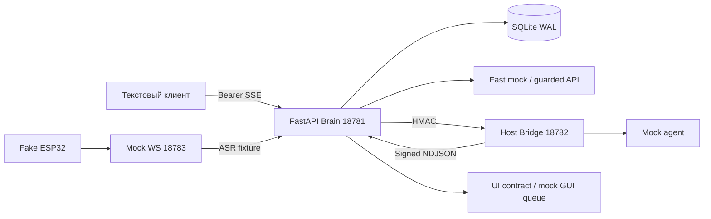

# Архитектура

Production voice overlay сохраняет upstream WS/Connection/VAD/ASR/TTS/Opus. Поддерживаемый
LLMProviderBase.response(session_id,dialogue) вызывает Brain из connection executor. Этот путь
пока не запущен из-за зависимостей. Проверенный сетевой стенд — отдельный fixture-only mock.

AsyncIterator Event: text_delta, sentence_ready, tool_status, widget_command, final, error, cancelled.
Каждый event имеет correlation_id/device_id/conversation_id/turn_id. SSE pull-based без неограниченной
очереди. Brain: максимум 4 хода, Bridge: 2 задачи, deadline 20 s, короткий acquire timeout,
выход <=32k символов. Отмена закрывает iterator; disconnect сохраняет cancelled. Status не содержит диалог.

SQLite WAL, foreign keys, транзакции, schema_migrations v1: conversations/messages/sessions/summaries/
facts/turns. I/O через asyncio.to_thread; короткая финальная транзакция переживает отмену task.
turn_id + hash payload обеспечивают идемпотентность: replay даёт final без повтора TTS/сохранения,
изменённый payload — 409. При restart running становится cancelled. Summary — детерминированная
выдержка, не LLM-summary. Факты требуют явного consent=True. Есть scoped purge/retention/forget_facts.

Fast Chat: mock по умолчанию, guarded OpenAI-compatible SSE при ключе/model/allow_paid.
Нет ключа — mock; запрет/ошибка до первого delta — mock fallback с trace; после delta — error без повтора.
«Спроси ChatGPT» выбирает fast API, Gemini/Cursor — соответствующий Bridge provider, сейчас закрытый
политикой. Контекст общий: исходный вопрос, предыдущие сообщения, summary, разрешённые факты.
Несколько отдельных cloud profiles и реальное сравнение двух моделей ещё не проверены.
Второе мнение автоматически после каждого ответа не вызывается.

Codex JSON-lines wire отделён от MCP JSON-RPC. Initialize, thread/start/resume, turn/start/completed/
interrupt и decline approvals реализованы с fixture transport. Cursor учитывает timestamp_ms/model_call_id
и duplicate flush. Gemini пропускает только assistant. Ни reasoning, ни tool stdout не идут в речь.
Реальные CLI admission отсутствует; HTTP не может включить subprocess. LiteLLM не установлен и не CLI adapter.

Launcher управляет только GoBot, проверяет порты, имеет restart budget и stop. Docker отсутствует;
host.docker.internal не проверен и не используется. Compose — отдельный неподтверждённый mock-container
профиль без соединения с host Bridge и без CLI auth mounts.
