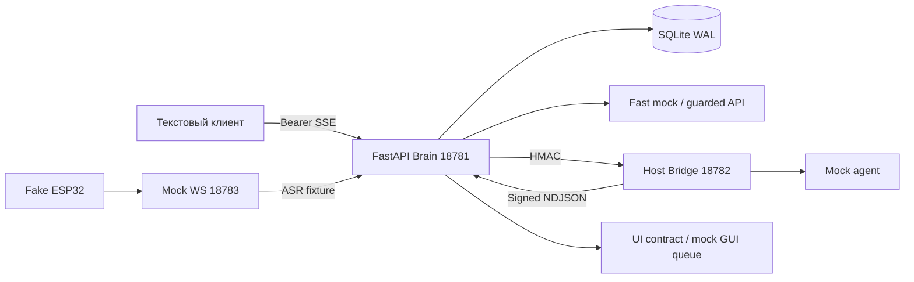

# Архитектура

Обновление 10 ноября: Browser → private HTTPS → общий Brain/Quality Router/SQLite →
loopback Bridge → fresh Antigravity/Codex. AUTO Flash Low, reasoning Flash Medium,
ручные Argon/Codex, Gemini CLI/API выключены. OpenAI STT/TTS основные.
См. CONTEXT_POLICY.md, MEMORY_ARCHITECTURE.md, SPEECH_FORMATTING.md.
Ниже сохраняется историческая схема исходного fixture-контура.

Дополнение браузерного продукта: [BROWSER_VOICE.md](BROWSER_VOICE.md). Приватный HTTPS transport
на Tailscale :18786 передаёт запросы в этот же Brain/SQLite. Browser audio и будущий XiaoZhi audio
имеют разные transport adapters. Общий SentenceBuffer и bounded text/audio pipeline работают в Brain.
Модельные режимы auto/codex/gemini/mock не меняют владельца истории. OpenAI — основной TTS,
Denis — только явный offline резерв. Диаграмма ниже показывает исходный fixture-контур.

Production voice overlay сохраняет upstream WS/Connection/VAD/ASR/TTS/Opus. Поддерживаемый
LLMProviderBase.response(session_id,dialogue) вызывает Brain из connection executor. Этот путь
пока не запущен из-за зависимостей. Проверенный сетевой стенд — отдельный fixture-only mock.

AsyncIterator Event: text_delta, sentence_ready, tool_status, widget_command, final, error, cancelled.
Каждый event имеет correlation_id/device_id/conversation_id/turn_id. SSE pull-based без неограниченной
очереди. Brain: максимум 4 хода, Bridge: 2 задачи, deadline 20 s, короткий acquire timeout,
выход <=32k символов. Отмена закрывает iterator; disconnect сохраняет cancelled. Status не содержит диалог.

SQLite WAL, foreign keys, транзакции, schema_migrations v1: conversations/messages/sessions/summaries/
facts/turns. I/O через asyncio.to_thread; короткая финальная транзакция переживает отмену task.
turn_id + hash payload обеспечивают идемпотентность: replay даёт final без повтора TTS/сохранения,
изменённый payload — 409. При restart running становится cancelled. Summary — детерминированная
выдержка, не LLM-summary. Факты требуют явного consent=True. Есть scoped purge/retention/forget_facts.

Fast Chat: mock по умолчанию, guarded OpenAI-compatible SSE при ключе/model/allow_paid.
Нет ключа — mock; запрет/ошибка до первого delta — mock fallback с trace; после delta — error без повтора.
«Спроси ChatGPT» выбирает fast API, Gemini/Cursor — соответствующий Bridge provider, сейчас закрытый
политикой. Контекст общий: исходный вопрос, предыдущие сообщения, summary, разрешённые факты.
Несколько отдельных cloud profiles и реальное сравнение двух моделей ещё не проверены.
Второе мнение автоматически после каждого ответа не вызывается.

Codex JSON-lines wire отделён от MCP JSON-RPC. Initialize, thread/start/resume, turn/start/completed/
interrupt и decline approvals реализованы с fixture transport. Cursor учитывает timestamp_ms/model_call_id
и duplicate flush. Gemini пропускает только assistant. Ни reasoning, ни tool stdout не идут в речь.
Реальные CLI admission отсутствует; HTTP не может включить subprocess. LiteLLM не установлен и не CLI adapter.

Launcher управляет только GoBot, проверяет порты, имеет restart budget и stop. Docker отсутствует;
host.docker.internal не проверен и не используется. Compose — отдельный неподтверждённый mock-container
профиль без соединения с host Bridge и без CLI auth mounts.
## Visual response extension

Browser и будущий ESP32 используют общий `PresentationDecision → VisualService →
gobot.ui v2` слой Brain. Источник фото Openverse отделён от model providers и
не требует CLI. Media cache имеет собственный SQLite index и три JPEG варианта;
conversation archive хранит только типизированный presentation trace, не бинарные данные.
Browser Renderer получает отдельное SSE событие; короткая speech representation
идёт через существующий Speech Formatter/TTS. Таймеры остаются операционным SQLite
состоянием, а не производной текстовой истории. Future ESP32 Renderer формирует
компактный JSON/MCP request только при capability/permission; физический LVGL код
и LAN origin ещё не готовы. [Подробности](VISUAL_PIPELINE.md).
