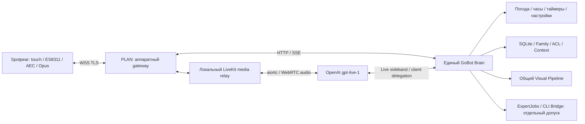
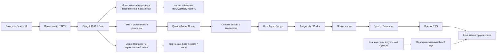

# GoBot Home — единый паспорт фактического состояния

## B -> actual A candidate (2026-11-13, source/free acceptance)

**Runtime applied:**2887ac9fb98ccee0f4bd5f36d613f1afe67043af, private HTTPS
https://plan.tailffc57c.ts.net:18786/device-next. Gateway realtime_b; original B
ledger7 starts remaining,0 active/0 pending hangups; extended spent package
disabled without refund. A handoff implemented=true, financially_authorized=false.
Prepared A grant remains disabled pending Owner's consolidated budget answer.
No provider opened during preparation/deployment. Phone/C policies/ledger and
installed firmware0.4.3 unchanged. Idle deployment backup:
run/night-train/backups/20261113T150238930850Z. Supervisor/Bridge/media services
were preserved; owned Brain/web restarted, gateway recycled for old B config.
422 targeted checks passed (391 handoff/native/modes +31 gateway/Owner/recovery),
plus5 local LiveKit/aiortc peer checks. No physical A handover/CLI/TTS PASS claimed.

For a future enabled A allowance, immediate financial rollback is to disable
run/hardware-a/policy.json (do not delete/restore its usage.sqlite), stop any
active A conversation by device hold/turn cancellation, and keep the original
B mount/config. The current A proposal is already disabled. Provider unknown
hangups remain explicit blockers; no automatic cross-engine paid fallback.

Owner explicitly resumed implementation of actual expert MODE handover. The
board B manager now uses NativeHandoff + existing ConversationModes, not a new
Brain/ExpertJobs loop. A direct "экспертный режим" or current confirmed server
mode offer cancels native speech, closes B and waits for confirmed provider
hangup. Unconfirmed hangup/503 denies A. Old physical playback must drain before
A output. Gateway reuses the original question with existing /chat/voice/stream,
without second STT or another question/tap. A streams sentence/audio chunks;
the first audio was asserted BEFORE final text in a free mock-stream test.
Short permitted B history goes to existing guest RAM flow, never private archive.
Question snapshot, fixed operation ID, identity ownership and first-question
checks prevent task replacement/duplicate mode creation; Stop targets actual A
turn ID. End/idle clears the transferred RAM seed. Phone/C defaults preserved.

**Not yet a fully accepted physical conversation.** Source is prepared; current
predeployment runtime was270f8f7. Installed firmware0.4.3 unchanged. The
first transferred question is automatic; further A questions retain existing
device touch/capture behavior. Continuous automatic A followups without a new
touch are NOT implemented/claimed. No false promise that Sol guarantees low TTFA.
gpt-live-transcribe does not support server_vad: official transcription docs were
checked; no unsupported parameters added to simulate automatic phrase endings.

Separate hardware A admission uses existing ExpertBudget/ExpertPolicy, disabled
proposal in run/hardware-a/policy.json:2 A attempts,SOL_HIGH,90s CLI each,
context<=3000 estimated tokens,result<=6000 characters,TTS<=3000 chars/turn.
Gateway finite batch counts failed speech attempts too across dates/restarts;
historical daily/CLI/B/C ledgers never reset. This proposed grant is NOT approved
or enabled. Previous one Sol task is spent; phone identity/grant is not borrowed.
No automatic paid provider test, TTS synthesis or CLI task was run.

Free acceptance:391 targeted tests passed;5 real loopback LiveKit/aiortc peer
scenarios passed separately (including mode handoff, Stop/network/drain failures).
Actual household acoustic/CLI/TTS acceptance awaits an explicit remaining A grant.

## Owner correction: expert MODE A is not background ExpertJobs

Owner's latest manual board B trial actually reached Codex CLI SOL_HIGH
(gpt-6.1-sol/high), completed in about43.74s, recorded CLI usage8442 tokens.
It was NOT an A mode handover. ExpertJobs buffered the entire result; a subsequent
short acknowledgment changed the turn revision, making voice_deferred=true.
The session then closed by followup_timeout. This confirms CLI execution, but
FAILS spoken-result delivery and FAILS the intended expert-mode acceptance.
The expert had no web/source tool and returned an honest source abstention;
fresh-news verification is NOT confirmed. Household text/result/IDs stay private.

Owner clarified the desired route is actual transition into existing mode A:
close B safely -> retain allowed question/context -> existing streaming CLI /
SpeechFormatter / sentence-TTS -> subsequent conversation in A. This supersedes
treating the background ExpertJobs scenario as the requested mode switch.
Existing ConversationModes/live coordinator and legacy voice stream must be
reused. Hardware B->A transition is NOT implemented/accepted yet. Do not label
queued ExpertJobs as "expert mode enabled" or guarantee lower latency from model
choice. Ordinary task delegation remains a separate operation.

The separate180s B start and one Sol task are consumed, not renewed/refunded.
Reported B response estimate$0.04088608 excludes transcription and is not the
$1 reservation or a final invoice. No active B session/pending B hangup remains.
Original seven minute B starts and C accounting remain untouched. No new paid
trial, firmware change, runtime deployment or implicit A STT/TTS allowance here.

## 2026-11-13: separate long B trial / one-phrase wake preparation

**Applied checkpoint:** Brain runtime270f8f782db9b988b9cabead816bc4e0524e5baf,
gateway remains realtime_b, extended manual grant enabled,1 start remaining,
0 starts/0 reserved estimate/0 pending hangups at activation. Separate Sol High
grant1 remaining; offline CLI isolation verified (mock HTTP1,real requests0).
Original B7 remaining. C/phone policies and all historical ledgers unchanged.
No firmware flash. Owner was invited to manually test; real CLI result NOT_RUN.
Free final checks:349 passed,4 optional peers skipped in regression run;
the4 loopback LiveKit/aiortc peer tests subsequently passed with actual local
test configuration. Earlier invocation with an invalid config path failed before
media setup; it did not call OpenAI. Portable C++ buffer test also passed.

Diagnostic firmware0.4.4-dev-one-phrase-local BUILT in pinned IDF image, NOT
INSTALLED; app2711984 bytes,34% free, SHA256
87967cd0230511419cc228d4e270d73a483b8093c57abe176a6cd19b163cbf0e.
Build retains the original diagnostic model1f3b425b...3010 and wake_route=0.
New variant pilot dd93bc89...bedfd (29736 bytes) was trained once locally,
but FAILED validation (11/15 hits,11 false events); held-out test15/15 hits,
17 false events/198 negatives over617.61 synthetic seconds. Human trials0.
No claim of reliable household/stress coverage; ambient qualification was not
run after first gate failure. Model not installed or routed to paid services.
[Pilot evidence](../firmware/spotpear/microwake/variant-pilot-report.json).
Positive PCM uniqueness also limits accent claims:15/15 distinct clips for each
Piper voice,9/15 eSpeak and8/15 each RHVoice voice. Some written stress forms
synthesize identically; five spellings are not five verified acoustic variants.
Runtime PSRAM/performance of the new buffer remains untested on hardware.

Deployment backup:run/night-train/backups/20261113T132534808523Z. Trial rollback:
idle `scripts/board_b_trial.py rollback`, then guarded idle Brain restart to load
the restored original B mount. Never restore usage databases. Rollback refuses
unconfirmed trial provider closes; resolve those through existing admin recovery.
The original firmware0.4.3 and touch remain available throughout.

Owner explicitly approved ONE manual board B session <=180s, <=12 responses,
<=2048 output tokens/response, $1 estimated API allowance (not guaranteed invoice
cap), plus ONE confirmed public-data Sol 6.1 High task: gpt-6.1-sol/high,
<=90s, context<=3000 estimated tokens, result<=6000 characters. No automatic
paid tests/retries, no C/Luna/Image allowance expansion. The original B ledger
and its seven remaining minute starts are preserved. New source uses a separate
voice-ab-b-extended ledger and separate experts ledger, expiry24h, exact enrolled
board, guest/RAM scope. Expense consent does not grant personal memory/adult
identity. Unknown provider hangups cannot be bypassed by rollback to old B.

Source: board_trial.py, scripts/board_b_trial.py; stage/idle deployment/activate
are distinct operations. A source-required question can offer Sol analysis after
a real server source abstention; it cannot start until actual task confirmation.
A stronger CLI with web tools disabled is NOT independent verification of recent
news: the offer explicitly preserves this limitation. Expert state uses existing
device scene protocol. This is mock-tested, not a completed real CLI trial.

Owner confirmed the second topic in the recent device B conversation was intended;
the journal's topic change is not evidence of an ASR error. Measured B response
estimate $0.02332976 excludes separate gpt-transcribe; equivalent60s Live voice
at the verified $0.05/min is $0.05 plus backend. Rough sample comparison is about
2x cheaper for B, not a universal price/quality claim or final invoice.

Wake: the installed detector is diagnostic, not wake-to-Brain. Existing corpus
already had both Russian stress variants; adding strings does not qualify KWS.
New isolated six-voice offline corpus adds five pronunciation forms. One bounded
CPU training run is in progress; no paid training/model calls. New one-phrase
buffer keeps1s local prefix + bounded12s total in PSRAM during connection setup,
then drains once to the existing audio engine. Overflow fails closed; no silent
truncation, idle uplink, recordings or second STT. Portable C++ prefix/order/
overflow/zeroization checks passed on build host. A diagnostic0.4.4 candidate is
being built from a COPY of installed0.4.3; it does not enable cloud wake or flash.
Acoustic recognition/false wakes/same-utterance delivery remain unconfirmed.

Validation checkpoint:348 passed,4 skipped across board/native/expert/quality/
half-duplex suites before the final scene helper; remaining local-peer and final
checks follow. Runtime at this checkpoint remains9819af6; installed firmware
remains0.4.3-dev-media-ready. No paid developer call was made.

## First manual hardware B conversation: partial acceptance, limits/source gap

Owner провёл один настоящий разговор на колонке и подтвердил слышимые ответы.
Encrypted diagnostic journal содержит ready: gpt-realtime-2.1-mini/marin, два
input transcripts, один gobot_tool request/result, три provider response attempts.
Live не использовался. Backend отказал в ответе на актуальный факт: проверенный
источник для такого запроса не подключён в этом аппаратном пакете. CLI/Luna/Image
этому пакету не разрешены; попытки эксперта не было. Это не «вообще нет интернета».

Две provider responses завершились incomplete/max_output_tokens (cap512), затем
session_time_limit (60s). Один turn имеет client_playback_reported/truncated,
второй playback unconfirmed_or_interrupted/truncated. Это не полный диалоговый/
акустический PASS. Вопрос о возможной ошибке распознавания второго запроса
Owner подтвердил как намеренный: отдельный transcript сам по себе не доказывает речь.
Исходное аудио не сохранялось. Тексты домашних вопросов/ответов не публикуются.

B:7 sessions remaining,1 reserved estimate$0.125; reported response estimate
$0.02332976 excluding separate transcription (не invoice/final total). Pending
B hangups=0, active=0; quota/ledger не сбрасывались, developer paid calls=0.
Лимиты512/60s/8 sessions не повышались. Следующий шаг — развести source readiness,
ASR и test truncation; не выдавать transport/несколько слышимых реплик за готовность
полного домашнего помощника. C quarantine/unknown usage по-прежнему сохранены.

## Owner confirmed web B; column switched to manual hardware B acceptance

Owner подтвердил работу B в вебе и попросил проверить его на колонке. Изолированный
BoardRealtime адаптер подключён явным host mount flag, gateway переключён с live_c
на realtime_b. Runtime **9819af68a04a191b6a51c4f9f1beb681fd427d64**. На устройстве
осталась **0.4.3-dev-media-ready**, без flash/OTA/NVS/wake_to_brain изменений.

Точный model gpt-realtime-2.1-mini, marin. Прежний отдельный аппаратный пакет:
8 ручных запусков по60s, максимум8 ответов×512 output tokens/сессию,
gpt-transcribe, $1 estimate, no CLI/Luna/Image/retries. Authorization/caps не
менялись, включён только enabled. На момент активации:8 remaining,0 reserved,
0 provider sessions,0 pending B hangups. Phone grant не используется.
C ledger/orphan final=false/reserve60s сохранены, C quarantine не отключён.

Listening→Thinking→Speaking→Listening: streaming Opus/WSS→existing local LiveKit/
WebRTC, микрофон закрыт во время ответа; новый вопрос после generation+provider
drain+physical playback activity ACK+queue drain+echo guard. Отсутствующий playback
ACK закрывает путь, не выдаётся за успех. Первый вопрос/конец фразы через VAD,
без второго касания; silence10s/utterance30s/session60s bounds. Отдельный Stop.
Прогноз погоды разрешён как read-only инструмент, настройка устройства по-прежнему
запрещена этому гостевому пакету; regression это проверяет.

Free evidence:22 tests PASS с двумя настоящими local aiortc peers/loopback LiveKit
(conversation,Stop,network loss,missing playback ACK), без OpenAI; затем96 targeted
regressions PASS. Board home profile/weather configured проверены без координат.
Готовность API enabled=true,8 remaining, active=0; WSS gateway ready realtime_b.
Физический разговор B/акустика **ещё не подтверждены**; Owner приглашён к двум
коротким вопросам с одним касанием. Автоматические платные пробы не выполнялись.

Config/financial WAL backups: `run/voice-ab-b/backups/20261113T120756639119Z`;
Brain/web source backup: `run/night-train/backups/20261113T120757795059Z`.
Откат только после idle: `.venv/Scripts/python.exe scripts/board_b_enable.py rollback`.
Это возвращает прежнюю C gateway config/выключает B, **не восстанавливает ledger**
и не объявляет C quarantine resolved. Прежний C может оставаться недоступным из-за
неподтверждённого расхода. Веб B/A/C сохранены. Master unchanged, PR draft.

## Owner: B требовал повторных касаний — исправление автоматического диалога

Причина найдена в /device-next: NativeVoice.followup был подменён текстом
«Нажмите Говорить», а первый вопрос запускался pttStart и ждал ручного pttEnd.
Подмена удалена; новый web B вызывает server-acknowledged listen/server_vad уже
для первого вопроса. Кнопка включает разговор один раз, окончание фразы делает
VAD, Brain создаёт ответ. После server+client playback drain ACK и echo guard
микрофон включается автоматически, в той же сессии. Нет второй STT, ручного commit
или новой provider session между репликами. Native legacy PTT API/defaults сохранены.

Проверены бесплатно: первый вопрос +2 продолжения; no response.create до речи;
повторный пакет не создаёт ответ; generation.done не включает микрофон до drain;
случайное касание не обрывает ответ; double tap не очищает первые слова; Stop
во время listen ACK не возвращает микрофон; старый turn_complete игнорируется.
10 секунд ожидания без речи → нормальное закрытие, не ошибка. Непрерывный шум/
незаконченная реплика ограничены30 сек без отправки обрезанной команды.
96 targeted tests PASS, production JS Node fixture3 ответа/1session/0provider calls;
Chromium390×844 regression PASS. Это не физическая Safari/acoustic приёмка.
Платные B/C/STT/TTS пробы не запускались, quotas/ledger/firmware не менялись.
Установлено в runtime **3de2eaa53873437203339242c5f66fdecdf4944c**, preview assets
cache version b-dialogue-1. WAL/config/source backup20261113T094229295444Z.
Фактический HTTPS /api/realtime/status сообщил automatic_dialogue_version=1;
новая страница/JS проверены, private Chromium smoke без TLS bypass PASS.
Financial tables/policies совпали с backup; B/C active=0. Платная phone voice
приёмка ожидает Owner, автоматический provider test не запускался.

## Owner-reported manual speech failure — hotfix

После публикации Owner сообщил «не работает». Runtime logs подтвердили отказ
в `/api/v1/next/transcribe`: `web_stt` ошибочно считался developer origin, затем
web gateway пытался декодировать non-JSON500 и скрывал причину. Это происходило
до обращения к STT API. Аналогичная ошибка была в origin `web_tts`.
Исправлены строго эти Owner manual origins для kind=realtime с прежними binding,
quota/spend checks; никакие grants/caps не повышены. Отказы теперь JSON403/502.
Добавлены HTTP tests с fake provider и настоящим budget ledger (success + отказ
по лимиту);46 targeted checks passed, включая безопасное принятие существующих workers
прежним process manager без их перезапуска.
Голосовой provider/human acceptance по-прежнему не заявлены. Готовность прежнего
отчёта относится к text/fixture/browser paths, не к проверенному платному голосу.
Hotfix установлен: **be5474fcc33c4b171a5459984a555916fc1a225d**.
WAL backup `run/night-train/backups/20261113T071057720168Z`; source rollback
предыдущего runtime4beb530 сохранён. Прежний process manager получил explicit
adoption существующих проверенных workers: manager process перезапущен без
остановки workers, затем только Brain/web обновлены. Bridge/Voice/Images/LiveKit/
board gateway сохранены. HTTPS/clock/real weather smoke PASS, financial rows и
policies неизменны. Новая реальная speech/API trial не выполнялась.

## Night Train v1 — действующий web preview

**[Открыть /device-next](https://plan.tailffc57c.ts.net:18786/device-next)** ·
[Утренний отчёт, evidence и откат](night-train-v1/MORNING_REPORT_TEMPLATE.md).
Branch `codex/hybrid-web-vnext` поверх71dcb18; recovery032e4ea/B сохранены.
Первый Night Train runtime4beb530; актуальный runtime hotfix **be5474f**, web source **168faae**.
W0–W8 доведены до integrated web candidate: contracts/реестр поверх Quick Intents,
deterministic preflight/operation IDs, scoped context, SQLite timers, Open-Meteo,
voice library100/100 и RAM narrator/Web Audio. Owner-only flag не даёт новых quotas.
Платные STT/TTS/B только вручную с прежним admission, checkbox OFF.

**Финальный полный pytest:2379 passed/18 skipped/1 xfailed/118 subtests,260.48s.**
Предшествующие73 и559 targeted PASS.150 authored semantic cases,34 API/security/media regressions;
независимый Gemini/holdout NOT_RUN. Chromium390×844 S3 fixture + production HTTPS,
без TLS bypass/overflow/JS errors; paid boundary calls=[]. Private smoke: clock,
реальный прогноз завтра→суббота PASS, old/new pages200, Host/authority attacks denied.
Null в16-м дне Open-Meteo больше не ломает полный прогноз ближайшего дня.

WAL/config/source/web backups; два guarded idle-only Brain+web restart (deployment
и real-source fix); остальные services/LiveKit/плата не перезапускались. Financial
rows/policies совпали с backup. Flag rollback проверен: preview403, old device200.
C:221 confirmed seconds/$0.1841667 estimate; orphan final=false/reserve60s/$0.05
сохранён, это не предел неизвестного счёта. Recovery использован, не продлён.
Hardware B отдельный8×60s/$1 пакет OFF, не deployed. Master неизменён, PR draft.

Candidate0.4.4-night-contract собран отдельно:2711488bytes,34% partition free,
SHA fe624dc9f020c4be738d05bb458cf800dcc16990a3ee4d1e8a5a2c3282b0d141.
[Hardware contract](../firmware/spotpear/vnext/CONTRACT.md), НЕ установлен.
Installed0.4.3/NVS/KWS/audio сохранены. C text handover BLOCKED; manual paid voice,
iPhone/Spotpear acoustic acceptance NOT_RUN. WEB_READY не означает PASS всех модулей.
Быстрый откат: `.venv/Scripts/python.exe scripts/night_preview.py disable`.
Ниже исторические этапы; текущий раздел и утренний отчёт приоритетны.

Обновлён 13 ноября 2026 года (UTC; 12 ноября на PLAN). Аппаратная ветка PLAN — `codex/spotpear-bringup-plan` от `bffaa24`.
Этот файл описывает **реализованный код, проверки и ограничения**. Требования
остаются в [единой целевой спецификации](GOBOT_HOME_TARGET_SYSTEM.md).
Описание задуманной функции не означает её готовности.

## Актуальный обзор на момент остановки разработки

### Последующее ограниченное поручение: Controlled Voice A/B

#### Применение C recovery и один ручной тест Owner

Актуальное состояние заменяет подготовительный статус ниже. В runtime Brain
развёрнут **`e623dde0821af18dac1067782470efd5d01bdbde`**: восстановление из
`032e4ea` и исправление отображения неизвестного резерва после UTC rollover.
Сравнение с прежним runtime `59e1280` подтвердило изоляцию изменений в
`live.py`, `live_api.py`, `live_budget.py` и новом `live_recovery.py`.
Модель GPT-Live 1, marin, media path и firmware **0.4.3** сохранены.

Перед применением подтверждены idle Brain/B/C/gateway. Остановлен только
аппаратный gateway; loopback-проверки подтвердили отсутствие старой LiveKit
комнаты и активной Brain-сессии. WAL-aware backups Live/Owner SQLite сохранены;
затем записаны `orphaned_unconfirmed` и Owner approval на **один** ручной запуск,
до **60 секунд**, окно **45 минут** (до 02:20:32 UTC / 23:20:32 São Paulo).
Перезапущен Brain worker под существующим supervisor и тот же аппаратный gateway.
Phone gateway, Bridge, Voice, Images и LiveKit не перезапускались.

Бесплатная проверка readiness после применения: C enabled, blocking_previous=0,
approval uses=0, старые calls/Owner attempts полностью совпадают с backup.
Новых provider calls от разработчика не было.

**Затем Owner выполнил разрешённую ручную пробу.** По его сообщению, прозвучали
погода на сегодня и завтра, удержание завершило разговор. Ledger подтверждает
ровно одну новую сессию и terminal usage **51 секунда**, **$0.0425** по действующему
оценочному тарифу. В серверном отчёте две реплики, final_usage_confirmed=true,
причина закрытия `session_time_limit`; отдельное срабатывание hold Stop этим
отчётом не доказано. Перебивание также не принято: Owner не смог отличить его от
последовательного вопроса. Индикация готовности к следующей реплике недостаточно
понятна; фиксируем дефект, без изменения прошивки/голосового тракта в этой итерации.

Все исходные записи четырёх предыдущих calls и Owner attempts полностью сохранены
по значениям строк. Теперь подтверждены **221 секунда / $0.184167**, отдельно
остались **15 observed seconds, final=false, резерв 60 секунд / $0.05** старой
сессии. Резерв не является верхней границей неизвестного провайдерского счёта.
Пакет 50 содержит 5 попыток, но recovery allowance **1/1 использован**: новых C
запусков сейчас нет, enabled=false ожидаем. Оставшиеся 45 попыток общего пакета
не являются автоматическим расширением согласованного допуска восстановления.

Приватные backup/rollback и до/после evidence:
`data/hardware/gobot-v1/recovery/deployment-20261113T013529Z/`, плюс WAL backups
в соседнем каталоге команды recovery. Возврат: в idle остановить gateway,
восстановить три исходных Live-модуля из deployment backup (`59e1280`),
перезапустить только Brain и gateway. **SQLite/Owner policy не откатывать**:
append-only recovery и новая подтверждённая трата должны остаться. Старый код
снова блокирует неподтверждённую сессию; это безопасный, но ограниченный rollback.

#### Независимая бесплатная подготовка аппаратного B

В исходниках подготовлены `board_realtime.py`, `board_realtime_api.py`,
`spotpear_realtime.py`, `spotpear_half_duplex.py` и опциональная ветка
`realtime_b` существующего gateway. Используются прежние NativeSession/Brain,
identity, инструменты, visuals и общий journal. Второго Brain/Family DB нет.
Конструктор NativeSession manager допускает общий journal без второго writer;
voice lease запрещает одновременные B/C одной колонки. Неподтверждённые расходы
C не участвуют в admission B; собственные B hangups при этом блокируют B.

B фиксирован: **gpt-realtime-2.1-mini / marin**, отдельный ledger и binding платы,
**8×60 с, максимум 8×512 output tokens/сессию**, gpt-transcribe, общий оценочный
допуск $1. Нет CLI/Luna/ImageGen, заимствования phone binding, смены модели или
автоматических платных retries. Резерв оценки выводится из persistent попыток;
transcription оплачивается отдельно и не объявляется включённой в подтверждённую
response cost. Абсолютный предел invoice не гарантируется.

Полудуплекс: Listening → Thinking → Speaking → Listening. Микрофон в Thinking/
Speaking потребляется, но в модель идёт тишина; накопленное эхо не проигрывается
следующему вопросу. Возврат к Listening требует generation end, provider output
drain, пустых relay-очередей, свежего device playback ACK после последнего пакета
и echo guard. Затем подтверждается effective VAD config (create_response=false,
interrupt_response=false). Codec flush не закрывает encoder между ответами.
Stop использует **существующее удержание** на 0.4.3; короткий случайный tap во
время ответа по-прежнему защищён. Новый жест без прошивки не обещается.

Бесплатные проверки: 25 passed с опциональным loopback LiveKit, включая четыре
прогона двух реальных **локальных** aiortc peers: диалог, отмена, потеря control,
нет device ACK. Это синтетический звук/эмуляция ACK, не физическая приёмка B.
Исправлена обнаруженная в таком прогоне ошибка: повторяющиеся idle heartbeats
бесконечно продлевали echo guard. Проверены также binding/guest ACL, budget,
дедупликация, запрет раннего followup и отсутствие второго journal writer.
Общая регрессия после этих изменений: **2154 passed, 18 skipped, 1 xfailed,
118 subtests passed** (208.42 секунды). Опциональные local LiveKit проверки выше
выполнены отдельно; skip не выдан за аппаратный успех.

**B не развёрнут и не подключён к production FastAPI** (его status route — 404).
Нужны отдельная приёмка source diff, opt-in подключение router к текущему Brain,
контролируемое включение board-only policy и ручное переключение idle gateway.
Полная реальная B-сессия и физический playback ACK ещё не проверены. B allowance
в рабочей среде не расходован; платные автоматические проверки не запускались.

#### Подготовительный checkpoint 032e4ea: административное восстановление C

Ниже сохранено состояние подготовки, **до применения**, описанного выше.
Это уточнение заменяет требование бессрочно ждать provider ACK из исторической
контрольной точки ниже. Отсутствие `session.closed` остаётся финансовой
неопределённостью, но может быть отдельно согласовано владельцем.

В исходниках подготовлены `live_recovery.py` и локальная команда
`scripts/voice_ab_recovery.py`: append-only события `orphaned_unconfirmed`,
отдельный Owner risk ACK, ограниченное число новых запусков, срок до 24 часов.
Новые таблицы находятся в существующем Live usage SQLite; исходные calls,
`final=false`, observed usage и Owner reservations не переписываются.
Допуск расходуется атомарно вместе с новой Live reservation, действует только
для прежнего device/client/profile epoch и не расширяет исходный бюджет.
Смена привязки Owner делает согласование недействительным.

Операторская процедура (подготовлена, **не выполнена на рабочем C**):

1. В согласованное окно остановить аппаратный gateway. Скрипт сам не останавливает
   сервисы; при доступном listener отказывается продолжать. Убедиться, что разговор
   не активен: два authenticated loopback Brain status checks.
2. Проверить отсутствие только старой комнаты `gobot-<application session ID>`
   через loopback LiveKit RoomService. По умолчанию команда только проверяет.
   `--apply` может удалить именно эту старую комнату и повторно проверить отсутствие;
   никакого OpenAI attach/retry/new session при этом нет.
3. Перед изменением SQLite сохранить WAL-aware backups Live и Owner usage.
   Записать `orphaned_unconfirmed`, не называя это provider-confirmed close.
4. Только после явного согласия Owner на неизвестный прежний расход применить
   `--accept-unknown-provider-cost --max-new-sessions 1 --hours 24` вместе с
   `--apply --session <приватный application ID>`. Без этого ключа новых запусков
   не разрешается. Команда предназначена локальному администратору, не голосу/LLM.
5. После отдельной приёмки развернуть проверенный код, восстановить gateway и
   начинать новую беседу только вручную. Создаются новые application/provider
   session и conversation scope; старые provider history/actions не переносятся.
   Подтверждённое впоследствии terminal usage может штатно закрыть старую запись,
   не удаляя историю административных решений.

Остаточный финансовый риск: окончательная длительность старой provider session
неизвестна; резерв 60 секунд и последнее observation 15 секунд не ограничивают
провайдерский счёт. Локальное освобождение ресурсов прекращает наш медиатракт,
но не доказывает прекращение тарификации у OpenAI. Новый ограниченный допуск
не погашает эту неопределённость. Owner risk ACK ещё **не применён**.

Приватный offline support packet сохранён в
`data/hardware/gobot-v1/support/20261113T011308575725Z/`; исходные ID, UTC journal
bounds, usage и manifest находятся только на PLAN. Project ID, request ID и
точное время прежней 503-попытки не были сохранены и отмечены отсутствующими;
новых запросов ради их восстановления нет. Обращение не отправлено.

Новая реализация проверена: **53 passed** (`test_live_recovery`,
`test_voice_ab_recovery`, `test_live`, `test_live_native_tools`,
`test_live_control_diagnostics`), только mocks/локальные временные SQLite,
включая 503, отсутствие ACK, scope/expiry/Owner checks, конкурентный admission,
WAL backup, exact-room cleanup и новый разговор без старых operations.
`git diff --check` пройден, help административной команды проверен. **Не развёрнуто**:
эталонный C и установленная 0.4.3 не изменены, B hardware adapter ещё не готов,
платных бесед и пятиминутных разрешений в этом проходе нет.

#### Контрольная точка C: неподтверждённое закрытие

Owner уточнил строгий порядок: восстановление управления C, затем аппаратный B,
бесплатная приёмка, ручное переключение. Одна ограниченная административная попытка
attach/close **существующего** provider ID получила HTTP 503 (InvalidStatus).
Она не создаёт новую voice session; новых paid conversations/повторов не было.
Ledger и cleanup_attempted не сброшены, final ACK не подделан.

В текущем C-пакете использовано 4 из 50, осталось **46**. Три закрытия подтверждены:
57+57+56 = **170 секунд**, оценка $0.141667 по действующему учёту. Четвёртая сессия:
последнее cumulative observation **15 секунд**, final=false, reserve 60 секунд.
Это не окончательная длительность и не доказанный денежный потолок. Дополнительный
B-пакет 8×60 с отдельно согласован, но не применён к аппаратному маршруту.

Историческая причина предупреждения известна только как sideband_disconnected:
предыдущий catch не сохранял класс ошибки/close code, поэтому утверждать, что это
точно сетевой разрыв или конкретный parser defect, нельзя. Локально добавлены
безопасные kind/числовые close/status diagnostics без raw exception text. Status
теперь умеет показывать live_previous_finalization_unconfirmed вместо ложного ready.
Проверено 27 существующих Live/native-tool fixtures + 1 redaction test, все без API.
Изменения **ещё не развёрнуты**, firmware 0.4.3 и эталонный runtime C сохранены.

**Процедура административного согласования Owner (не автоматический обход):**

1. Не открывать новые C-сессии, не переносить расход в B и не удалять pending row.
2. В том же API-проекте проверить доступные session/usage записи. Если кабинет не
   показывает individual session, получить подтверждение провайдера/support по
   сохранённому provider ID. Идентификаторы и временные метки — приватно в PLAN,
   не в публичном issue; агрегат суточного расхода не равен final usage этой сессии.
3. Нужны подтверждение закрытого состояния и окончательные usage seconds либо
   формальное объяснение невозможности получить их. HTTP 503/404, истечение
   местного таймера или отсутствие звука таким доказательством не являются.
4. Сохранить исходное подтверждение, время и provenance; WAL-aware backup ledger.
   Если затем получен настоящий session.closed — применить штатное observe(final).
   Внешнее административное подтверждение должно иметь отдельную запись provenance,
   оно не называется полученным WebSocket ACK. Пока такого пути согласования нет,
   исходный final=false сохраняется и C остаётся заблокированным.
5. После разрешения инцидента допускается одна явная operator cleanup-проверка того
   же ID; не цикл reconnect и не автоматический reset cleanup_attempted. Только
   затем проверить C readiness без новой платной беседы и переходить к сравнению.

Общая готовность к ручному A/B сейчас **BLOCKED**, B hardware adapter не установлен,
пятиминутные разговоры не разрешены текущими минутными grants. Успешный voice A/B
и вывод об экономии моделей не заявляются.

Владелец разрешил только подготовку и ручное сравнение C/B, не общее возобновление
разработки. Сообщил положительную субъективную оценку установленной 0.4.3 Live:
быстро, естественно, хорошее распознавание; объективная слышимая задержка/стоимость
сравнения ещё не измерены. Прошивка и C сохраняются как эталон.

Аудит: существующий B — `realtime.py`, `realtime_api.py`, `realtime_contract.py`,
`realtime_budget.py`; marin, общий Brain/Tools/Visual/Memory policy. Есть server VAD
с interrupt_response=false и команды PTT/followup/playback/close. Аппаратный
`gobot_device_gateway.py` пока не имеет B-маршрута; `spotpear_live.py` специфичен
для Live и не переименовывается под Realtime. Новый firmware не требуется по
проверенному media-ready/continuous WSS протоколу, но его применение к B должно
пройти бесплатный transport acceptance.

Минимальные изменения: отдельный B media adapter с тем же Opus/LiveKit/WebRTC;
Listening/Thinking/Speaking и микрофонный gate, drain ACK и измеренный echo guard;
изолированный серверный переключатель и отдельный board budget, без изменения C.
Проверить replay/Stop/Close/ACL/usage на mocks и локальных peers до ручного запуска.

Owner явно разрешил новый B-пакет: **8 ручных сессий по 60 секунд**, до 8 ответов
по 512 output tokens, gpt-realtime-2.1-mini + существующая gpt-transcribe input
transcription, оценочный серверный предел $1, без CLI/Luna/Image/авторетрая.
Это согласие пока не объявлено работающим аппаратным B: адаптер и admission ещё
не внедрены. Эталонные policy/config/release сохранены приватно, текущие лимиты C
не сброшены и не перенесены на B. Пятиминутный lifetime не разрешён этим пакетом.

Отдельный блокер C: после sideband disconnect остался provider session с
final_usage=false/cleanup_attempted=true; последующие create отклоняются до
подтверждённого завершения. Подделка final usage/очистка ledger не выполнялись.
Оценка моделей и таблица результатов пока **NOT_RUN**; восемь вопросов из Owner
ТЗ распределяются по минутным сессиям: приветствие/небо+закат; таймер/погода;
объяснение ребёнку/нет интернета/контекст; тихая речь/числа/TV/Stop — отдельные пробы.
Для каждой пары сохраняются exact model/voice, tool outcomes, provider usage и
клиентские playback ACK; слышимую задержку оценивает владелец отдельно, без подмены
server TTFA и без p95 на малой выборке. После сравнения — C default, draft PR, no merge.

**12 ноября 2026, America/Sao_Paulo. Разработка приостановлена по прямому указанию владельца.**
В этом checkpoint обновлена документация; новый код, прошивки и платные пробы не запускались.
Работающие сервисы и разрешения не отключались. Следующие этапы ниже — зафиксированные
незавершённые работы, а не разрешение продолжать их автоматически.

### Что есть сейчас

GoBot — один существующий Brain на PLAN, браузерный интерфейс и физическая круглая
колонка Spotpear. **Прототип работает частично, полная продуктовая приёмка не завершена.**
На колонке установлен **0.4.3-dev-media-ready**, подключение к Brain разрешено, gateway
работает в `live_c`. Рабочий запуск — касание. Русское локальное «ГоБот» установлено
как диагностический детектор, но **wake_to_brain=false**: разговор по слову ещё не принят.

| Компонент | Фактическая версия / состояние |
|---|---|
| Устройство | Spotpear EN-V5 With-B-1, ESP32-S3 rev 0.2, flash 16 МиБ, PSRAM 8 МиБ, круглый LCD 240×240, ES8311 |
| Установленный app | 0.4.3-dev-media-ready, 2 711 328 байт; flash verify, USB boot, Wi-Fi и enrollment подтверждены |
| SHA-256 app | `81eb1ed149b79d943057d17a9569f630f64b735409dd2fbdeb0a9186fc145386` |
| Brain runtime | `59e1280139b25582053478000f1a62b41b20ec2a`, подтверждён authenticated status; последующие commits документации runtime не меняют |
| PLAN | `codex/spotpear-bringup-plan`; code checkpoint 59e1280, документация до остановки cefeaf4; dirty tree перед обзором отсутствовал |
| GitHub | `codex/spotpear-hardware-bringup`, code equivalent 3d5eae4; [PR #1](https://github.com/anpavel84-afk/gobot-home/pull/1) открыт как draft, **не merged в master** |
| Целевое ТЗ | [Единая спецификация](GOBOT_HOME_TARGET_SYSTEM.md), [Owner issue #2](https://github.com/anpavel84-afk/gobot-home/issues/2) |

### Текущий стек и маршрут

| Слой | Стек |
|---|---|
| PLAN backend | Python 3.14.4 в текущем venv, FastAPI 0.136.3, Uvicorn 0.49.0, Pydantic 2.13.4, asyncio, SQLite |
| HTTP / WebSocket | httpx 0.28.1, websockets 16.0; локальные сервисы, приватный Tailscale HTTPS для браузера |
| Host media | aiortc 1.16.0, PyAV 19.0.2, LiveKit Python 1.2.1, PyJWT 2.10.1; LiveKit Server 1.13.11 на loopback |
| Firmware / build | Существующая XiaoZhi/ESP-IDF 6.0.1, ESP-SR 2.4.7, LVGL, ES8311, Opus; закреплённый Docker image, Linux build host vmi3510488 |
| Аудиофронтенд | I2S 24 кГц, MIC + цифровой DAC reference; ресемплер 16 кГц, FD AFE MR/AEC; mono speaker дублируется в TX slots |
| Local wake | microWakeWord / MixedNet / TensorFlow Lite Micro, локальная обработка 16 кГц; диагностический режим |
| UI | Существующий браузерный HTML/CSS/JS, общий scene contract, физический touch UI; исходники visual language и SVG сохранены |
| Данные | Прежние SQLite Family/Memory/Context; opt-in Speaker ECAPA/SpeechBrain локально; Windows DPAPI для биометрии и debug-журнала |

Выбран **путь 2B**: LiveKit находится на PLAN, **не внутри ESP32**. Нативный LiveKit
ESP32 SDK 0.3.12 конфликтовал с закреплёнными ESP-SR/codec/audio/video components.
Глобального понижения ESP-SR не было. Второй Brain, новая семейная база,
LiveKit Cloud и прямой Gemini API не добавлялись.

### A / B / C и границы возможностей

| Режим / модуль | Реализовано | Что нельзя считать принятым |
|---|---|---|
| A — экспертный сравнительный контур | Legacy STT → CLI (существующий Antigravity Flash Low/Medium) → русский Speech Formatter → TTS; резерв сохранён | Не подменён автоматически Sol Medium; текущая физическая C↔A приёмка не выполнена |
| B — Realtime | `gpt-realtime-2.1-mini`, WebRTC + sideband, существующий Brain; сравнительный режим сохранён | Замечания владельца к распознаванию не объявлены исправленными |
| C — Live | Реальные сессии `gpt-live-1`, `delegation.type=client`, один Brain; браузерный основной C↔A | API GPT-Live 1.1 не подтверждён; Live 1 не выдаётся за 1.1 |
| Luna | Разрешённый браузерный backend `gpt-6-luna` через Responses, 2048 input /512 output, без tools/retries, один запрос одновременно; ограниченные реальные текстовые пробы были | **В текущем аппаратном допуске Luna запрещена**; наличие browser backend не означает доступ платы |
| Expert CLI | ExpertJobs/Store/Bridge и точные Argon/Astra/Sol profiles; отдельный реальный typed B → Sol High → B подтверждался | Голосовой C/колонка → CLI → голос не принят; в текущем допуске платы CLI запрещён |
| Погода / таймеры | Общие Quick Intents и Tool Executor, Open-Meteo current/forecast до 16 дней, home-location/followup, реальные серверные таймеры и сцены | Weather.com не подключён; полный LCD countdown и повторная приёмка инструментов на 0.4.3 открыты |
| Визуалы | Stage 1 по вопросу → согласованное Stage 2 по ответу; cache/Wikimedia-first/разрешённый Image API; при отсутствии фото остаётся лицо | Не все browser visuals приняты на физическом LCD; схемы/графики/фото и decode ACK на плате требуют отдельных проверок; Image API плате не разрешён |
| Семья / память | Существующие profiles, PIN, epochs, ACL, персональные настройки, локальная Speaker Identity | Биометрия не калибрована и не является авторизацией; native C/плата сейчас guest/RAM-only, `remember=false`, без личного долговременного retrieval |
| Дизайн | Пакет 192 reference screens, 72 face variants, 109 icons, 34 layouts сохранён и используется в существующих renderers | Макеты не доказывают интеграции; Figma-импорт не принят; каталог 400 сценариев не означает 400 работающих функций |

### Что менялось в аппаратной итерации

1. Сохранены factory backups, enrollment, touch UI и работающие A/B/C. На 0.2.1
   владелец услышал ответ и подтвердил постановку таймера; на 0.2.2 — домашнюю погоду
   сегодня и «А завтра?». Громкость затем доведена до 100, прирост подтверждён владельцем.
2. microWakeWord обучен и установлен; тесты выявили недостаточное качество и ложные
   события. Автоматический запуск Brain по детектору оставлен выключенным.
3. На 0.4.0 включены MIC/REF и AEC; на 0.4.1 — непрерывный C; на 0.4.2 — ACK платы
   перед созданием provider session. Старое локальное завершение каждой C-реплики
   по паузе удалено. Касание/Stop/mute и UI сохранены.
4. Исправлены переполнение startup buffer, отправка служебной тишины и скрытая
   ошибка фонового feeder в тесте. Но очередь startup оставалась и задерживала
   текущую речь: владелец подтвердил позднее перебивание, backlog достигал 3919 мс.
5. **0.4.3:** Connecting → готовность WebRTC → `gobot_media_ready` → включение capture
   и «Слушаю». Тихие слова не вырезаются; в touch-тесте нужно дождаться «Слушаю».
   Wake+question одной фразой остаётся отдельной незавершённой целью.
6. У колонки обнаружен пропущенный opt-in текстового debug-журнала. Теперь отдельная
   привязка включена; старый диалог не восстановлен. Поправлена и метка runtime:
   берётся действительный HEAD, а не неподвижный `master`.

### Проверки: доказательства разделены

| Уровень | Результат и предел |
|---|---|
| Последняя общая регрессия | **2120 passed, 3 skipped, 1 xfailed, 118 subtests passed**, 261.71 с. Без платных API; opt-in локальный LiveKit включён. Это не акустическая приёмка |
| Firmware build / install | 0.4.3 собрана, app проверен SHA-256, записан только ota_0 и прошёл verify. USB подтвердил версию, Wi-Fi, enrollment, возврат в standby |
| P0 AEC / hardware | Реальные MIC/REF и одновременный playback, нулевые read/write errors; владелец подтвердил речь поверх тестового звука. Текст/ERLE/whisper не доказаны |
| 0.4.3 free physical media | USB-активация, реальный ESP32/WSS/WebRTC/LiveKit, synthetic peer с задержкой setup 5 с: 150 uplink/142 downlink пакета, 400 mic frames во время звука, 0 ошибок, peak/current backlog **120/100 мс**, после Close upload=0 |
| Human / paid на 0.4.2 | Последняя сессия: 7 native turns, 10 local_tool_status, 6 visual_response; владелец подтвердил позднее перебивание. Это не приёмка исправления 0.4.3 |
| Закрытие последней сессии | `session_time_limit`: 60 с от старта приложения, 57 с provider usage, final usage подтверждён. Это причина окончания длинной беседы, не доказательство причины каждого короткого обрыва |
| Журнал | Real Windows DPAPI → существующий authenticated API → owner read проверены synthetic metadata; board direct read получил отказ, тестовая запись удалена. Настоящий следующий диалог после включения журнала ещё не записан/не разобран |
| Не выполнено после 0.4.3 | Human tap → погода → «Подожди, а завтра?» в той же сессии; реальный текст/смысл и акустическая задержка; визуальная приёмка новых надписей LCD |
| Ещё открыто | Тихая русская речь, многократные перебивания/эхо, шум/дальность, network drop/reconnect, последняя часть ответа, Stop/mute на конечной версии; p95 не измерен |

Программный feed, USB-команда, synthetic tone, browser playback meter и физическое
касание/услышанная речь — разные доказательства. Успешный тест/сборка не означает
человеческий PASS. [Числовая evidence](../firmware/spotpear/duplex/evidence.json),
[release manifest](../firmware/spotpear/duplex/media-ready-release.json),
[аппаратная приёмка](../firmware/spotpear/acceptance.json).

### Допуски, журнал и восстановление

На момент остановки readonly-проверка показала: gateway `live_c`, active=false,
Brain/B/C/voice streams/pending hangups/unconfirmed sessions — 0. Разрешён отдельный
пакет платы **50 ручных запусков до 60 с**: использовано 2, подтверждено 114 с,
**осталось 48**. Счётчик сохраняется между днями/рестартами; это не безлимитный
unattended stress test. Luna/CLI/Image API в этом пакете закрыты. Телефон имеет
отдельные разрешения; они не присваиваются плате. Платных автоповторов нет.
Оценка полного пакета — $2.50 по используемому учёту; абсолютный invoice cap не гарантируется.
Минутный lifetime не увеличен и автоматическая следующая платная сессия не открывается.
Настройка общего idle — 10 с; mute сам по себе provider session не закрывает.

Журнал — локальный opt-in, Windows DPAPI, retention 7 дней. Пишет нативные текстовые
гипотезы распознавания/ответа, маршруты и действия, ошибки и lifecycle; не raw audio,
embeddings, ключи, полные prompts или архив контекста. Он отделён от semantic memory,
имеет bounded queue и dropped/error counters; исчерпывающая без потерь запись не обещается.
Тексты семьи, policy, credentials, бинарники, NVS и дампы в публичный GitHub не включены.

Сохранены две проверенные factory copies, свежие полные flash snapshots и прежние
бинарники, включая 0.4.2. Guard проверяет аппаратную идентичность, protections,
хеши и разделы; `media-ready-rollback` предназначен для возврата в ACK-релиз.
**Реальная процедура rollback не упражнялась.** Не выполнять flash/restore/paid trial
лишь потому, что они перечислены в обзоре.

### Точка продолжения — только после возобновления владельцем

Следующий незавершённый шаг — человеческий тест установленной 0.4.3 и чтение именно
его нового board-journal: отделить ingress delay, модель, output queue и реальный звук.
Затем нужны оставшиеся аппаратные/инструментальные проверки, KWS-калибровка и семейная
приёмка. Разработка сейчас остановлена; новые пробы, настройка и обучение не запущены.

## История реализации и прежние отчёты

Раскрыть архив этапов. Версии, квоты, runtime и «не проверено» ниже относятся к своим датированным checkpoint, а не заменяют обзор выше.

## Дуплекс Spotpear и LiveKit, 12 ноября 2026

**Текущая диагностика задержанного перебивания.** Последняя ручная сессия на 0.4.2 содержала 7 native turns, 10 local_tool_status и 6 visual_response. Закрытие — session_time_limit (60 секунд от старта приложения, 57 секунд provider usage). Пакет: 48 запусков осталось. Ошибок шлюза 0, но текущий/peak PCM backlog — 3879/3919 мс: стартовая очередь сохраняла постоянное отставание. Текстовый журнал для платы не был включён: он был ограничен binding телефона, board scope пуст. Прошлые слова не восстановлены и не угадываются.

Исправление touch-media-ready **установлено**: firmware 0.4.3-dev-media-ready (2711328 байт, SHA 81eb1ed149b79d943057d17a9569f630f64b735409dd2fbdeb0a9186fc145386), guarded USB flash/verify и boot подтверждены. До записи сохранён свежий полный 16-МиБ snapshot, проверены factory backups, NVS/loader/OTA/assets; записан только ota_0. После tap — Connecting, capability ACK и создание одной сессии; «Слушаю» и PCM начинаются только после gobot_media_ready. Тихие/первые слова не отбрасываются; для промежуточного touch-релиза пользователь ждёт «Слушаю». Wake-to-Brain по-прежнему выключен; wake+question одной фразой не объявлен принятым. После минутного предела — «Минута завершена», без скрытого reconnect. Старый 0.4.2-путь и бинарник сохранены для отката; физический rollback не выполнялся.

Параллельно добавлен и включён отдельный явный debug_journal_device_bindings для согласованного владельцем журнала колонки. Финансовый grant сам запись не разрешает; DPAPI/retention 7 дней/remember=false и запрет raw audio сохраняются, board writer не получает права чтения чужих журналов. Реальная локальная проверка DPAPI → существующий authenticated API → чтение владельцем прошла, прямое чтение board binding отклонено, тестовая synthetic запись удалена адресно. Прошлые отсутствующие транскрипты не восстановлены. Проверки journal/owner — 21 passed; handshake + real loopback WebRTC/LiveKit — 13 passed, включая delayed setup без накопления PCM; бесплатный полный synthetic peer — 3 passed. Общая регрессия: **2120 passed, 3 skipped, 1 xfailed, 118 subtests passed** (261.71 с), локальный LiveKit включён, платных тестов нет. Прежние IDF/ESP-SR/AEC/MWW/UI сохранены.

**Физический бесплатный прогон 0.4.3:** USB diagnostic activation, тот же production WebRTC/LiveKit, 5000 мс задержки synthetic peer, 150 uplink/142 downlink пакетов, deferred ACK, 400 кадров микрофона во время тестового звука, 0 ошибок. Peak/current backlog — **120/100 мс**. После завершения USB подтвердил phase=0/upload=0. OpenAI не вызывался; 48 аппаратных запусков сохранены. Это подтверждает устранение многосекундной очереди в данном бесплатном прогоне, но не измеряет человеческий barge-in/понимание модели. Визуальная приёмка новой надписи на LCD пользователем и настоящий разговор после установки ещё не выполнены.

После регрессии gateway возвращён в **live_c**, TLS ready; работающий Brain подтвердил enabled=true для платы и code pin **59e1280**. Отдельный journal opt-in активен, при переключении режима оставалось 48×60 секунд. На новую человеческую пробу не запрашивался отдельный финансовый допуск: используется действующий конечный пакет. Проба и чтение её настоящего диалога ожидаются; успешная запись synthetic metadata не выдаётся за восстановление старого разговора.

Owner issue #2 выбирает путь 2B: защищённый WSS/Opus от платы и LiveKit media relay на PLAN. ESP-SR остаётся 2.4.7. В устройство установлен и проверен по flash образ 0.4.0-dev-duplex. ES8311 принимает MIC и DAC reference, выполняется ресемплинг 24→16 кГц и FD AFE с MR/AEC. Первый физический локальный прогон дал 913 входных и 151 выходной блок, reference ненулевой во время звука, ошибок чтения/записи 0. Владелец подтвердил, что говорил поверх тестового звука. Повторный прогон дал 930/153 блока и активность после AEC. PCM не сохраняется. Текст человеческой фразы и качество её понимания моделью ещё не подтверждены.

После отрицательных платных проб установлен 0.4.2-dev-session-ack с flash verify и USB boot. Плата отправляет gobot_session_ready после применения continuous. Gateway открывает платный leg только после ACK. Регрессия без ACK проверяет отсутствие запуска. Бесплатный физический прогон инициирован через USB и прошёл: continuous=1, 161 uplink /150 downlink пакетов, 451/450 кадров микрофона/динамика через LiveKit, playback ACK, 0 ошибок. Владелец отдельно подтвердил слышимый восьмисекундный сигнал. Native microWakeWord сохранён с wake_to_brain=false.

Последняя отдельно разрешённая ручная GPT-Live-проба тоже не дала слышимого ответа. ACK уже получен, пришло 68 микрофонных пакетов, затем gateway зафиксировал **hardware_input_backlog_or_state**: четырёхсекундный буфер переполнялся во время подключения. Прежние 35 исходящих пакетов нельзя считать ответом: LiveKit способен выдавать служебную тишину до подачи PCM в AudioSource. Всего три отрицательные provider-пробы этого этапа закрыты с final usage по 15 секунд; суммарная оценка $0.0375. Дополнительный допуск 1×45 секунд исчерпан по количеству сессий. Новых платных вызовов при ремонте не выполнялось; gateway оставлен в бесплатном duplex_test. Телефонные разрешения не переиспользованы.

Исправления на PLAN: общий setup deadline 10 секунд и жёстко ограниченный RAM-буфер 12 секунд, без ожидания конца вопроса; микрофон начинает публикацию после запуска WebRTC sender. До реального источника PCM служебные кадры LiveKit не заполняют очереди и не отправляются на плату. Добавлены только числовые diagnostics фазы/прочитанных samples/backlog. Прежний тест терял исключение фонового feeder — теперь это ошибка приёмки. Пятнадцать целевых бесплатных проверок проходят, включая задержку setup 5 секунд, тишину до источника, закрытие при timeout без второго create и полный аппаратный адаптер с синтетическим peer.

Новый **физический бесплатный** прогон использовал уже production live_turn + реальные WebRTC и LiveKit, с искусственными 5 секундами setup. Получены 248 uplink /147 downlink пакетов, 447 кадров микрофона, 400 кадров при одновременном тестовом звуке, playback ACK, 1 закрытие fixture и 0 ошибок. USB подтвердил возврат phase=0/upload=0. Активация была USB-диагностикой, не новым физическим касанием; звук синтетический, OpenAI не вызывался. Peak/final input backlog 5919 мс показывает задержку накопленного старта; это **не** доказательство малой задержки баржина. Реальный разговор «погода → подожди, а завтра?» остаётся NOT_PASSED до нового разрешённого модельного прогона. Установленное приложение и recovery не перепрошивались при серверном ремонте; C/A/B телефона сохранены.

На PLAN работает локальный LiveKit Server 1.13.11 на loopback. В согласованной C-сессии TurnGuard не завершает фразу по 800 мс, шлюз не ждёт finish микрофона для ответа, вход продолжает передаваться во время TTS. Stop/Close освобождают Room и provider session через прежний Brain. Полная регрессия после ремонта startup: **2108 passed, 3 skipped, 1 xfailed, 118 subtests passed** (228.79 с); реальные opt-in loopback LiveKit tests включены, платных API нет. Отдельный повтор проверки новых числовых diagnostics и ACK: 4 passed.

Checkpoint кода ремонта: PLAN `bb2dfdd`, опубликован в PR #1 как `fc5a86c`. Gateway после checkpoint перезапущен только при active=false и подтвердил готовность WSS/TLS в duplex_test; Brain/телефон и установленный app не перезапускались. Запрошен один новый аппаратный допуск 1×60 секунд/$0.05 без backend/CLI/Image/авторетрая; до явного ответа он не применён и provider не вызывается.

**Следующее решение Owner:** проба 1×60 разрешена и проведена без ошибок gateway: 708 uplink/581 downlink пакетов, continuous ACK и playback ACK. Final usage — 38 секунд, оценка $0.031667. Scoped final report содержит две реплики, 4 local_tool_status, 2 visual_response; setup create 1467.71 мс + attach/ACK 815.18 мс. Финальная причина — idle_timeout; позднее пришёл и аппаратный abort. Владелец сообщил, что выполнил другой сценарий, поэтому понимание погоды/перебивание по эталону не принимаются.

Владелец затем явно разрешил **50 ручных запусков GPT-Live 1 по 60 секунд** для этой колонки, без запроса согласия на каждый запуск. Серверная схема расширена до 50/$2.50; для такого конечного пакета допускается expires_at=null, счётчик не обнуляется при смене дня/перезапуске. Телефон, приватные ACL и прежние ledgers отдельны. Luna/CLI/Image API и платные автоповторы не разрешены. Проверка 50-го/отказа 51-го, междневного счётчика и запрета чужих категорий прошла. Также ограничен хвост служебной тишины после последнего PCM источника: он не должен держать аппаратный playback/idle активным. Целевая регрессия 52 passed, проверка обновлённого бессрочного конечного пакета 12 passed, отдельная проверка LiveKit и сохранности финального звукового маркера 3 passed. Применение пакета и загрузка нового кода в runtime выполняются после idle-check.

Пакет 50×60 применён атомарно после приватных WAL-aware backups обоих ledgers и policy. Brain перезагружен только при нулевых turns/voice streams/B/C/pending hangups/unconfirmed; running Brain подтвердил enabled=true. Владелец успел активировать одну сессию нового пакета до перезагрузки gateway — она не прерывалась. Подтверждены 57 секунд и закрытие; осталось 49 запусков. Отмечен no-audio ValueError на старом gateway. Новая обработка различает пустую активацию с подтверждённым нормальным idle/lifetime-close и настоящий сбой: закрытие без речи не создаёт ошибку/фиктивный TTS, но sideband failure по-прежнему даёт ошибку. 9 media fixtures прошли, платных автоматических проб нет.

Также исправлена ошибочная метка версии: telemetry раньше читала refs/heads/master при работе в аппаратной ветке. Теперь startup pin берётся из действительного HEAD через read-only git rev-parse и сохраняется на время процесса. Проверки отдельной ветки и фиксации pin, а также journal-регрессия: 13 passed. Установка firmware остаётся 0.4.2; новая загрузка gateway/Brain выполняется в следующем idle-окне, без сброса оставшегося пакета.

**Текущий runtime после idle-reload:** Brain authenticated status подтвердил фактический code pin `4dec0da`; gateway запущен с того же checkpoint в live_c, TLS готов, enabled=true для платы. Старый gateway не прерывался во время ручной пробы; reload сделан после её final usage и нулевых активных сессий. В пакете осталось **49 из 50**, срок не ограничен датой, максимум одного запуска — 60 секунд. Последняя сессия пакета завершилась по session_time_limit с 57 секундами/$0.0475, без model transcript/tool/output events; успешным разговором она не считается. Всего в двух ручных пробах после startup-fix подтверждено 95 секунд/$0.079167. Никаких платных автоматических проб, Luna/CLI/Image API в этом этапе нет. Полная регрессия 2108 относится к предыдущему startup checkpoint; новые изменения покрыты отдельными целевыми проверками выше.

[Аппаратные данные](../firmware/spotpear/duplex/evidence.json) · [Образы и воспроизведение](../firmware/spotpear/duplex/README.md).

## Аппаратная проверка Spotpear, 12 ноября 2026

На Spotpear установлена `0.3.0-dev-mww-probe`. До записи сохранён свежий полный снимок, ota_0 прошёл verify. Загрузка, Wi-Fi, enrollment и громкость 100 подтверждены по USB. Нативный microWakeWord обрабатывает реальный ES8311 через существующий ресемплер 24→16 кГц. Проверка акустических признаков совпала на Linux и S3 для всех 98 кадров (3920 значений, контрольная сумма 1987024791). В выборке USB зарегистрированы 14 912 кадров, 4970 вызовов модели, максимум 3799 мкс на блок, 0 underrun и 0 ошибок. Два события реального микрофона без разметки нельзя отнести к верным или ложным. Uplink в наблюдениях idle равен нулю. Срабатывание отображается локально, автоматическая маршрутизация в Brain в диагностическом образе отключена.

На четырёх голосах обучен MixedNet 20 888 байт. Отдельный синтетический Dmitri дал 9/15 и 8 ложных событий на 198 отрицательных записях, Elena — 15/15 и 28 ложных. В непрерывном получасе синтетических отрицательных примеров было 138 ложных событий. После обучения на дополнительно найденных ошибках другая модель дала 17 событий за такой же получасовой тест, с распознаванием 7/15 на Elena. Пятый эксперимент с расширенной моделью дал 13/15 на Dmitri, 10/15 на Elena и 12 ложных событий в таком получасе. После прошивки пробный детектор на физическом микрофоне достиг 16 193 вызовов, 22 неразмеченных событий, 0 ошибок и 0 underrun. Реальный пользователь совершил касание, счётчик зарегистрировал запуск. По этим счётчикам нельзя установить, какие звуки произносились. Аппаратная приёмка русского ключа и начало реального разговора по слову остаются открытыми. [Происхождение и воспроизведение](../firmware/spotpear/microwake/README.md) · [Хеш установленного образа](../firmware/spotpear/microwake/installed.json).

В изолированной копии сборки проверено подключение LiveKit ESP32 SDK 0.3.12. Менеджер компонентов IDF подтвердил конфликт версий: av_render 0.9.1 требует esp_codec_dev ~1.4, штатная сборка Spotpear закрепляет ~1.6.2. Отдельные попытки разрешения зависимостей показали такие же расхождения по esp_audio_effects (~1.1.0 против ~1.3.0), esp_audio_codec (~2.3.0 против ~2.5.0) и esp_video (ветки 1 и 2). В исходнике используемого драйвера ES8311 при настройках GoBot включается ADCL + DACR (регистр 0x44 = 0x58), тогда как приложение запрашивает один канал. Наличие пригодного эхо-референса на конкретном экземпляре требует физического измерения. Включение LiveKit в рабочую прошивку и акустический дуплекс не подтверждены. Драйвер GoBot открывает ES8311 в duplex с одним input и без reference. В похожем [профиле Spotpear Ball v2](https://github.com/n-IA-hane/esphome-intercom/blob/main/yamls/full-experience/single-bus/spotpear-ball-v2-full-afe.yaml) микрофон и опорный сигнал DAC поступают в разных слотах RX. Это предстоит измерить на данном экземпляре.

Регрессия в полном окружении PLAN: 2100 passed, 3 skipped, 1 xfailed, 118 subtests passed. В дополнительной проверке пятого кандидата ранее не использованный Festival msu_ru_nsh_clunits дал 11/15, 0 ложных на 198 синтетических отрицательных клипах. Порог заморожен до проверки. Это другой синтезатор (festvox-ru 0.5+dfsg-6, BSD-like, Nickolay V. Shmyrev), не человеческая проверка.

В 0.2.3 владелец услышал прирост громкости при 100 и сообщил, что пауза не распознана. Один внутренний счётчик auto_ends без метки времени реплики не подтверждает корректное автоокончание. В аппаратном клиенте EndTouchCapture отключает голосовую обработку до ответа. Проверка дуплекса и эха во время playback остаётся отдельным сценарием.

UI 0.2.0 установлен и загрузился с сохранёнными Wi-Fi и enrollment. Владелец прислал фото родного лица и подтвердил переход от физического касания к «Слушаю». В этой сборке проверка MultiNet останавливала инициализацию аудиодвижка. Шлюз получил ноль пакетов. Три ручные сессии C закрылись с подтверждёнными 15 секундами каждая. Голосовой ответ тогда отсутствовал.

На этапе голосовой проверки на плату установлен `0.2.1-dev-touch-audio`. Запись в ota_0 прошла verify, Wi-Fi и enrollment восстановлены, в ожидании upload=0. В этой версии разделены запуск AFE и KWS. Лицо поднято на 17 пикселей. Нижняя подсказка целиком помещается в две строки, ширина других подписей учитывает хорду экрана. Шлюз ждёт первый декодированный пакет перед платным соединением, передаёт аудио по WebRTC с ограниченным буфером и использует сигнал воспроизведения платы. Сервер принимает отдельную гостевую привязку платы на 24 часа, четыре сессии до 45 секунд, два запроса Luna, суммарная оценка до $1. CLI и Image API в этом допуске закрыты. Настроено местоположение домашней погоды.

На 0.2.1 владелец подтвердил голосовой ответ и постановку таймера. Через шлюз прошли 120 входящих и 103 исходящих пакета Opus. Brain показал одну сцену и реальный таймер в scope платы завершился. Установка соединения заняла 1,64 секунды в этом прогоне. Провайдер подтвердил 27 секунд и закрытие по idle. Сообщение пользователя о слишком тихом звуке открывает отдельную акустическую проверку. Первые четыре сессии суммарно заняли 72 секунды, оценка $0,06. Luna, CLI и Image API не вызывались. Разрешён второй допуск на две сессии по 45 секунд без Luna, CLI и Image API. Через инструмент Brain на PLAN проверены фактические ответы Open-Meteo для домашней погоды и продолжения «А завтра?».

На физической 0.2.2 владелец подтвердил погоду на сегодня и продолжение «А завтра?» для того же места. Обе сессии закрылись по idle, 26 и 30 секунд соответственно. Шлюз завершил оба хода без ошибки. Громкость 85 владелец оценил как слишком тихую. Запросил 100 и автоматическое окончание вопроса без второго нажатия. Оба финансовых допуска исчерпаны. По шести подтверждённым сессиям 128 секунд, оценка $0,1067. Расходов Luna, CLI и Image API не зарегистрировано.

[Сопоставление восьми сцен с атласом](../firmware/spotpear/touch-preview.png) · [Версия и хеши](../firmware/spotpear/touch_release.json) · [Аппаратная приёмка](../firmware/spotpear/acceptance.json) · [Процедура прошивки и отката](../firmware/README.md).

## 1. Где находится проект и как им пользоваться

* Репозиторий: [anpavel84-afk/gobot-home](https://github.com/anpavel84-afk/gobot-home).
* Локально: `C:\Users\PLAN\gobot\GoBotHome`.
* Панель: приватный Tailscale HTTPS, порт 18786; экран устройства — `/device`.
* Профиль дисплея: круг 240×240, конфигурируемый. Это браузерный прототип.
* Сохранённый legacy baseline — `a71b71e987efdfe01884e34de10712782c0e36ac`.
  C↔A, графический комплект, домашние диалоги и журнал сохранены.
  Код бытового расширения — `7649463e3b82b73b47c040ef56293cdb6ee41b4f` в локальном Git на PLAN;
  состояние push — не выполнялся в этом этапе; коммиты сохранены на PLAN. Фактический runtime — `7649463e3b82b73b47c040ef56293cdb6ee41b4f`,
  проверен 2026-11-12T01:40:54.584825+00:00; развёртывание — завершено; startup pin проверен через authenticated Brain status, 14 исходников совпадают с code commit.
  Текущее расширение и его проверки — §41; журнал отладки — §40.
  Прежний подтверждённый runtime до этого этапа — `94d329665abece10c3829f2fb491b59cabbb5fd7`.
  B остаётся прежним Realtime Mini; A использует существующий legacy-путь.
  Исторические проверки стабилизации — раздел 10.

## 2. Карта legacy-пути запроса (native candidate — раздел 15)

Интерфейсы используют один Brain, память, Router и серверные инструменты.
Служебное вступление отделено от полезного ответа и его TTFA. Оно использует
тот же AudioContext, но отдельный набор источников с приоритетом основного звука.

## 3. Что реализовано

| Компонент | Фактическое поведение | Основной код | Граница проверки |
| --- | --- | --- | --- |
| AUTO / FAST | Antigravity Flash Low; автоматического дорогого fallback нет | [routing.py](../services/brain/gobot/routing.py), [antigravity.py](../services/brain/gobot/antigravity.py) | Реальные ограниченные CLI-пробы выполнены |
| REASONING / ручной выбор | Flash Medium; Argon и Codex доступны явно | [routing.py](../services/brain/gobot/routing.py), [live_agents.py](../services/brain/gobot/live_agents.py) | Пригодность к любым сложным задачам не доказана |
| Оценка качества | Раздельные сложность, фактическая неопределённость, последствия и проверка | [quality.py](../services/brain/gobot/quality.py) | Детерминированные правила; не точные вероятности |
| Быстрые команды | Существующие Quick Intents, source-backed погода, scoped таймеры и bounded unavailable-маршруты для неподключённых действий | [quick-intents.json](../services/brain/quick-intents.json), [quick_intents.py](../services/brain/gobot/quick_intents.py), [local_tools.py](../services/brain/gobot/local_tools.py) | Текущее покрытие — §41; количество и readiness labels inventory не равны работающим интеграциям или акустической приёмке |
| Завершение и отказ от уточнения | При актуальном pending «нет, спасибо» отклоняет его, сохраняя разговор. Без pending действуют точные правила завершения. End/«стоп» не удаляет сохранённые таймеры; кнопка остановки речи сохраняет микрофон и сессию | [conversation_control.py](../services/brain/gobot/conversation_control.py), [live.py](../services/brain/gobot/live.py), [live.js](../services/phone/dist/live.js), [brain.py](../services/brain/gobot/brain.py) | Проверки текущего этапа — §41; Stop/ACK unit evidence не доказывает natural barge-in или iPhone-акустику |
| STT | OpenAI основной; Whisper только вручную | [stt.py](../services/brain/gobot/stt.py), [audio.py](../services/brain/gobot/audio.py), [capture.js](../services/phone/dist/capture.js) | Русские короткие фразы/домашний шум требуют дальнейшей проверки |
| TTS | OpenAI, выбранный голос; PCM streaming; необязательный лимит символов после форматтера | [audio.py](../services/brain/gobot/audio.py), [pipeline.py](../services/brain/gobot/pipeline.py) | Реальные пробы и клиентские события; не акустическая лаборатория |
| Speech Formatter | Отдельный speech_text; Markdown, дубли имён, числа, даты, падежи, словарь | [speech_formatter.py](../services/brain/gobot/speech_formatter.py) | Правила не дают полной гарантии русской морфологии |
| Вступления | 100 готовых OpenAI marin клипов, 2886 символов; случайный подходящий вариант по категории | [speech_openings.py](../services/brain/gobot/speech_openings.py), [speech-openings.json](../services/brain/speech-openings.json), [turn-trace.js](../services/phone/dist/turn-trace.js) | Реальное создание 100/100; сочетаемость каждого вступления с живым ответом не проверена |
| Старый звук ожидания | Denis «Секунду…» исключён; старый URL возвращает 410 | [browser.py](../services/brain/gobot/browser.py), [browser.js](../services/phone/dist/browser.js) | Резервный ручной голос Denis для ответа отдельно сохранён |
| Контекст | SQLite-архив в GoBot, бюджетный пакет, последние обмены, темы/эпизоды, FTS5 | [memory.py](../services/brain/gobot/memory.py), [archive.py](../services/brain/gobot/archive.py), [context_manager.py](../services/brain/gobot/context_manager.py) | Семантический retrieval и качественные summaries не доказаны |
| Визуальная тема | Составные именные группы, active_visual_subject, нормализация ё/е и падежей | [semantic_visual.py](../services/brain/gobot/semantic_visual.py), [visual_memory.py](../services/brain/gobot/visual_memory.py), [image_query.py](../services/brain/gobot/image_query.py) | Эвристика, не универсальное семантическое понимание |
| Визуальный поиск | Prefetch параллельно ответу; Wikimedia и Openverse; source/license checks, TTL/LRU кэш | [visual.py](../services/brain/gobot/visual.py), [visual_images.py](../services/brain/gobot/visual_images.py), [visual_prefetch.py](../services/brain/gobot/visual_prefetch.py) | Проверка metadata не равна полной проверке содержимого фото |
| Визуальные сцены | Фото/галереи, локальные схемы, карточки/таймер, лицо; поздние старые события отсекаются | [response_composer.py](../services/brain/gobot/response_composer.py), [device-renderer.js](../services/phone/dist/device-renderer.js), [visual.js](../services/phone/dist/visual.js) | Реальные изображения проверены в Browser и Device Renderer |
| Генерация картинок | API-адаптер и согласие/лимиты подготовлены; Codex capability обнаружена | [image_generation.py](../services/brain/gobot/image_generation.py) | Codex image-only изоляция не проверена; генерация не включается молча |
| Семья / Speaker Identity | Профили, PIN, локальные биометрические компоненты и guest downgrade | [family.py](../services/brain/gobot/family.py), [speaker.py](../services/brain/gobot/speaker.py), [family_api.py](../services/brain/gobot/family_api.py) | Биометрия не является авторизацией и не объявлена надёжной |
| Device Mode | PTT, автоматическая отправка, скины Classic/Soft/Minimal, серверное сохранение настроек | [device.js](../services/phone/dist/device.js), [device_contract.py](../services/brain/gobot/device_contract.py), [device_store.py](../services/brain/gobot/device_store.py) | Телефонный круг не доказывает совместимость платы ESP32 |
| Continuous Conversation | Локальное окно после фактического playback, экспериментальный VAD, timeout и отмена | [capture.js](../services/phone/dist/capture.js), [device.js](../services/phone/dist/device.js) | TV/шум/реальный iPhone не приняты |
| Wake word | Контракт/статус есть | [activation.py](../services/brain/gobot/activation.py) | Русское «ГоБот» рабочей моделью не подтверждено |
| Наблюдаемость | Раздельные часы Brain/Bridge/клиента, usage либо unavailable, actual playback counter | [telemetry.py](../services/brain/gobot/telemetry.py), [turn-trace.js](../services/phone/dist/turn-trace.js) | Клиентский counter не является акустическим измерением |

Пути Python в таблице относительны к `services/brain/gobot`, JSON — к
`services/brain`, клиентские JS — к `services/phone/dist`.

## 4. Быстрые серверные сценарии

Намерение, варианты речи, параметры, исполнитель, ограничения и readiness
хранятся отдельно. «Засеки три минуты» и «таймер на три минуты» ведут к одному
инструменту. Время/дата читаются из часов домашнего сервера с его UTC-offset;
это не угадывание местоположения человека. Таймеры читаются из серверного
состояния владельца. Точные совпадения шаблонов не запускают отдельную LLM.

Имеются время/дата/день недели, запуск/отмена/остаток таймера, справка,
калькулятор, закрытие диалога и уже существующий scoped memory path.
«Засеки время» требует уточнения: секундомер не выдаётся за таймер.
Неподдержанные числительные не должны превращаться в другую длительность.
Погода, музыка, устройства дома и дверь не считаются подключёнными по одному
совпадению фразы. Неоднозначная или отрицательная команда не исполняется
приблизительным сопоставлением. «Да» не становится универсальным разрешением.

Изучены первичные источники [Home Assistant intents](https://github.com/OHF-Voice/intents),
[Alexa built-in intents](https://developer.amazon.com/en-US/docs/alexa/custom-skills/standard-built-in-intents.html)
и [Siri Shortcuts](https://support.apple.com/en-gb/HT209055).
Свой каталог и примеры написаны для GoBot; чужой корпус массово не импортирован.
Дальнейшее расширение: реальные обезличенные промахи → предлагаемые шаблоны →
проверка параметров и прав → позитивные/негативные тесты → включение executor.
Синтетические варианты не следует считать статистикой реальных пользователей.

## 5. Контекст, данные и доступ

* SQLite сохраняет исходные сообщения/статусы и происхождение, темы/эпизоды,
  источники summaries/фактов, provider_sessions и context_runs.
* Обычный пакет имеет target 3600 / maximum 6000 estimated tokens; особый
  подробный режим — до 12000. Provider usage учитывается отдельно.
* Обычные CLI-обращения не продолжают накопительный provider thread.
* Семейное, личное и гостевое различаются. Личный архив требует подтверждения.
* Mock/fixture данные исключены из production retrieval. remember=false — RAM.
* Перед миграциями используются SQLite online backup с WAL и integrity_check.
* Архив, ключи, биометрия, WAV и сертификаты не публикуются в GitHub.
* Публичные generic opening clips тоже остаются локальным runtime-кэшем;
  в GitHub доступны их тексты, builder и обезличенный отчёт создания.

Подробности: [Context policy](CONTEXT_POLICY.md), [Memory architecture](MEMORY_ARCHITECTURE.md),
[Context evaluation](CONTEXT_EVALUATION.md), [Security](SECURITY.md).

## 6. Измерения и что они означают

| Проверка | Результат | Ограничение |
| --- | --- | --- |
| Две реальные Flash + TTS пробы | Начало playback через 7,783 / 6,971 с от текста; 549 TTS символов | STT исключён; desktop IAB, не iPhone |
| Первая картинка | Показ через 7,058 с, до начала голоса | Второй реальный случай обнаружил ё/е-баг |
| Исправление ё/е | Оба сохранённых ответа проходят бесплатный streaming replay с настоящим кэшем | Нового платного повторения после фикса нет |
| ACP без prompt | Первая новая сессия 1723 мс; вторая в том же runtime 16 мс | Не измерение inference/ответа, изоляция ещё не допущена |
| 100 вступлений | 100 completed, 2886 символов, 0 повторов | Денежная стоимость API не сообщена адаптером |
| Визуальный synthetic eval | 40/40 предметов на собственном наборе | Не независимое доказательство качества любых фото |
| Регрессия | 930 passed за 19,60 с на коде `6f936b4` | Mocks отдельно от реальных устройств |
| Локальный HTTPS без моделей | «Нет, спасибо» — 469,58 мс; часы/дата/справка — 211–214 мс | Полное HTTP-обращение, не время слышимого ответа; 4 пробы |

Доказательства: [real latency probes](real-latency-probes-20261110.json),
[Antigravity audit](antigravity-latency-audit.json), [opening build](speech-openings-build.json), [quick intents research](quick-intents-research.json),
[visual source checks](semantic-visual-source-checks.json), [context evaluation](CONTEXT_EVALUATION.md),
[проверка локальных команд и кэша через HTTPS](quick-openings-https-check.json).
Исторические замеры не переименовываются в текущие результаты.

## 7. Что остаётся открытым

1. M1: уменьшить реальное время до содержательного голоса. Новый ACP runtime
   требует эквивалентной изоляции, отмены, fresh sessions и разрешённого замера.
2. Проверить PTT, followup, preemption вступления, отмену и воспроизведение
   на настоящем iPhone. Клип не считается содержательным ответом.
3. Проверить retrieval/summaries и переходы тем на независимом русском наборе.
4. Подтвердить русский wake word и частоты ложных срабатываний на домашнем шуме.
5. Подключить разрешённые погодные/музыкальные/домашние источники и их ACL.
6. Проверить безопасный Codex ImageGen; API-генерацию использовать только
   в отдельном согласованном лимите.
7. Проверить реальную ревизию ESP32, память, экран, микрофон, Opus/transport.
   Физического устройства и подтверждения firmware-совместимости пока нет.

## 8. История внедрений

| Коммит / этап | Что изменилось | Свидетельство |
| --- | --- | --- |
| Ранний MVP | Общий Brain, Bridge, Browser, инструменты, SQLite и voice path | Git history; старый [снимок статуса](https://github.com/anpavel84-afk/gobot-home/blob/9c087ce/docs/CURRENT_STATUS.md) |
| Context / quality / speech | Бюджеты, независимые риски, семья, форматирование речи | Профильные документы и regression tests |
| `2c4c5bd` | Prefetch по финальному вводу, CLI только текст | MULTIMODAL_RESPONSES.md |
| `654152e` | Безопасные растровые Commons thumbnails | test_wikimedia_entities.py |
| `0931bd5` | Иллюстрации названных персонажей; карты ответа скрыты | test_character_images.py |
| `6d7811a` | Настройки визуала, gated generation и followup | CONTINUOUS_CONVERSATION.md |
| `c079771`, `574de9a` | Общие именные группы, visual subject, placeholder и отмена | semantic-visual-evaluation.json |
| `a0e46f8`, `9c087ce` | Лимит TTS, две реальные пробы, ё/е и падежи | real-latency-probes-20261110.json |
| `4919da3` | Стабилизация вступлений, проверенных slots, pending/followup и позднего визуала | dialogue-stabilization-checks.json; HTTPS deployment |
| `6f936b4` | Локальный конец беседы, 100 OpenAI-вступлений, quick intents и этот паспорт | 930 tests; создание клипов; HTTPS-проверка и deployment ниже |

Полная история действий хранится в Git. Эта таблица сохраняет смысл этапов;
старые неактуальные выводы доступны по commit, а не перемешаны с текущим статусом.

## 9. Правила дальнейших обновлений

Каждое значимое внедрение сопровождается обновлением этого файла: поведение,
файлы, проверки, ограничения, расходы/разрешения и изменения runtime.
В записи указываются дата, commit реализации, ссылки на изменённые компоненты
и доказательства проверки. До коммита допустима пометка «в работе»; после
проверки она заменяется фактическим результатом. Опубликованный код и запущенная
версия учитываются отдельно. Полные технические отчёты остаются по ссылкам,
а сводное состояние — здесь. Ссылка на паспорт находится в README, обязательность
его обновления закреплена в AGENTS.md.
Незавершённая функция отмечается явно. Статусы «код», «mock», «реальный
провайдер», «браузер», «iPhone», «ESP32» не подменяют друг друга.
Целевая спецификация определяет требования; этот паспорт — их фактическую реализацию.

## 10. Проверка и развёртывание базового пакета 6f936b4

10 ноября 2026 года развёрнут код `6f936b4b60a1945d4aca476a2630d460e0f9ee46`.
Полный прогон: **930 passed за 19,60 с**, включая параметры таймера,
локальные завершения, идемпотентность и Node-проверки клиентской очереди.
Проверка индекса и всей Git-истории Gitleaks 8.30.1 перед коммитом: 0 находок.

После перезапуска проверены приватный HTTPS и `/device` (HTTP 200), health
Brain/Bridge/голосового стенда/изображений. Активных turns и голосовых потоков — 0.
Метаданные native isolation для Antigravity/Codex подтверждены; без согласия
на квоту они остаются недоступными. Gemini CLI отмечен retired и недоступен.

Через настоящий HTTPS выполнены четыре временных обращения с remember=false,
speak=false и без разрешения CLI-квот. Все ответили локально: завершение
«Нет, спасибо!», часы, дата и справка. Завершение содержит conversation_ended;
ни один запрос не создал аудиочанков, CLI-вызова или синтеза TTS.

Кэш marin сообщает 100/100 готовых клипов. Один клип получен через HTTPS и
декодирован как WAV 24 кГц длительностью 2,0 с. Старый URL Denis возвращает 410.
Это проверка доставки и декодирования, **не подтверждение слышимого
воспроизведения нового вступления на iPhone**. Платные вызовы в этой проверке — 0.
Реальное создание всех клипов ранее израсходовало одобренный лимит:
100 запросов / 2886 символов / 0 повторов. Денежная стоимость недоступна.

Документационные изменения после этого развёртывания служб не перезапускают.
Ключи, приватный контекст и содержимое семейных разговоров сюда не добавляются.

## 11. Стабилизация быстрого диалога — 10 ноября 2026

База перед исправлениями — `2f0eefc`, рабочее дерево было чистым.
Замечания независимого аудита воспроизведены: 15 падающих backend-регрессий
и падающий тест настоящего клиентского соединения вступления.

* Исправлена передача третьего аргумента в playFeedback. Настоящие функции
  offerOpening → fetch/decode → FeedbackController → playFeedback вызывают
  AudioBufferSource.start с готовым буфером и ролью filler.
* В браузере IAB готовый marin-клип действительно запущен и завершён через
  Web Audio. Это проверка аудиографа desktop, не акустическое испытание iPhone.
* Распознаватель возвращает validated / needs_parameters / rejected /
  unavailable; отсутствие намерения возвращается отдельно. Широкий legacy
  timer route удалён; slots передаются исполнителю без повторного разбора фразы.
* Полчаса, альтернативы, отрицания и хвост команды проверяются целиком.
  Отмена разрешает один ID/номер; несколько таймеров без ясной цели — уточнение.
  Массовая отмена допускается только по явной команде «все».
* decline_pending, stop_output и conversation_ended имеют разные события.
  Pending хранится в RAM с owner/conversation/profile epoch при remember=false;
  в постоянном режиме используется существующая таблица с TTL 120 секунд.
  «Да» не даёт новых полномочий и не выполняет неподключённое действие.
* Старт followup требует окончания серверного аудио, actual playback ACK,
  пустой очереди ответа/вступления, echo guard и актуальной сессии. no_audio,
  ошибка TTS, отмена, Stop и уход в фон не открывают микрофон автоматически.
* Завершённый текст фиксируется до необязательного позднего визуала.
  Отмена картинки не стирает его из контекста; подтверждённо проигранные
  фрагменты по-прежнему учитываются отдельно от сгенерированного текста.
* Необязательный кэш переживает отсутствие/повреждение каталога и клипа.
  Клиент держит максимум 8 декодированных клипов; fetch ограничен 5 секундами.
  Подбор читает только metadata с пределом 80 мс. Порог 2250 мс сохранён.
  Семантически ограниченные клипы помечены requires; выбранное вступление
  не повторяется подряд в сеансе. Все 100 исходных WAV сохранены без пересинтеза.

Проверки и таблица изоляции ошибок: [dialogue-stabilization-checks.json](dialogue-stabilization-checks.json).
Новые регрессии: [test_dialogue_stabilization.py](../tests/test_dialogue_stabilization.py),
[opening_connection.cjs](../tests/opening_connection.cjs),
[device_ui.cjs](../tests/device_ui.cjs). Новых платных запросов — **0**.
До этого прохода 930 тестов; расширенная регрессия — 956 passed за 20,36 с.
P0 опубликован и развёрнут как `4919da3c7def2df94fc7a70fd22a1b0ca9dd5045`.
Перед перезапуском active_turns=0 / active_voice_streams=0; выполнен SQLite
online backup с WAL, integrity_check=ok, без новой миграции схемы.
[Проверка после deployment](dialogue-stabilization-deployment.json): семь реальных
HTTPS-обращений (remember=false, speak=false, quota=false), все local,
191–354 мс полного HTTP, без CLI/STT/TTS. Это не TTFA голосового запроса.
Проверены выдаваемый browser.js, /device HTTP 200, health и 100/100 клипов.
Codex потребовал штатной повторной офлайн-проверки: 1 mock HTTP запрос,
0 реальных модельных запросов, tools=[]. Границы допуска не ослаблялись.
Реальное ускорение CLI и полный сценарий iPhone не измерены.

Дополнительное усиление цели таймера подготовлено после этого deployment:
номер относится только к показанному списку ID (120 секунд, owner/conversation/
profile epoch), а не к заново пересортированным живым таймерам. Без списка
нужен вопрос-уточнение. Истечение таймера не сдвигает смысл старого номера.
Усиление привязки номера развёрнуто вместе с пакетом a71b71e; без актуального списка цель уточняется.

## 12. Контролируемый ACP-кандидат

Реализован отдельный экспериментальный путь в существующем Host Bridge:
[antigravity_acp.py](../services/brain/gobot/antigravity_acp.py),
[штатная metadata-проба](../scripts/audit_agy_acp.py),
[проверки транспорта](../tests/test_acp_candidate.py).
Настройка [router-policy.json](../services/brain/router-policy.json):
`antigravity_transport=stream_json` — рабочий прежний путь;
`acp_experimental` — кандидат с отдельным обязательным допуском. По умолчанию
он выключен. Недоказанный ACP не переключается скрыто на второй транспорт.

Кандидат переиспользует bounded JSON-RPC GoBot и Windows kill-on-close job.
Параллельность 1, ожидание очереди 100 мс, init/session RPC до 10 с,
первый вывод до 35 с, вся операция до 90 с, idle runtime до 60 с,
до 16 свежих sessions на runtime. session/load/resume не используется.
Каждая сессия имеет отдельный ID, MCP servers=[], client FS/terminal=false;
permission requests отклоняются, tool activity завершает операцию.
При отмене отправляется session/cancel, затем runtime уничтожается;
после нормального завершения используется объявленный session/close.
Отсутствующий usage остаётся unavailable. Авторизационные файлы не читаются.

Нативно подтверждены только initialize и две session/new/close через
установленный Antigravity 1.5.3, с поддерживаемыми sandbox/process-per-session
флагами. Числа и SHA: [antigravity-acp-candidate.json](antigravity-acp-candidate.json).
Эти времена относятся к metadata, а не ответу модели. session/prompt не отправлялся.

**Блокер допуска:** session/new не предоставляет проверяемого отчёта об
эффективных deny-правилах worker. Отказ клиентской стороны не доказывает запрет
внутренних файловых/командных/web/MCP tools агента. Нативная adversarial-проверка
этой гарантии не проведена. Поэтому native_session_deny_verified=false,
а кандидат блокируется до любого prompt даже при включённом переключателе.
Сравнение скорости без устранения этого блокера не имеет смысла; безопасности
ради ускорения не уступаем. Прежний stream-json путь сохранён.

Основание: [официальный agy ACP](https://antigravity.google/docs/cli/acp),
[ACP sessions](https://agentclientprotocol.com/protocol/v1/session-setup),
[ACP prompt lifecycle](https://agentclientprotocol.com/protocol/v1/prompt-turn).

Полная регрессия текущего пакета: **965 passed за 21,03 с**. Из них 8 ACP
fixtures проверяют реальный stdio RPC с локальным агентом: свежие сессии,
повторное использование процесса, отказ permissions/FS/tools, EOF/битый JSON,
очередь и отмену. Это не проверка инструментария нативного агента на реальной LLM.
Новых платных API/модельных запросов — 0. Старые разрешения не использовались.
Следующий внешний приёмочный сценарий: реальный iPhone PTT → ожидание с готовым
вступлением → ответ → followup → «нет, спасибо» → микрофон остаётся закрыт.
Он пока **не выполнен**. Useful TTFA нового кода не измерен.

Откат транспорта: сохранить/вернуть stream_json в конфигурации, проверив
отсутствие активной беседы перед перезапуском. Откат кода — отдельный проверенный
revert-коммит с регрессией, без reset/force push; миграций этого этапа нет.
Копия SQLite находится локально под ignored data/backups и не публикуется.

## 13. Итоговое развёртывание стабилизации

Запущенный код: **a71b71e987efdfe01884e34de10712782c0e36ac**, ветка master.
Коммиты этапа: 4919da3 (P0), abb4c8f (связь номера таймера с показанным списком),
a71b71e (отдельный выключенный ACP-кандидат). После них меняется только документация;
перезапуск ради Markdown не требуется.

Проверка [фактического runtime](dialogue-stabilization-runtime.json): все четыре
сервиса healthy, /device=200, исправленный browser.js отдаётся, native isolation
metadata Codex/Antigravity подтверждены, 100 marin клипов доступны. Реальный
HTTPS «Нет, спасибо» — 379,23 мс полного HTTP (n=1, без STT/TTS),
conversation_ended; повтор request_id возвращает replay. Это не сравнение скорости
модельного ответа и не слышимая задержка iPhone. Оба перезапуска выполнены без
активных turns/voice streams. Клиентскую страницу необходимо обновить для нового JS.

Продуктовый транспорт остался **stream_json**. ACP не допущен: включение одного
флага не обходит native proof gate. Новых оплачиваемых API-вызовов, prompt или
пересинтезов вступлений в этом проходе не было. Все разрешённые ранее бюджеты
остаются израсходованными. Проверка секретов индекса и истории — 0 находок.

Полная приёмка на iPhone и новое сопоставимое измерение полезного ответа
остаются открытыми. Комфорт ожидания и исправление воспроизведения не подменяют M1.

## 14. Приёмка a71b71e и решение по ACP — текущий этап

Начальный HEAD — `6bf40d47eb00199dbfdffac36ab64b4985a62b8f`.
Пакет стабилизации не переписывается. Начатые после него голосовые настройки
погоды/устройства сохранены как **17 незакоммиченных WIP-файлов** и копия с
SHA-manifest под ignored run/preserved-work; они в этот проход не публикуются.
Голосовой конфигуратор не объявляется готовым или развёрнутым.

### Приёмка телефона

[phone_acceptance.py](../scripts/phone_acceptance.py) экспортирует проверенный
код a71b71e из Git в ignored run/phone-acceptance. Приватный HTTPS использует
committed gateway factory и статические ресурсы этого пакета; хеши browser.js,
device.js, device-renderer.js, capture.js и turn-trace.js сверены с Git.
Это тестовая обвязка существующего gateway, **не новый Brain/голосовой pipeline**.
Brain и Bridge не перезапускались и остаются на a71b71e. Изменения WIP-клиента
не отдаются телефону. HTTPS перезапущен только после active_turns=0 и
active_voice_streams=0; Tailscale, TLS и сеть не перенастраивались.

Владелец отдельно разрешил **3 STT-запроса / 45 секунд, 2 Flash-запроса,
800 TTS-символов**. Старые бюджеты не использованы. Одноразовый локальный
ledger резервирует попытку перед отправкой; ошибка/отмена не возвращает лимит.
По 400 символов TTS на каждый из двух содержательных turns, не более 15 секунд
одной записи. Режим OpenAI file STT; live STT временно закрыт, чтобы его вызовы
не обходили лимит. AUTO не меняется глобально: только тестовые запросы
ограничиваются Flash Low без дорогого fallback. Генерация картинок для этого
теста подавляется без изменения сохранённых настроек. Готовые вступления
используют существующий кэш; никакого нового синтеза вступлений.

Перед STT длина принятого файла проверяется локальным декодером в RAM.
Это дополнительная проверка лимита приёмки; её время нельзя выдавать за
ускорение обычного STT. Ни файл, ни PCM, ни содержимое вопроса ledger не сохраняет.
Тестовые turns принудительно remember=false. Обычные согласия интерфейса всё
равно требуются. Пока обвязка активна, не следует использовать другие клиенты
для платных обращений. После окончания запускается phone_acceptance.py --finish:
ledger закрывается, счётчики не обнуляются, pinned-клиент остаётся обычным.

**Последовательность на настоящем iPhone (не более трёх реплик):**

1. В панели выбрать OpenAI STT/TTS, marin, согласия STT/TTS/CLI; отключить
   «Запоминать этот разговор». Открыть /device, обновить и включить GoBot.
2. PTT: «Что такое чёрная дыра? Ответь двумя короткими предложениями».
3. После ответа, в followup: «А почему из неё не выходит свет? Коротко».
4. После второго ответа: «Нет, спасибо». Молчать 15 секунд, проверить, что
   микрофон остаётся закрыт. При ошибке не повторять автоматически.

От владельца нужны наблюдения: одно вступление или повтор; сохранено ли начало
основного ответа; работал ли followup; остался ли микрофон закрыт; примерная
слышимая пауза после вступления. Дополнительная аудиозапись не требуется.

[phone_acceptance_report.py](../scripts/phone_acceptance_report.py) выбирает
**только** trace IDs из одноразового ledger и существующей content-free телеметрии.
Не читает messages/архив разговоров. Отдельно считает earcon, начало/конец
вступления, useful playback и оставшуюся тишину по одной клиентской шкале;
Bridge durations остаются в своей шкале. Playback — оценка AudioContext,
а не акустическое доказательство первого слова. p95 для этого n не строится.
Текущий результат: [phone-acceptance-results.json](phone-acceptance-results.json).
**Физическая приёмка ожидает действий/подтверждения владельца**; desktop и Node
её не заменяют.

Бесплатно повторены 350 целевых тестов **из снимка a71b71e**, включая ранний
ответ до клипа, preemption, Stop, скрытие страницы, VAD silence, pending/end,
контекст при позднем визуале и реальные функции общей клиентской очереди.
Ещё 4 теста проверяют ограничитель, сохранение счётчиков после перезапуска,
передачу capped remember=false запроса и отбор только тестовой телеметрии.
Это программные проверки, не новая акустическая приёмка телефона.

### ACP: вывод D, отдельное разрешение ещё требуется

[Наблюдение native worker](acp-worker-acceptance.json) получено скриптом
[audit_acp_worker.py](../scripts/audit_acp_worker.py), без session/prompt.
Установленная версия и защищённые флаги сохранены. Canary workspace содержит
только синтетический файл и собственную Git-границу, чтобы discovery не
переходил в родительский проект. CLI credentials не читались и не копировались.

Текущий argv: pinned agy --settings tracked-policy --log-file NUL acp
--sandbox --process-per-session --disable-telemetry. Наблюдались один parent
и два разных worker PID. Переиспользуется parent/broker; worker создаётся
заново. Для исторических 1722,79 / 15,63 мс argv и worker PID не сохранены,
поэтому точный набор прежних флагов неизвестен. Их нельзя объявлять
эквивалентным прогоном или переносить 16 мс на текущую конфигурацию.
Ранее записанные 1823,82 / 1582,61 мс сохраняются в исходном отчёте.

В последней metadata-пробе, n=2: session/new roundtrip 1878,92 / 1202,95 мс.
Наблюдение worker началось через 27,93 / 16,01 мс после запроса; остаток до
ответа — 1850,99 / 1186,94 мс.
Подготовка argv/проверка бинарника — 331,71 мс; environment — 0,57 мс;
spawn + Windows job — 17,68 мс; initialize RPC — 162,27 мс. Полный open с
вложенными этапами — 512,51 мс. Два session/new wire RPC — 1878,39 / 1202,61 мс. Это наблюдаемые интервалы metadata-старта,
не inference. Частота psutil — 10 мс; auth/network/runtime внутри worker
по отдельности недоступны. Точные wire durations и вложенные этапы приведены
в JSON; их нельзя складывать как независимые этапы.

Проверены поддерживаемые configOptions и available commands установленной
версии. /permissions не объявлен через ACP; read-only root CLI аудит правил
не доказывает их применение worker. Root задаёт plan, session возвращает default;
в argv worker путь tracked policy не виден. Ни отличие mode, ни отсутствие
аргумента/отчёта сами по себе **не доказывают обход permissions**: настройки
могут передаваться другим каналом. Они требуют проверки поведения, а не ручного
выставления native_session_deny_verified.

Документация описывает native deny rules для ACP, но не описывает локальную
подмену подписочного provider для offline модельного теста. customModelsConfig
относится к Gemini API-key mode, который в GoBot исключён. Неподдерживаемые
флаги, API-ключи и обход подтверждений не добавлялись.

Владелец получил отдельный конкретный запрос на **до 4 Flash-проб без STT/TTS**:
файлы, команда-маркер, loopback HTTP и синтетический MCP в canary workspace.
Разрешение на телефон их не покрывает. Допуск требует наблюдаемой попытки
инструмента и native запрета **до эффекта**, с проверенными canary-детекторами.
Один отказ модели, отсутствие попытки, позднее tool_call notification или
клиентский Deny недостаточны. Такие результаты останутся «не доказано».
Сейчас эти модельные пробы **не запускались**, native proof=false, ACP выключен.

После допуска предлагается отдельное текстовое сравнение: один фиксированный
вопрос/ContextPacket, Flash Low, одинаковые настройки, два транспорта × cold/warm
(4 независимых вызова, без автоматических повторов и без TTS). При отсутствии
преимущества сохраняется stream-json. Речь проверяется отдельным следующим
лимитом. Сейчас оснований для переключения транспорта нет.

## 15. Realtime Mini, Family Identity и русская речь: кандидат миграции

База прохода — master@b09f2f369eb183f22b47fa72b4018324b1aa8c0d. Сохранены и интегрированы
17 прежних WIP-файлов голосовых настроек. Ни reset, ни stash, ни откат базы не выполнялись.
Новая архитектура и заменённые правила внесены в единую спецификацию, §36–39.
На момент подготовки этого раздела runtime ещё a71b71e; развёртывание и итог проверок
фиксируются ниже после выполнения. Описанный кандидат не является принятой миграцией default.

### 15.1. Что реализовано

- `realtime_contract.py`, `realtime_provider.py`, `realtime.py`, `realtime_api.py`:
  audio-only WebRTC SDP через прежний HTTPS/FastAPI, серверный sideband `/v1/realtime`,
  ровно одна active audio media section, запрет provider data channel/video, подтверждение
  effective session.updated, один native разговор на несколько реплик, владение клиентом,
  запрет позднего setup после Cancel, cleanup/hangup и content-free persistent ledger для
  незакрытых calls. Известный результат не повторяется автоматически.
- `realtime.js`: отдельный native adapter общего GoBotClient, а не новый Brain. PTT,
  автоматический commit после отпускания, отказ короткой/тихой записи, server VAD только
  для followup, Stop/pagehide/offline/track-ended cleanup. Звук идёт напрямую по WebRTC;
  обычный turn не вызывает старые STT, CLI, Speech Formatter или отдельный TTS.
  Текст админки передаётся как input_text; text-only output поддерживается конфигурацией.
- Воспроизведение: generation done отделено от output buffer drained и клиентского
  фактического ненулевого audio signal. Только совместные подтверждения допускают followup
  и сохранение полного услышанного ответа. После прерывания полный непрослушанный хвост
  не записывается как услышанный. Точная граница услышанного в Safari пока не принята.
- `realtime_budget.py`: отдельные local owner policies для Realtime и expert jobs,
  ограничение attempts/sessions/responses/time/output tokens/наблюдаемого usage,
  дедупликация usage по response ID. Ошибки не возвращают лимит автоматически.
  Это не гарантированный абсолютный dollar cap: usage приходит после обработки.
- Visual Composer подключён к финальному input transcript и ранним output transcript
  fragments через существующий SpeculativePhoto/ImageCache; локальные схемы и widgets
  остаются прежними. Иллюстрация не блокирует голос, старый turn не меняет новую сцену.
  Отвергнутый answer_map не используется как обязательная заглушка.
- Подключены существующие typed clocks/timers/settings/weather/memory-denial tools.
  Таймеры имеют устойчивый device scope и не зависят от provider session; гостевой scope
  не открывает личную историю. Семантическая достоверность нативной речи до проверки
  обязательного текущего источника ещё не доказана серверным gate: default не допускается.
- `expert_jobs.py`: proposal/expiry/context revision, реальное пользовательское согласие,
  один активный эксперт, отдельный бюджет, pending function call с единственным output
  для настоящего call_id. Старый результат не перебивает новый turn; отказ не запускает
  CLI. Native эксперт требует PIN-подтверждённого взрослого и отдельного лимита.
  Реальные экспертные пробы этой миграции не проводились.

### 15.2. Модель, параметры, расходы

`gpt-realtime-2.1-mini` подтверждена официальной модельной страницей и отдельным бесплатным
GET metadata с текущим серверным ключом: HTTP 200, точный model ID совпал.
Это не успешное создание Realtime call и не проверка акустики.
SDK openai в окружении отсутствует; используются имеющиеся httpx 0.28.1/websockets 16.0.
Транспорт — Realtime API, не GPT-Live. См. `realtime-api-compatibility.json`.
Долговременный ключ остаётся в DPAPI; клиент получает только app session ID и SDP answer.

Целевой голос marin; сохранённый выбор пользователя и явно выбранный семейный голос
применяются при создании сессии. После первого audio output voice не меняется через
session.update. Записанные сто вступлений в native-turn не проигрываются.

Проверка штатным Codex model/list (0 модельных запросов) подтвердила:
ASTRA_HIGH = gpt-6-astra + high, SOL_XHIGH = gpt-6.1-sol + xhigh.
ARGON_DEEP использует уже разрешённый gemini-4-argon-medium, effort medium в model ID.
Каталог/валидаторы и Bridge передают фактический профиль без молчаливой подмены effort.
Повторный Codex offline audit: tools=[], 1 mock HTTP request, real_model_requests=0,
проверка изоляции пройдена. Это не проверка качества экспертных выводов.
ACP остаётся OFF, и больше не блокирует бытовой native путь.

Для расчётной оценки Mini используются официальные token rates на 10.11.2026:
text input/output $0.60/$2.40 за миллион, cached text $0.06;
audio input/output $10/$20, cached audio $0.30. Это не реальный счёт;
асинхронная input transcription учитывается отдельно. Новые paid Realtime/CLI/ImageGen
пробы не выполнялись. Владелец отдельно разрешил одну новую iPhone-пробу:
1 сессия Mini до 90 s, до 4 response attempts по 384 output tokens, асинхронная
входная gpt-transcribe; без CLI/ImageGen/автоповторов. Подготовка допуска — §16.2.
Ранее разрешённый телефонный ledger завершён: 3 STT attempts / 11.3945625 s,
2 Flash reservations, 800 TTS characters reserved. Reservation не означает фактическое
озвучивание 800 символов; физическая приёмка по этому счётчику не заявляется.

### 15.3. Family Identity и SpeakerIdentity через WebRTC

Существующие Family/PIN/epoch, SQLite Memory/ContextManager, SpeechBrain ECAPA в
.venv-speaker переиспользованы. Новых пользователей или альтернативной family DB нет.
`family_access.py` отделяет principal, client device, предполагаемого speaker,
подтверждённый профиль, conversation и native/provider sessions.

`realtime-speaker.js` + `realtime_speaker.py` копируют активное микрофонное аудио в
локальный PCM16 16 kHz mirror. До 6 секунд / 192000 bytes на segment и до 1 секунды
кольцевого RAM-буфера. PTT и server-VAD followup имеют server-generated segment nonce,
однократную отправку и проверку актуальной сессии. Это не второй STT. Embeddings
не отправляются OpenAI. Нет фоновых API-вызовов из SpeakerIdentity; raw PCM не пишется
на диск и освобождается после обработки. Тёплый worker освобождает предыдущие audio
references и входной tensor, сохраняя веса модели.

До согласий/образцов/калибровки показан unknown, а не «Узнал вас». На фактическом ПК
при аудите: модель установлена, family profiles=0, enrolled profiles=0, calibration=false.
Поэтому обработчик подключён, но семейная идентификация пока не готова к узнаванию.
Для регистрации используются прежние добровольные образцы и held-out calibration.

Локальная реальная проверка worker на уже разрешённом синтетическом marin-клипе
3.1 s дала embedding 192 components. Первое отдельное наблюдение холодного загрузчика —
12169 ms. Повторный свежий процесс с уже прогретым файловым кэшем — 2845.02 ms;
следующая обработка в том же worker — 69.73 ms. По одному наблюдению на условие,
не p95, не benchmark реальной семьи и не скорость Realtime ответа.
`realtime-speaker-local-check.json` содержит только обезличенные размеры/времена.

Native candidate преднамеренно не загружает личный архив даже при PIN cookie.
Сейчас native память — guest RAM-only; настройка remember=false не ослабляется,
а remember=true пока не включает долговременную native историю. Это видно в UI.
Смена распознанного говорящего либо несоответствие manual UX профилю закрывает старую
provider session. Старый результат распознавания не меняет новый turn. Автоматическое
распознавание/смена голоса без паузы ещё не приняты на реальных людях.

### 15.4. Характеры и голоса семьи

`family_assistant_preferences` — связанная таблица по существующему family_profiles.id,
миграция 7, ON DELETE CASCADE, schema version и atomic revision/CAS. При существующих
профилях перед новой миграцией выполняется SQLite backup. Prompt/preferences хранятся
в игнорируемой приватной БД, не в публичных JSON или GitHub.

В прежней семейной карточке добавлены ты/вы, имя/обращение, частота имени, язык,
семь character presets, длина, глубина, сложность языка, поле до 1500 символов,
выбор встроенного голоса, reset, проверка выбранного UX и готовый cached preview.
Свой prompt можно читать/менять только с собственным действующим PIN/epoch.
Чужой профиль не изменяется, stale revision отклоняется.
Удаление биометрии сохраняет характер; удаление человека удаляет оба вида данных.
Custom voice creation/клонирование не реализованы. Нет автоматического платного preview;
marin может использовать уже готовый клип, отсутствие cedar-клипа честно показывается.

Native manual PIN UX применяет голос и structured style при старте, проверяет effective
instructions. Произвольный prompt/имя/обращение передаются как отдельные низкоприоритетные
user data, не вставляются в системный слой. Это не открывает private-memory ACL.
Обновление prefs закрывает старую native сессию; новая конфигурация — на следующем Start.
Безопасное полноценное сохранение личной темы через rotation ещё не реализовано.
Изменение детских prefs закрыто до настройки настоящего серверного parental edit grant;
флажок биометрического согласия не выдаётся за такое разрешение.

### 15.5. Русский Speech Formatter и проверки

Legacy SpeechFormatter и audio.py канонически совпадают с a71b71e; код чтения цифр
не заменён. В native system instructions есть компактный Russian Pronunciation &
Number Grammar. `realtime_russian.py` использует прежний детерминированный нормализатор
только для точных tool data: display_text, spoken_text/spoken_date, explicit identifier
semantics и часы/минуты. Native audio не проходит postprocessing и повторный TTS.

`tests/data/realtime-russian-evaluation.json`: 100 независимо составленных примеров,
10 категорий; 90 normalizer/data cases и 10 акустических stress cases. Текстовые
проверки не доказывают ударения или произношение в реальном звуке. Нового синтеза нет.

Бесплатные проверки: native protocol/SDP/ownership/cancel/cleanup/usage, guest/PIN ACL,
семейные prefs/CAS/delete/reset, expert proposal/refusal/one-call/stale result,
существующий worker boundary и production browser client с fake media/network.
Полный набор и развёртывание — после финальной проверки ниже. Live native/iPhone/ESP32
этими fixtures не заменяются.

### 15.6. Ограничения допуска

Новый ограниченный live Realtime test budget разрешён владельцем; результат пробы
ещё не получен. Нет измеренного нативного cold setup/TTFA, подтверждённых acoustic
чисел/ударений или фактического iPhone. Не завершён строгий
mandatory-current-fact audio gate. Не включён private native retrieval, не принят
speaker-driven voice rotation/handoff, parental editing и physical speaker accuracy.
Основной engine остаётся legacy до отдельной приёмки; скрытого fallback нет.

Голосовые typed настройки из прежнего WIP теперь интегрированы: валидированные
voice/device preferences, readback, подтверждение найденного weather location и
Open-Meteo current card с TTL/rate caps. Точная исходная геопозиция владельца в
этом проходе автоматически не менялась; сервис не обещает автономное подключение
датчиков. Бесплатные weather tests используют MockTransport.

## 16. До деплоя сохранена рабочая версия; Демо 2 A/B

До перезапуска сохранён локальный ignored backup `data/backups/legacy-before-realtime-20261110T220200Z`:
архив source a71b71e, bundle опубликованной истории master@b09f2f3, онлайн backups
обеих SQLite (integrity_check=ok), проектные настройки и DPAPI-конфигурация,
100 готовых marin-клипов и их metadata (200 файлов, 11485006 bytes).
CLI credentials/home не копировались. Приватный архив не отправляется GitHub.
Указатель находится в `run/legacy-preservation-pointer.json`; source/backup hashes
и отсутствие провайдерских вызовов — `legacy-preservation-check.json`.

Нормализованные LF исходники `speech_formatter.py` и `audio.py` совпадают с a71b71e;
CRLF рабочей копии audio.py не считается изменением алгоритма. Старое произношение
и клипы доступны для сравнения. Записи последних домашних разговоров ради диагностики
не создавались; отдельного сохранённого файла каждого прошлого TTS-ответа нет.

`/demo2` — общий вход. `/demo2/a` и `/demo2/a/device` используют 25 hash-verified
legacy static assets a71b71e и старый голосовой путь. `/demo2/b` и
`/demo2/b/device` выбирают native-кандидат без автоматического запуска оплаченной
сессии. Это два клиента **одного обновляемого Brain**, не два независимых frozen
сервера. Полный старый source/config/data snapshot хранится отдельно для настоящего
отката, а не выдаётся за два одновременно неизменяемых backend deployment.

Быстрый откат — выбрать legacy/A, без изменения Git и удаления данных. Полное
восстановление старых баз из backup не выполняется автоматически: сначала сохранить
новые изменения и отдельно согласовать восстановление, чтобы не потерять свежую историю.

### 16.1. Бесплатная проверка перед развёртыванием

Полный regression suite: **1111 passed, 26.21 s**. Все 7 изменённых production JS
файлов прошли node --check. Demo A/B проверяет immutable asset hashes и запрет
подменённого baseline; native client tests выполняют настоящий production JS с
fake WebRTC/media/network, без API/микрофона. Это не проверка Safari или реального
WebRTC media с OpenAI. После последней настройки сохранённого голоса отдельно
повторяются native/browser fixtures до публикации.

### 16.2. Допуск новой iPhone-пробы B

Владелец дал новое отдельное согласие: 1 сессия `gpt-realtime-2.1-mini` до 90 секунд,
не более 4 серверных response attempts, максимум 384 output tokens на ответ,
асинхронная входная `gpt-transcribe`. CLI, ImageGen, отдельные legacy STT/TTS и
автоматические повторы исключены. Ориентир до $1 с запасом не объявляется абсолютным
денежным пределом. Старые бюджеты не переиспользуются, отказ setup не возвращает attempt.

`allowed_client_id` привязывает допуск к сохранённому клиенту iPhone. Проверка происходит
до создания provider call. Для сессии принудительно отключаются генерация изображений
и экспертные инструменты, даже если прежние настройки устройства разрешали их.
Настройки самого устройства при этом не перезаписываются. Приватная policy хранится
только в ignored `run/realtime/policy.json`; открытие страницы само не расходует попытку.

Исправлен найденный в реальном desktop browser дефект: на круглом экране отсутствует
footer, и native controls не добавлялись в DOM. Теперь они находятся внутри существующей
панели диагностики. Production JS DOM test воспроизводит именно эту разметку без footer.
B выбирает Realtime, а без API consent микрофон остаётся закрытым. Проверены desktop
viewport 390×844, A/B navigation и фактический raster 240×240. Это не физический iPhone.
Предварительное развёртывание af35bfe: `realtime-deployment-check.json` (бюджет тогда OFF).

Добавлены обезличенные persistent отчёты: стадии setup и каждого turn, response attempts,
доступный provider usage и оценка без входной транскрипции. Время измеряется на сервере
от начала сессии; input_ended — получение PTT release либо provider speech_stopped,
client_playback — получение сообщения о ненулевом сигнале браузерного audio analyser.
Их разность — диагностический proxy, а не доказательство времени первого полезного
слова или акустической корректности на iPhone. Запросы/ответы/PCM/биометрия в отчёт
не попадают; специальный тест проверяет allowlist. Полный regression: 1116 passed,
29.50 s; после дополнительной проверки привязки клиента native subset — 28 passed.

Текстовый native timer tool теперь допускает эквивалентные «5 минут»/«пять минут»,
сверяя валидированную длительность, и использует устойчивый scope устройства.
«Нет, спасибо» отклоняет pending expert proposal без запуска/нового ответа; без
предложения закрывает разговор. Full expert result доступен в раскрываемой карточке,
actual model/effort сохранены. Реальных экспертных вызовов в этом проходе не было.

Физический прогон выполняет владелец: открыть B/device, включить GoBot, дождаться
готовности и задать короткий вопрос
с датами; затем один содержательный followup и «Нет, спасибо». Готовые legacy клипы
не синтезируются заново. До получения звука/телеметрии native приемка не объявляется.

### 16.3. Фактически загруженный B и разрешённая проба

Код `384c5522d34440e067d6b689fd34e2cc69208dc1` опубликован в origin/master и
загружен службами. Перед перезапуском active_turns=0, active_voice_streams=0,
active_native_sessions=0 и pending_hangups=0. HTTPS, Brain/Bridge и A/B маршруты
проверены после запуска, HTTP200. Приватный HTTPS и существующая сеть сохранены.

В 22:31 UTC 10.11.2026 создана новая одноразовая owner policy. Начать единственную
сессию можно до 00:31 UTC 11.11 (21:31 10.11 по America/Sao_Paulo); сессия всё равно
ограничена 90 s и остатком срока policy. Consent Realtime и локальный SpeakerIdentity
включены в существующем профиле телефона по явным указаниям владельца. Другие профили
не менялись. Native сессия сама не запускалась, developer provider calls=0;
при выдаче допуска sessions_reserved=0. Подтверждение: `realtime-phone-trial-admission.json`.

Настроенный default voice marin; ранее явно выбранный голос может примениться при
создании. Фактический голос подтверждается session.updated/ready. SpeakerIdentity
подключён и модель установлена, но enrolled profiles=0/calibration=false: пока он
не может узнавать членов семьи. Образцы и калибровка требуют добровольного участия,
синтетическое тестовое аудио за реальный семейный отпечаток не выдаётся.

Приёмка на физическом iPhone, фактические audio latency/произношение и native visual
показ остаются ожидаемыми. Допуск не означает включение Realtime по умолчанию или
постоянный бюджет использования. Ошибка setup не запускает автоматическую вторую
сессию. Для сравнения остаются A и полный локальный backup до обновления.

## 17. Первый реальный iPhone-прогон B: обрыв речи и завершение

Источник — сообщение/скриншот владельца и content-free ledger, а не desktop-подмена.
`realtime-phone-first-trial.json`: одна разрешённая сессия, 3 response attempts,
setup acknowledged 2214.12 ms; input end → client audio signal 1259.08 ms для первого
и 1518.91 ms для третьего ответа. Второй ответ не имеет client playback acknowledgement.
Это не время первого полезного слова и не акустическая проверка произношения.
Владелец сообщил об обрывах речи, затем отключении после паузы.

Первые два output_tokens — **384/384**, равны тестовому потолку; во втором из 384
output tokens 345 обозначены provider reasoning_tokens (подмножество text tokens),
audio_tokens=27. Ограничение было слишком низким для этой проверки и объясняет риск
обрыва. Исходный response.done status_details не сохранялся, поэтому достижение
потолка не выдаётся за сохранённый статус max_output_tokens. Повышение лимита требует
нового согласия; прежняя policy не расширена и reservations не сброшены.

От старта до сохранения cleanup report 58642.87 ms, не 90 секунд. Hangup подтверждён,
active sessions=0. Точная причина закрытия не сохранена старым runtime; нельзя честно
объявить её timeout, Safari error или provider error. Расчёт response usage $0.01188468
не включает отдельно оплачиваемую входную транскрипцию и не является итоговым счётом.

Исправлены воспроизводимые дефекты обработки:
- Native close синхронно закрывает mic/меняет DeviceApp state; повторный close возвращает
  тот же promise. Старый draw-loop/legacy error handler не затирают причину и не рисуют
  error при нормальном end/timeout. Нажатие на выключенное лицо сохраняет последнее объяснение.
- Safe enum причины закрытия, длительность lifecycle, allowlisted provider error codes
  и completion counters сохраняются без transcript/PCM/raw error messages. Повторный cleanup
  не меняет первую причину. Совпавший код ошибки без ссылки на наш cancel event не игнорируется.
- Только correlated response_cancel_not_active после нашего response.cancel — warning,
  а неизвестная ошибка остаётся fail-closed. API semantics: официальный Realtime client-events
  reference допускает cancel без активного response, возвращая error без уничтожения сессии.
- max_output_tokens incomplete больше не становится тупиком followup: после реального
  окончания имеющегося аудио продолжение разрешено, а память помечается incomplete.
  Reasoning-only результат без аудио не считается услышанным и не запускает retry/followup.
- Исчерпанная одноразовая проба отклоняется клиентом до запроса микрофона/нового call.
  Нет автоматического второго оплачиваемого запуска, старый лимит остаётся исчерпанным.

Бесплатные проверки: full regression 1119 passed / 30.53 s, затем добавлены два
incomplete cases, целевой набор 83 passed / 6.72 s. Desktop browser: ручной Stop
без активной оплаченной сессии оставляет нормальную muted-сцену, mic closed; это не
повторение iPhone audio bug. Исправленный живой iPhone-прогон ещё не выполнен.
Новый визуальный OWNER DIRECT Wikimedia-first принят в текущую работу; scope не заменён.

## 18. Wikimedia-first и controlled Image API fallback

Новое owner правило реализовано внутри прежних `VisualService.images/_images`,
`attachment`, `VisualResponseComposer`, ImageCache и SceneManager; отдельного pipeline
нет. `ScreenPreferences.visual_source_policy` сохраняется в прежнем профиле устройства:
`wikimedia_generate` по умолчанию, `wikimedia_only` и `wikimedia_first` с опциональной
Openverse. Cached qualified asset проверяется до нового поиска. PageImages/Commons
проверяются до secondary/generation; сначала RU исходная смысловая группа, потом
целые нормализованные aliases. Изображения не задерживают native голос.

Критерии: явная article/entity связь либо caption match; допустимая лицензия;
отказ placeholder/logo, если не запрошены; безопасный HTTP/MIME/PIL decode;
long side >=240 и short side >=96. Это metadata-based gate, не VLM-проверка пикселей.
Уровень exact/overview и source/license сохраняются. Dictionary failure не исключает
поиск неизвестной составной темы. Ранее проверенные локальные diagrams/widgets остаются
доступны и не называются нейросетевой генерацией.

Генерация: прежний официальный `OpenAIImageGenerationAdapter`, gpt-image-2.6-flare,
1024×1024, JPEG, low quality/complexity; модель/параметры сверены с официальным Image API
reference. Это не реальная оплаченная проверка доступа/качества. Существующий Codex
image-only isolation blocker сохранён; согласие на Codex не переносится на API.
Default provider новых prefs — openai, но generation OFF/consent=false/limit=0.
Сохранённый старый provider не переписывается. Для фактических предметов предпочтение
illustrations больше не обходит retrieval. Творческий дракон/планета могут использовать
прямую разрешённую генерацию. Медицинский anatomy synthesis без валидации запрещён,
включая followup с медицинским subject и нейтральным текущим вопросом.

`generation_attempts` атомарно резервирует дневной лимит до вызова; `generation_lineage`
в том же приватном cache SQLite хранит модель, public visual subject prompt, style,
consent snapshot, outcome, usage, asset ID. Failed/cancelled attempt не возвращается;
неизвестный outcome того же cache key не запускается повторно автоматически в этот день.
Успешный asset повторно используется без синтеза; browser rendition сохраняет 1024,
device rendition 240×240. Доступный API usage сохраняется, итоговая денежная стоимость
пока null. При ошибке API ответ продолжается. Чувствительные запросы в этот путь закрыты.

В существующих «Устройство → Экран и внешний вид → Генерация изображений» появился
source policy select; прежние Auto visual, лимит и consent сохранены. Browser rich card
и круглый renderer помечают AI-generated. В нативной тестовой policy ImageGen по-прежнему
запрещён, новый бюджет на изображения не выдавался. Выбор источника сам ничего не генерирует.

Новые fixture cases (`test_visual_source_policy.py`): Wikimedia success/cache для
Moon/Oxheart/Falcon 9; empty/irrelevant/logo/tiny/corrupt → разрешённый mock generator;
policy/budget denial; optional secondary after Wiki; illustration preference без bypass;
cancellation/unknown outcome без повторной оплаты; medical followup gate. Прежние tests
подтверждают concurrent voice/visual, stale turn rejection и единый 240×240 contract.
Full suite до последней локальной доработки ledger: **1136 passed / 34.03 s**;
после consent snapshot/provider failure handling целевые ImageGen/policy: 18 passed.

Бесплатные реальные проверки `visual-wikimedia-first-check.json`:
- Чёрная дыра: Wikimedia Commons / M87, CC BY 4.0, 1179.19 ms, готовый decoded JPEG 240×240.
- Эндокринная система: Commons Endocrine English.svg через raster thumbnail,
  CC BY-SA 4.0, 929.89 ms, decoded device JPEG. Это не акустическая/медицинская экспертиза.
- Повтор чёрной дыры: cache_hit=true, 22.51 ms, source request counter не изменился.
Платных генераций/LLM для этих проверок 0. Фактический показ этих новых сцен во время
голоса на физическом iPhone и hardware ESP32 не подтверждён.

Дополнительно проверены provider outage без падения голоса/автоповтора и творческий
дракон. Дневной счётчик привязан к устойчивому server-injected client_id, а не
realtime-guest RAM scope: новая native сессия не обнуляет лимит и переиспользует
тот же разрешённый cached asset. API отображения usage использует такой же scope.
Это отдельный бюджет изображений, не разрешение на личную память.
После failure/creative cases full suite: 1138 passed / 32.61 s; затем stable-budget
регрессия и browser checks: 67 passed / 2.70 s. Перед развёртыванием выполняется
финальный полный набор.

Финальный полный набор после всех изменений: **1139 passed / 31.88 s**. Production JS syntax checks пройдены. Реальных оплаченных Image API/новых Realtime вызовов в этом исправлении не выполнялось.

### 18.1. Развёртывание исправлений

Код 9b78a1c (включая native исправления 3e9dc0b) опубликован и загружен после проверки
отсутствия активных legacy/native операций. A/B, profile/status API: HTTP200.
`realtime-visual-fix-deployment.json` фиксирует runtime, 1139 tests, исходную одну
израсходованную сессию и отсутствие её автоматического расширения. Владелец уточнил:
сначала речь прерывалась, после паузы беседа не возобновлялась. Новый ретест с потолком
1024 вместо 384 предложен, но до нового согласия не включается.

В настоящем desktop browser проверены выбранная policy Wikimedia → Generate-if-missing,
режим generation OFF/consent=false/daily limit 0, остальные варианты политики и загрузка
элементов настроек. Дополнительно поправлен старый текст UI: в native followup аудио
идёт OpenAI для server VAD, в legacy VAD локальный; молчание в native окне не объявляется
гарантированно бесплатным. Эта проверка не заменяет iPhone audio/network acceptance.
Legacy A, Speech Formatter, private backup и 100 marin-клипов сохранены.

## 19. Владелец разрешил постоянное ручное тестирование B

Новый OWNER DIRECT отменяет прежнюю одноразовую пробу для собственного iPhone.
Реализована явная owner_interactive policy: max_sessions/max_responses_per_session,
max_session_seconds, observed_token_limit и expires_at могут быть null. Это настоящий
uncapped режим, не подстановка большого скрытого числа. Null допускается только для
owner_interactive с конкретным allowed_client_id; developer_trial сохраняет scoped
ограничения. Старые usage/cancellation/call ledgers и отчёты не очищаются.

На ответ выбран поддерживаемый предел 4096 вместо слишком малого тестового 384.
API/провайдерские ресурсные ограничения остаются; это не обещание бесконечной длины
одного ответа или непрерывного фонового микрофона. Native expiry watcher учитывает
отзыв policy; Stop/idle/followup timeout/pagehide/offline по-прежнему закрывают звук
и микрофон. Следующий ручной запуск не требует нового разового разрешения.

Счётчики usage сохраняются без application spending cap; согласие не переносится на
CLI/ImageGen или автоматические платные developer прогоны. Default engine вне B пока
legacy; A и backup остаются для сравнения.

Browser preflight правильно понимает sessions_remaining/max_sessions=null вместо
ошибочного JS сравнения с нулём. В диагностике виден статус ручного тестирования.
Закрытые сессии вытесняются из RAM, а durable cancellation не позволяет переиспользовать
их IDs. Command deduplication вынесена в прежний SQLite ledger: лимит 512 команд больше
не закрывает долгую ручную беседу; повтор старой команды после вытеснения RAM-кэша
по-прежнему не выполняется.

Бесплатные проверки: более 100 session reservations и более 50 responses без old caps;
old timestamps без искусственного 90 s cutoff; другой client/нет consent запрещены;
повтор session ID/command ID запрещён; revocation закрывает активную fixture session;
свыше 256 command IDs сохраняют dedup; очищенный RAM cache не открывает replay/чужой
close. Native/browser/expert subset: 45 passed / 8.73 s. Full suite перед deployment
выполняется отдельно. Реальные вызовы разработчиком для этого переключения не запускались.

Итог полного набора: **1143 passed / 35.01 s**. GET native status теперь no-store, чтобы телефон не сохранял старое состояние «проба использована». Нового оплаченного developer вызова не было.

### 19.1. Допуск включён и проверен на сервере

Runtime 4f23908 опубликован и загружен; перед restart все legacy/native операции
отсутствовали. Новая owner_interactive authorization действует до отзыва: counts,
application session duration и expiry=null, output cap=4096. Привязка к прежнему
клиенту iPhone сохранена, realtime_consent=true. Старый policy snapshot сохранён
в ignored run/realtime/policy-history; usage SQLite не сбрасывалась. CLI/ImageGen OFF.

Реальный GET status подтверждает unlimited_manual_testing=true, sessions_remaining=null,
no-store; A/B/device routes HTTP200, active sessions=0 и pending hangups=0 на момент
включения. Новый developer оплаченный вызов не создавался. Подтверждение:
`realtime-owner-manual-admission.json`. Фактический iPhone audio retest выполняет
владелец в удобном ему количестве; старое отрицательное состояние страницы надо
обновить, чтобы загрузить исправленный browser preflight.

## 20. Случайное касание и «паук»/«плод» в native B

Аудит кода подтвердил два параллельных пути: native audio → Realtime ответ и committed
input audio → gpt-transcribe → текст для UI/визуала/context. Второй не подменяет аудио
основной модели текстом. Это не два последовательных STT и не legacy CLI/TTS.
[Официальный reference](https://developers.openai.com/api/reference/resources/realtime/server-events)
указывает на асинхронность и возможное отличие transcript от понимания native model.
Скриншот «Пауки» — request-side scene label, не доказательство правильного голосового
понимания и не готовая фотография. Исходное аудио и закрытые transcripts не сохранялись,
поэтому точный acoustic/ASR механизм прежней подмены не восстанавливается.

Последний доступный перед изменением content-free report: completed=1,
provider_errors={}, close_reason=page_hidden, input end→client audio signal 2065.23 ms,
setup ack 1754.95 ms. Это последний ledger, не доказанная идентификация конкретного
содержания вопроса со скриншота. Не объявляется новой акустической оценкой произношения.

### 20.1. Управление касанием

`DeviceApp.press/beginPress/cancelTapGuard`: при playing/feedback короткое касание
не вызывает NativeVoice.pttStart, Stop, endRecording или microphone capture.
Удержание 500 ms разрешает прежний путь намеренного прерывания. Pointer release/cancel
и native close отменяют таймер. Idle PTT начинается как раньше, без задержки.
В toggle mode нужен явный Stop, чтобы случайным касанием не оборвать речь.
Это предотвращение случайной отмены, не кэш/replay уже отменённого provider-аудио.
Фикстуры исполняют production device.js: short tap, cancelled pointer, stale timer,
deliberate hold, toggle. Реальное ощущение порога на iPhone ещё не принято.

### 20.2. Согласованность и подтверждённое уточнение

В NativeSession retrieval loading scene теперь avatar, а не query-only «Пауки».
SpeculativePhoto/ImageCache/Wikimedia-first сохранены; готовое фото по-прежнему требует
подтверждения сущности текстом ответа. Голос не ждёт картинку.

`response_alignment.py`: локальное сравнение повторённой превосходной конструкции и
существительного. «Самый ядовитый паук»/«самым ядовитым плодом» даёт suspected_mismatch;
синонимы/свободные перефразировки/неподходящая грамматика остаются unknown. Это не
универсальный semantic checker; возможны пропуски и ложные предупреждения (например,
близкие head nouns). Он не переписывает голос, не закрывает сессию и не вызывает LLM.
Нестабильное последнее слово delta отбрасывается; порядок input/output events независим.
При warning снимается неподтверждённая картинка, выбранное лицо продолжает речь.
В ledger остаются только alignment_counts без raw question/answer/entity.

Вне круга видна «Авторасшифровка» и кнопка «Ответить по этой расшифровке». Только её
нажатие явно отправляет текущий подтверждённый текст через имеющийся NativeVoice.sendText
в ту же сессию и голос; нет нового STT/CLI/отдельного TTS. Для распознанных quick tools
кнопка скрыта, чтобы не предлагать повторное действие. Кнопка защищена от двойного
нажатия, review привязан к turn_id, очищается при close/profile/новой реплике.
Это RAM/UI текущего вопроса, а не новые содержательные диагностические логи.

Native instructions дополнены просьбой уточнять неясный главный объект, а не заменять
его созвучным. Prompt не выдаётся за гарантированную точность распознавания.
Нативный быстрый audio path остаётся; автоматического ожидания внешнего STT до каждой
первой фразы не добавлено. Бюджет owner manual остаётся uncapped; CLI/ImageGen отдельны.

### 20.3. Проверки

12 grammar fixtures; native ASR-before-output и ASR-after-output conflict fixtures;
partial unfinished noun не даёт warning; initial retrieval сцены остаются avatar;
нет автоматического дополнительного response.create, warning счётчик без raw content;
production DOM correction требует click, игнорирует старый turn и не дублирует отправку.
**Полный набор: 1158 passed / 36.81 s**; production JS syntax checks пройдены.
Новых оплаченных developer вызовов нет; физический iPhone retest после deployment
остаётся отдельной проверкой владельца, а не подтверждённым результатом fixtures.

### 20.4. Развёртывание

Runtime 528c866 опубликован и загружен после проверки active turns/voice/native=0.
A/B и status HTTP200; pending hangups=0. Owner manual policy остаётся uncapped,
CLI/ImageGen OFF; существующие consent, память, кэш и legacy A сохранены.
Подтверждение: `realtime-touch-alignment-deployment.json`. После последней защиты
от возврата старой gallery отдельно прошли 42 device/composer tests. Чтобы телефон
загрузил новую защиту жеста и review controls, обновить страницу B. Это не новая
запись звука и не выполненный акустический ретест iPhone.

## 21. Круглый cover и двухэтапный визуал — OWNER DIRECT

Фактическая база этого прохода: master 84762ac (runtime 528c866). До изменений
рабочее дерево чистое; reset/stash/rebase не применялись. Прежняя A и локальный
backup сохранены. Развёртывание новой версии фиксируется ниже после idle guard.

### 21.1. Что изменилось

`device-renderer.js`: фото получает preview JPEG из того же кэша, сохраняет пропорции
и заполняет круг 240×240 через center cover. Исчезли двойные поля padded device.jpg
и внутреннего квадрата 200×200. Есть совместимость с прежними padded-only frames.
Схемы/SVG источники получают image_fit=contain; текст остаётся в safe area.
Compact gobot.ui несёт fit/stage/revision; это подсказка будущему renderer, а не
подтверждение реализации cover в LVGL или нового cropped аппаратного JPEG.

`visual_prefetch.py:TwoStageVisual` — turn-local coordinator вокруг существующего
VisualService.attachment, не новая поисковая система. Legacy SpeculativePhoto сохранён.
`VisualStages` хранит question_topic/provisional_visual/answer_topic/refined_visual/
topic_alignment_status. NativeSession планирует оба этапа фоновыми задачами; обычный
аудиоответ не ждёт картинки и не получает дополнительного CLI/STT/TTS/LLM-вызова.

Stage 1: final input transcription (или текстовый вопрос) → тема/короткая локальная
сцена → найденное изображение. Предварительный topic label снова разрешён решением
владельца §45; прежний always-avatar §43 этим заменён. Асинхронная транскрипция всё
ещё не доказывает понимание native audio. Если input transcript приходит позже
начала речи, Stage 1 раньше него обещать нельзя.

Stage 2: завершённое предложение либо >=8 устойчивых слов, без оборванного слова;
именная группа/явная связанная научная номенклатура/названный объект/процесс.
Примеры в проверках: Пауки→Phoneutria, кратер Луны→кратер Тихо,
сердце человека→Кровообращение человека (contain для схемы). Не всякая сущность
может быть надёжно извлечена такими правилами: unresolved/unknown сохраняет первый
визуал вместо неподтверждённой подмены. Это не ChatGPT-equivalent semantic model.

Не больше двух уточнений, дедупликация темы/ассета, старый Stage 1 не перекрывает
Stage 2. Рендереры держат прежнюю декодированную сцену того же turn до готовности
новой; fade 180 ms / reduced motion. Browser заменяет карточку в одном scene slot,
а не накапливает стадии каруселью. Для clock/timer quick intents optional image
lookup не запускается: фактический widget принадлежит серверному инструменту.

Mismatch: существующий conservative grammatical frame + обязательная связь новой
сущности с affirmative question-topic clause. «Паук/плод» предупреждает; unrelated
слова и предложения будущих тем не становятся final visual. Unknown не равен match.
При warning UI переходит к нейтральному лицу; автоматического платного исправления
нет. Гарантий распознавания любой смысловой ошибки это не даёт.

### 21.2. Источники, расходы, память

В native two-stage: кэш → Wikimedia article/PageImages/Commons → разрешённый
Generate-if-missing. Старый saved wikimedia_first нормализуется к этой политике;
Openverse legacy code/cache не удалён. Админка предлагает Wikimedia only либо
Wikimedia+generation и три visual strategy; default question_then_refine.
Настройки сохраняются существующим DeviceStore; никакой новой Family DB.

Stage 1 никогда не тратит деньги на неподтверждённую гипотезу. Возможность платного
fallback откладывается до устойчивого alignment, не более одного допуска за turn,
при отсутствии подходящего фото/существенной конкретизации. VisualService сохраняет
атомарный дневной счётчик, lineage/unknown-outcome guard, medical restriction и
actual-provider consent. Native owner policy всё ещё ImageGen OFF. Codex ImageGen
не объявлен изолированно доступным; новых разрешений на него этот проход не даёт.
Confirmed visual subject остаётся в существующей scoped памяти, provisional не
выдаётся за подтверждённый предмет. Новых raw household diagnostic записей нет.

### 21.3. Проверки и границы

Полный бесплатный набор: **1176 passed / 36.31 s**. Новые проверки: production Canvas
cover/contain и 240×240; source identity/stale load; browser scene replacement после
decode; 16 shared two-stage cases и native protocol flow до response.done;
wrong-turn presented signal игнорируется. Сохранены существующие >30 разнообразных
визуальных сценариев, memory/ACL/profile и legacy regression tests.

Реальные бесплатные Wikimedia/cache пробы: `two-stage-wikimedia-check.json`.
Пауки: provisional из кэша за 28.09 ms, Phoneutria — 1814.87 ms от старта
контролируемой пробы, CC BY-SA 4.0, preview декодирован. Кратер Тихо —
2051.33 ms, LRO Public domain, preview декодирован; медленный прежний кандидат
не перезаписал уточнение. Это не время native голоса и не тест iPhone: ответ
подставлен фикстурой, сети/кэш условия различаются. LLM/ImageGen/STT/TTS вызовов 0.

В in-app браузере production renderers с этими сохранёнными изображениями:
Stage 1→Stage 2, одна текущая карточка, late Stage 1 отвергнут обоими renderer;
круг заполнен без искажения пропорций. Отдельно показан фактический растр 240×240
на прежнем снимке муравьёв. Снимки локально: run/device-cover-preview.jpg и
run/two-stage-visual-preview.jpg (не публикуются как household telemetry).
Это сценарный стенд рендереров, не реальный Realtime voice run.

Content-free native ledger теперь разрешает visual_*_sent/candidate_ready/presented
тайминги. Presented приходит после декодирования/рисования видимой страницы,
проверяется current turn + фактически отправленный frame ID. Это клиентский сигнал,
не доказательство акустического/физического отображения на iPhone.
Новые реальные голосовые задержки не измерены; отсутствие ухудшения latency на
физическом iPhone ещё не принято. Платная генерация, iPhone и ESP32 не тестировались.

## 22. Silence close и выбранный владельцем характер

### 22.1. Расследование и исправление

В восьми последних content-free reports найдены command_failed без provider_errors;
самый последний report закрыт page_hidden. Содержание бесед и effective VAD payload
не записывались, поэтому конкретный пользовательский случай нельзя достоверно
приписать единственной причине по этим данным.

Найден воспроизводимый дефект: update_input ждал точного равенства словарей VAD.
Официальный Realtime session.updated возвращает полную effective конфигурацию,
включая дополнительные default поля. Добавление такого поля в production protocol
fixture воспроизводит прежний timeout подтверждения followup. Теперь
input_settings_applied сравнивает requested controls и допускает extra defaults;
опасные create_response/interrupt_response/idle_timeout изменения не принимаются.
В followup явно idle_timeout_ms=null: provider не должен создавать idle prompt.
Документация: [Realtime client events](https://developers.openai.com/api/reference/resources/realtime/client-events),
[VAD](https://developers.openai.com/api/docs/guides/realtime-vad).

Дополнительно устранена классификационная гонка: remote WebRTC close/EOF может
дойти раньше штатного terminal SSE. NativeVoice.transportEnded немедленно глушит
микрофон и звук, затем однократно читает owner-scoped /sessions/{id}/status.
Подтверждённый followup/idle timeout становится нормальным muted, а реальная/неизвестная
потеря связи остаётся error. Нет автоматического Start/reconnect/платного retry.
Сам status — только closed/reason, с прежним device/client/epoch контролем и no-store.

Followup requested/acknowledged добавлены в allowlisted timing ledger. Для будущего
command_failed сохраняются только action + ограниченный тип исключения, без raw
message/аргументов/содержания речи. Старые reports не переписаны.

Проверки: effective extra-default ack; отказ при auto-response/interrupt/idle prompt
и отсутствии turn_detection; тишина→followup_timeout без нового response.create;
terminal status чужому scope 404; production JS WebRTC-before-SSE normal close и
реальная потеря связи; mic выключен немедленно и нет нового session start.
Это mocks/Node, а не новый физический iPhone-прогон. Реальный повтор владельцем
после deployment остаётся необходимым.

### 22.2. Характер

На момент настройки Family profiles=0. Новый семейный профиль/PIN не создаётся и
личность не подтверждается автоматически. Явное пожелание владельца применяется
только к его уже разрешённому client-bound owner_interactive B: индивидуальные
предпочтения лежат в private run/realtime/policy.json. Их полный текст не публикуется.
Переиспользованы AssistantPreferences и preference_instructions/preference_user_data;
система Family/биометрии не дублируется. Если будет выбран подтверждённый Family
профиль, его preferences имеют приоритет над phone-owner style.

Structured манера проходит в разрешённый стиль, произвольные пожелания — отдельным
user item низшего приоритета, с acknowledgement. Это один setup item на сессию,
без дополнительного ответа/модели. Голос, guest/RAM memory, child/ACL/tool restrictions,
экспертные согласия и ImageGen OFF сохраняются. Стиль не означает узнавание говорящего;
другой человек на том же телефоне может услышать выбранную манеру, но не получает
личные данные. Индивидуальный семейный выбор требует существующего profile flow.

Тест с synthetic private preference подтверждает отсутствие его в system instructions
и public budget/status, role=user для пожелания, неизменный голос, отсутствие права
private memory/expert и отсутствие платного ответа при setup. Прослушивание характера
на реальном Realtime/iPhone ещё не оценивалось.

Итоговый бесплатный regression прогон объединённого пакета: **1180 passed / 37.45 s**.
Новых paid developer calls и синтезов вступлений нет.

### 22.3. Опубликовано и запущено

Runtime **2c276a614ce806715d9402b9ab2fd612bb55c067** отправлен в origin/master и
перезагружен после idle guard: turns/voice/native/pending hangups=0. A/B/panel/status
и обновлённые JS HTTP200; отдаваемый device renderer совпадает с опубликованным файлом.
Private owner style применён атомарно, прежний policy сохранён в private history.
Неограниченный ручной owner budget сохранён; voice=marin, expert/ImageGen OFF.
Family profiles не создавались, PIN/ACL/биометрия не изменялись. Публичный status
не содержит персональный промпт. Evidence: `two-stage-silence-deployment.json`.

Перед push весь prospective Git index и вся история проверены gitleaks: 0 findings.
Полный набор 1180 passed / 37.45 s; после дополнительного исключения Family-профилей
из phone-owner style отдельно 50 native/family-preferences tests passed / 14.16 s.
Обновить B в Safari, затем новый Start. Рекомендуемая ручная приёмка: короткий вопрос
→ ответ → молчание в followup → нейтральное завершение без Error и микрофон OFF;
потом новый ручной Start и оценка выбранного характера. Это инструкция владельцу,
не утверждение, что данный физический прогон уже выполнен.

## 23. Срочное исправление запуска с owner style

После включения характера реальные owner попытки закрывались setup_failed / user_stop
с provider_errors.other=1 до settings_acknowledged; службы и HTTPS оставались healthy.
Сырые provider ошибки ранее не сохранялись, поэтому их точный payload не восстановлен.
Найден дефект bootstrap preferences: client item ID pref_ + uuid.hex имел 37 символов;
заменён на 32-символьный uuid.hex. Provider input item IDs ограничены 32 символами
([официальная схема](https://developers.openai.com/api/reference/resources/realtime/client-events)).
Production socket fixture теперь проверяет это ограничение, чего прежний mock не делал.
50 native/family-preferences checks passed; новой платной developer пробы нет.
Характер не удаляется, voice и budgets не меняются. Подтверждение нового запуска
настоящим владельцем ожидается после загрузки исправления. Настройка погоды продолжается.

## 24. Незавершённая настройка погоды — сохранённый рабочий checkpoint

После startup hotfix 1d71913 начато исправление голосового подключения погоды:
SettingsTools получает шаги connect/location/confirm/verify, проверку перед записью,
отмену и current-turn guard; NativeSession — отдельную owner-bound capability
и чтение pending из правильного device context. Это пока локальный checkpoint,
не объявленная приёмка и не загруженная версия. Private device_settings_allowed
ещё не включён. Целевая проверка интеграции/визуала настройки остаётся незавершённой.
Впоследствии checkpoint опубликован вместе с экспертным проходом §25; это не приёмка настройки погоды.

Следующее явное указание владельца: вариант B принят для обычного разговора;
сейчас приоритет — завершить Realtime→Expert CLI Handoff. Эту незакоммиченную работу
сохраняем, не откатываем и не подменяем отдельной системой. Активных subagents нет.

## 25. Realtime → Expert CLI Handoff: бесплатная приёмка

Исходная база этого прохода: runtime `1d71913`, checkpoint `743287a` сохраняет
незавершённую настройку погоды из §24. Владелец сообщил, что B держит разговор и
его устраивает. Это пользовательская приёмка обычного разговора, не замер latency,
не акустическая проверка всех числительных и не реальный Expert CLI E2E.

Минимальный проход: проверить admission/catalog → закрыть consent race и лимиты →
сохранить готовые разборы с ACL → показать состояние в B → бесплатная регрессия →
отдельно согласовать одну реальную задачу. Bridge и Family не пересоздавались.

### Что добавлено и почему

* [ExpertJobs](../services/brain/gobot/expert_jobs.py): обработанный consent_ready
  устраняет гонку позднего ASR и expert_start; один confirmation turn используется
  один раз. Отказ/изменение задачи не является «да». Exact model/effort обязательны.
* [ExpertBudget / ExpertStore](../services/brain/gobot/expert_store.py): отдельный
  конечный grant client/profile/expiry/job-count, timeout, лимиты ContextPacket и
  результата. Согласие Realtime не разрешает CLI. После резервирования повторно
  проверяются закрытие, revision, права/Family epoch; гонка может консервативно
  израсходовать reservation, но не запускает CLI и не вызывает автоматический retry.
* Результаты — связанная таблица в существующей Brain SQLite (migration 8),
  profile_id/epoch/conversation. Только взрослый PIN-профиль + remember=true;
  remember=false остаётся в RAM. Чужой профиль, отозванный epoch и ребёнок не читают
  взрослый результат. Удаление Family профиля удаляет связанные карточки.
* expert_start возвращает один **accepted**, не вывод эксперта. По готовности
  отдельный user-level data notice возвращает результат в ту же Realtime-сессию;
  повторного function_call_output на исходный call_id нет. Central response lock
  сохраняется. Нативный голос не переключается, отдельный TTS/CLI на обычную реплику
  не добавлен. Реальное качество пересказа ещё не принято.
* Новый вопрос сохраняет готовый разбор на экране без автоматического перебивания.
  После закрытия доступен сохранённый результат собственного подтверждённого
  профиля; reconnect/restart не перезапускает CLI. Running после restart — interrupted.
  Окно followup закрывает микрофон, а не согласованный job до его собственного timeout.
* [Expert UI](../services/phone/dist/expert-ui.js) встроен в B browser/device:
  блокеры, точный model/effort, отдельный quota consent, статусы и полный безопасный
  textContent. Смена/закрытие профиля очищает карточки и инвалидирует поздний fetch.
  Новый параметр preferred expert передаётся только серверу handoff_version>=2,
  чтобы статический новый JS не ломал старый работающий backend при обновлении.

### Каталог и изоляция

| Профиль | Реальный model / effort | Что подтверждено |
| --- | --- | --- |
| SOL_HIGH | gpt-6.1-sol / high | Installed Codex model/list, без inference |
| SOL_XHIGH | gpt-6.1-sol / xhigh | То же; не молчаливая замена High |
| ASTRA_MEDIUM | gpt-6-astra / medium | Installed Codex model/list, без inference |
| ASTRA_HIGH | gpt-6-astra / high | То же |
| ARGON_DEEP | gemini-4-argon-medium / medium | Ранее сохранённый native Antigravity catalog |

[Санитизированные метаданные](expert-model-metadata.json). Каталог не доказывает
доступность inference по подписке. «Gemini 1» не определён и не подменён.
Офлайн-аудит Codex выполнен после изменения digest экспертных профилей:
1 synthetic mock HTTP request, tools=[], реальных model calls=0, isolated=true,
terminal AgentError от намеренного mock HTTP400. [Evidence](expert-handoff-isolation.json).
Это проверка ограниченного runtime, не замер полезного ответа и не ACP-допуск.

### Бесплатные проверки и оставшаяся реальная приёмка

Полная регрессия до финальных race-проверок: **1204 passed / 44.30 s**.
Финальная регрессия: **1208 passed / 46.69 s**. Browser QA фиксируется после развёртывания.
Новые tests/test_expert_handoff_acceptance.py используют настоящие Brain/Family/
Context/SQLite-компоненты, синтетические профили, provider socket и executor:
позднее согласие, один call/output/notice, точная модель, отказ/изменение области,
timeout/error/cancel/quota, новый вопрос/профиль, профильные ACL, ребёнок,
remember=false, restart без retry, пакет без чужой памяти, HTTP no-store, UI DOM.
Отдельные проверки гонки во время reserve_session не допускают старый CLI.

На проверенном live runtime: expert_jobs_allowed=false, отдельного policy.json
экспертов нет, Family profiles=0. Реальных экспертных тестов **0**; latency согласие→
эксперт→голос и расход CLI **не измерены**. Не менялись owner uncapped Realtime,
marin, ImageGen OFF, A backup, .venv-speaker и private HTTPS.

Следующий конкретный тест: один SOL_HIGH (gpt-6.1-sol/high), ContextPacket ≤3000
оценочных токенов, результат ≤6000 символов, timeout 90 s, одна попытка без retry.
Нужны отдельное согласие владельца и взрослый PIN-профиль в существующей «Семье»;
PIN не присылать в чат. Новый personal client отличается от гостевого телефона:
контролируемый test admission необходимо привязать к его фактическому client_id,
не открывая экспертов глобально и не обрывая текущую гостевую настройку B.
Телефонный прогон выполняет владелец: предложение → «да, Sol High» → одна задача →
тот же голос + полный результат. Отказ и смена темы/профиля проверяются отдельно.
Пока этот допуск не получен, эксперты остаются OFF; mock не называется iPhone E2E.

### Публикация и развёртывание

`78d6536fab95b1a7f839d0eace3600d3b9122e13` опубликован в master и запущен.
До обновления: active_turns=0, active_voice_streams=0, active_sessions=0,
pending_hangups=0. Обе SQLite сохранены штатным online backup, integrity_check=ok,
в ignored data/backups/before-expert-handoff-20261110T215914; исходный legacy
backup не изменён. Индекс и вся Git-история: gitleaks 0 findings; private runtime,
базы и домашние предпочтения не публиковались.

[Deployment evidence](expert-handoff-deployment.json): A/B, device B, expert-ui.js,
«Семья» HTTP200; handoff_version=2; model/effort metadata и matching isolation
подтверждены. Owner manual uncapped сохранён, expert_jobs_allowed=false,
ImageGen=false. Реальных model calls в этом проходе не было.
В настоящем браузере проверена раскрытая панель на device B: блокеры, пять
точных профилей/effort, checkbox отдельной квоты и ссылка на существующую «Семью».
Микрофон оставался выключен. Screenshot: local run/expert-handoff-preview.png.
Это desktop browser QA, не физический iPhone Expert E2E.

Финальное усиление ACL: неверный/отозванный PIN epoch скрывает не только сохранённые
результаты, но и список активных персональных заданий. После этой поправки **79
targeted native/expert tests passed / 20.04 s**; полная регрессия 1208 выше относится
к непосредственно предшествующей версии. Запрошен отдельный один SOL_HIGH E2E;
ожидание ответа не является разрешением, runtime admission остаётся OFF.
ACL-поправка `597d6991bb12ab9c9d0ae1d889e27c6b6a711d1a` также опубликована и
запущена после свежего idle guard (все четыре счётчика 0). A/B и status HTTP200,
owner manual unlimited сохранён, experts/ImageGen OFF; deployment evidence обновлён.

Откат: сохранённый A доступен по /demo2/a/device; отдельный native/legacy выбор
сохранён. Для экспертов достаточно оставить admission OFF; новые UI/таблица не
меняют обычный голосовой путь. Не удалять новую таблицу и не откатывать базу поверх
текущих данных. Полный возврат runtime требует отдельной проверки совместимости.

## 26. Visual fulfillment: от темы до файла или конкретной причины отказа

База: фактический HEAD `e69c880`, runtime `597d699`, master. Рабочее дерево перед
началом чистое. Сохранены Realtime B, Expert Handoff v2, незавершённая настройка
погоды, память/ACL, A и backup. Новых CLI/Realtime/STT/TTS/ImageGen проб **0**.

### Причины разрыва

* Noun extractor выбирал первое существительное: «скорость» вместо «орёл».
  Теперь снимается грамматический начальный вопросительный предложный оборот;
  предмет сохраняется до/после глагола. Explicit parser отделяет команду/«фото»
  от предмета, поддерживает show/find/generate/look-like.
* TwoStageVisual публиковал только frames с images. Miss/error отбрасывался,
  предварительный badge оставался без результата. Теперь miss — fallback
  Presentation с причиной, asset_delivered=false; topic label не success.
* Реальная проверка источника выявила дополнительные отказы: словарь «орел»
  содержит Aquila/Oryol/eagle, «луна» — Luna/moon. Раньше любое число значений >1
  блокировало EN-нормализацию. Теперь собственные имена не скрывают единственное
  нарицательное значение; несколько нарицательных смыслов остаются ambiguous.
  «Кратер Луны» не принимал статью «Лунный кратер»: добавлено регулярное RU
  сопоставление с сохранением главного noun и всех qualifiers. Нерегулярные связи
  не угадываются. Negative fetch policy повышена до 11, годный positive cache сохранён.
* Realtime не имела visual_request, а инструкция «web недоступен» не различала
  произвольный браузер и встроенный поиск. Теперь есть инструмент, alias из
  gobot_tool и capability/settings. Точная прежняя устная реплика не восстанавливалась
  из домашнего аудио: это аудит кода, не выдуманный raw provider forensic log.

### Реализация

[NativeSession](../services/brain/gobot/realtime.py) запускает explicit action по
финальному input transcript. Tool call присоединяется к одной turn-local задаче,
не создаёт отдельный visual stack. Аргументы не подменяют пользовательский предмет.
Поздний transcript ожидается только инструментом; обычный нативный голос не идёт
через дополнительный STT/CLI/TTS. Auto visual OFF / Minimal / answer-only не
блокируют явную просьбу; source/generation policy продолжают действовать.

[TwoStageVisual](../services/brain/gobot/visual_prefetch.py) публикует файл либо
recoverable fallback через прежний VisualService/ImageCache. Wikimedia-first;
explicit public subject после miss допускает уже разрешённую генерацию без ожидания
ответа модели. Неявная гипотеза ждёт alignment; mismatch/old turn/cancel блокируют
обновление. Реальный Stage 1 не заменяется неудачной Stage 2 карточкой.

visual_status показывает поиск, готовность и fallback. Browser/круглый renderer
показывают понятный текст; reason-коды скрыты из пользовательских facts.
Download/decode failure → scoped visual_failed → карточка без автоматического
retry/повторной оплаты. visual_presented проверяет текущий frame/turn; поздний ack
после ошибки игнорируется. Готовый файл не является подтверждённым показом на iPhone.

### Реальные настройки без их изменения

| Параметр | Сохранённое значение |
| --- | --- |
| native image_generation_allowed | false |
| profile generation_allowed | false |
| generation_consent | false |
| generation_mode | off |
| generation_daily_limit | 0 |
| generation_provider | codex |
| visual_source_policy | wikimedia_generate |
| automatic_illustrations | true |
| visual_strategy | отсутствует в старом JSON; validator default question_then_refine |

Генерация заблокирована серверной политикой и настройками; Wikimedia и локальные
карточки доступны. Codex ImageGen всё ещё не принят как isolated image-only
provider; оплачиваемый Image API не включался. Mode/consent/limit/provider и
unknown previous attempt имеют отдельные причины, не общее «картинки невозможны».

### Проверки и ограничения

* Полная итоговая регрессия: **1251 passed / 47.12 s**. Новые
  tests/test_visual_fulfillment.py и production Node checks. Промежуточный targeted
  native/visual/UI набор: 95 passed / 11.92 s.
* Fixtures: grammatical subject, explicit формы, late ASR, shared worker/tool,
  miss/error, policy/mode/consent/day-limit, permitted generation fallback без текста
  модели, current frame ack/failure, запрет подмены, explicit при auto-visual OFF,
  отменённые/старые turn. Generation/provider/audio здесь синтетические.
* Бесплатная настоящая Wikimedia: [evidence](visual-fulfillment-source-check.json).
  Орёл → article Eagle, CC BY-SA 4.0, реальный коллаж орлов; кратер Луны → article
  «Лунный кратер», LRO Tycho mosaic, Public domain, явно overview. Иллюстрация темы
  не подтверждает вид конкретного орла/место наблюдения или все факты ответа.
* Asset preparation без cache hit: орлы **1687.94 ms**, кратер **2599.90 ms**.
  JPEG 240×240 декодированы. Это два серверных наблюдения, не TTFA/iPhone/p95.
  Сопоставимого нового голосового before/after нет.
* Desktop browser QA: временный loopback fixture с production BrowserVisualRenderer
  и DeviceRenderer, public cached фото, без Realtime/API генерации. Изображения
  реально показаны в браузере и полном круге; fallback state проверен. Screenshots
  local run/visual-fulfillment-eagle.png, -crater.png, -fallback.png. Fixture остановлен.
  Это не native голосовой E2E и не физический телефон; устное отсутствие ложных
  обещаний остаётся отдельной приёмкой владельца, prompt не даёт такой гарантии.

Ручная проверка iPhone B: «С какой скоростью летает орёл?» → «Покажи орла» →
«Покажи кратер Луны». Ожидается фото; при source miss — конкретный generation
policy denial и карточка повторяемого запроса. Expert E2E из §25 всё ещё требует
отдельного допуска; в этом проходе он не выполнялся.

### Развёртывание этого прохода

Код `7b1d925f75bb5a5ba66001d3c1f94979948e7160` опубликован в master и запущен.
Перед остановкой: active_turns/active_voice_streams/active_sessions/pending_hangups
все 0. Online backup обеих SQLite: integrity_check=ok; ignored backup
data/backups/before-expert-handoff-20261110T223130 (имя унаследовано от helper).
Первоначальный A backup не менялся. Индекс и вся история проверены gitleaks,
0 findings. Приватные политики, предпочтения, базы и медиа в Git не добавлялись.

[Deployment evidence](visual-fulfillment-deployment.json): A/B и assets HTTP200;
оба device JPEG через штатный HTTPS реально декодируются в 240×240 (16 296 и
22 212 байт, ниже 65 536). Модель gpt-realtime-2.1-mini, marin; owner manual
unlimited, experts OFF, ImageGen OFF. Новых платных developer calls 0.
Физический iPhone/native audio ещё не проверен; обновить B перед ручным сценарием,
чтобы новая сессия получила visual_request и актуальные инструкции.

## 27. Включение image fallback по разрешению владельца 11 ноября

Владелец явно разрешил **до 20 изображений в сутки** через OpenAI Image API,
автоматически только после неудачи Wikimedia, 1024×1024 / low quality / low complexity,
без автоматических повторов и без платных developer trials. Это новое отдельное
разрешение, не повторное использование старых бюджетов. Разговор Realtime и CLI
эксперты сохраняют собственные допуски. Codex image-only provider не разблокируется.

Аудит снимка: ru.wikipedia.org достиг **нашего** дневного порога 80 HTTP requests;
Commons был на 74. Активного удалённого Retry-After не было. Это отказ локальной
квоты до полноценного поиска, не доказательство отсутствия фото на Wikimedia.
Один visual расходует несколько HTTP requests, поэтому 80 — не 80 разговорных картинок.

Добавлен private run/visual-source-budget.json: Wikimedia hosts делят общий предел
**60 HTTP/min и 2000 за rolling 24h**. Кэш и существующие счётчики не сбрасываются;
Openverse остаётся 8/min и 80/24h. Удалённые 429/Retry-After продолжают блокировать
источник независимо от локального допуска. Старый отрицательный cache по исчерпанной
квоте не блокирует новый допуск: только failure key учитывает revision лимитов,
положительные assets не удаляются. Пределы в available() теперь фактические.
[Правила источника](https://www.mediawiki.org/wiki/Wikimedia_APIs/Rate_limits)
требуют User-Agent, до трёх concurrent requests и соблюдения Retry-After; существующие
две slots/allowlists/MIME/decode/license checks сохранены.

Генерация: native policy image_generation_allowed=true и отдельный server daily cap=20;
на существующем связанном телефоне generation_allowed/consent=true, mode=missing,
provider=openai, daily_limit=20, source_policy=wikimedia_generate. Profile limit
не может превысить серверный. Ledger использует UTC-day и включает неудачные попытки;
смена разговора не обнуляет его. Чужие профили не включаются, client binding прежний.
Фактическая активация и runtime SHA фиксируются ниже после развёртывания.

Ключ существует; бесплатный GET metadata для gpt-image-2.6-flare вернул HTTP200.
Это не подтверждение успешной генерации. [Официальный Image API](https://developers.openai.com/api/docs/models/gpt-image-2.6-flare)
поддерживает модель; API оплачивается отдельно от Codex subscription. Фиксированы
size/quality/complexity/n=1; usage сохраняется. Лимит числа попыток — не обещание
абсолютного долларового потолка. Платных тестовых генераций в этом проходе **0**.

Дополнительно исправлен вопрос «Сколько у человека волос на голове?»:
предложная группа владельца «у человека» больше не становится предметом
«человек волос»; для счётного plural сохраняется «волосы». Проверены три порядка
слов. Реальная бесплатная Wikimedia вернула Public-domain иллюстрацию строения
волоса (Gray945.png), декодированную в 240×240, **1666.96 ms** без генерации.
Это схема, не фотография всей головы и не подтверждение числа волос в речи.

Оплаченная image worker не отменяется одним закрытием followup: микрофон закрывается,
пока ограниченный worker заканчивает работу. Stop, profile/pagehide/network cleanup
и жёсткий session timeout остаются в силе. Изображение не блокирует обычную речь.

Проверки: полный набор до последнего followup guard — **1263 passed / 62.89 s**;
итоговые targeted результаты и activation evidence фиксируются после завершения.
Модельная генерация/речь проверялись только fixtures. Физический iPhone и реальный
Image API output в этом проходе не подменяются metadata или unit tests.

Активация выполнена на runtime `eb4e4c8fe7611958a2b2cf8438196e68a35ed69c`,
опубликованном в master. Перед обновлением все четыре active/pending счётчика 0;
backup Brain/DeviceStore/ImageCache SQLite integrity_check=ok, ignored
data/backups/before-image-activation-20261111T054355. Native policy и настройки
сохранены локально, разрешение записано в private run/image-generation-authorization.json.

[Проверка включения](image-integration-enablement.json): real native status
image_generation_allowed=true, server cap=20; существующий owner phone profile
allowed/consent=true, mode=missing, provider=openai, daily=20. Client binding прежний,
manual Realtime unlimited сохранён, expert_jobs_allowed=false. Wiki budget=60/min,
2000/rolling-24h; ledger/backoff не сбрасывались. A/B HTTP200, hair JPEG HTTP200,
декодирован 240×240. Генераций разработчика **0**, фактический Image API output и
физический iPhone не проверены. Новая беседа/обновление B получает активную конфигурацию.

После финального followup guard: **87 targeted tests passed / 25.02 s**.
Промежуточный тест «нет, спасибо» обнаружил зависимость fixture от одного 10 ms
scheduling tick перед асинхронным SQLite close. Заменён ожиданием фактического
closed в ограниченном окне с обязательным cleanup; paid response по-прежнему запрещён.
Новый тест подтверждает, что followup закрывает микрофон, но сохраняет mock generation
worker. Проверка index/history gitleaks перед публикацией — 0 findings.

## 28. Разбор несостоявшейся передачи B → CLI и восстановление A

Владелец сообщил, что в последнем разговоре просил передать задачу в CLI, но не
получил результат. [Аудит существующего журнала](expert-handoff-blocker-audit.json):
последняя записанная сессия закрыта 11 ноября в **05:57:57 America/Sao_Paulo**,
причина user_stop, 4 пользовательских turn, 6 provider responses completed,
provider_errors пуст. Разница client_playback − input_ended: 1573.70, 1696.10,
1287.82, 1494.24 ms. Это сигнал клиента, **не первое полезное слово** и не акустика.

На момент проверки expert_jobs_allowed=false; отдельного expert policy нет;
семейных профилей 0; в expert ledger зарезервировано **0 запусков**, durable expert
results=0. expert_start при такой конфигурации не передавался модели. Запуск не
мог пройти предусмотренные серверные допуски. Это не подтверждённый timeout CLI.

Текст закрытой гостевой беседы не записывается в persistent native report; query,
answer и UI events очищаются при закрытии. Старый отчёт также не содержал этапов
expert tool. Поэтому **нельзя восстановить точную реплику модели или утверждать,
что именно в этой беседе вызван expert_propose**. Шесть responses при четырёх turn
не доказывают экспертный вызов. Домашние разговоры ради диагностики не сохранялись.

Подтверждённый дефект кода: общие инструкции предлагали expert_start независимо
от фактического допуска; expert_propose создавал awaiting_confirmation даже при
заведомой блокировке. Это могло создавать ложное ожидание передачи.

Исправлено в существующем pipeline:

* Компактный effective admission включается в session instructions; expert_start
  отсутствует при blocked admission, включая guest/нет согласия/нет лимита.
  Propose и согласие не считаются запуском; нужен настоящий accepted=true.
* Заблокированный expert_propose возвращает state=blocked, executed/accepted=false;
  не создаёт фиктивное задание «Ждёт согласия». В существующей панели сразу
  раскрывается «Задача в CLI не передана» с конкретными причинами.
* Финальный текст явной просьбы передать задачу независимо от model tool даёт
  UI-диагностику блокировки. Эвристика intent **не авторизует запуск**. Повторный
  final transcript того же turn не считает вторую просьбу.
* Persistent report дополнен allowlisted expert_activity/expert_blocked_reasons:
  requested/proposed/start_requested/accepted/completed и конкретные отказы.
  Нет текста задач, speaker/provider IDs или аудио. Исторические записи не дополняются
  выдуманными этапами. Счётчик blocked считает решения допуска, а не число заданий.
* ExpertJobs использует соседний ledger своего RealtimeManager; синтетический
  тестовый manager больше не обращается к production expert ledger по умолчанию.

Эксперты остаются **OFF**. Для реального запуска по-прежнему нужны отдельное
согласие на конечный лимит и подтверждённый взрослый Family/PIN профиль; инструкция
модели или разрешённая генерация картинок эти условия не заменяют. Реального
Realtime → CLI → spoken result на iPhone пока нет. Защита отмены, late consent,
одного запуска/одного function_call_output и private results сохранена.

A: frozen assets a71b71e сохраняют исходные SHA; поверх HTML подключён небольшой
compat layer. Локальные voice settings, CLI consent и conversation_id отделены
от B. В круглом A доступны прежние controls разрешений STT/TTS/CLI; readiness
проверяет только metadata, без provider generation. На существующем owner phone
сохранён private manual grant по просьбе восстановить A: bootstrap согласий один
раз, дальнейший локальный отказ сохраняется. Это не разрешение developer paid tests
или экспертам B. Микрофон не запускается открытием страницы, A/B используют общий
exclusive lock. Перед A нужно выключить B в другой вкладке. Полный прежний backup,
Speech Formatter, выбранный голос и 100 клипов не перезаписываются.

Бесплатная приёмка: **1269 passed / 50.57 s**; отдельно production DOM для A и
expert panel, bound readiness API, blocked proposal/no fake job, отсутствие приватного
текста в журнале, позднее согласие/отказ/отмена/профили/один executor — mocks.
Новых платных STT/LLM/TTS/expert/image проб **0**. Физический iPhone после этих
исправлений и понимание русского шёпота не проверены. Публикация/runtime SHA — ниже
после развёртывания. Backup Brain + DeviceStore SQLite integrity_check=ok:
ignored data/backups/before-expert-handoff-20261111T061141.

На отдельное предложение приёмки одного Sol High job владелец ответил:
**«Пока оставить экспертные запуски выключенными»**. Новый expert grant не создаётся;
реальная CLI-приёмка отложена по этому решению. Ручное сравнение A — отдельный
обычный legacy conversation path, не экспертная делегация из B.

## 29. Owner Full Test — реализация до активации

Новый OWNER DIRECT заменил прежнее решение expert OFF. Добавлены owner_testing.py,
защищённые gateway/Brain endpoints, SQLite reservation ledger и панель в существующем
интерфейсе. Подготовлены увеличиваемые через UI начальные limits: API estimate $10/day,
500 Realtime responses/day, 20 CLI jobs/day и прежние 20 Image API attempts/day.
Это оценка с резервом unknown usage, не абсолютный предел счёта; транскрипция отдельно,
CLI quota не API USD. Ручной owner и разовый developer расход учитываются отдельно.
Для нового developer acceptance подготовлены до 24 responses в двух Realtime sessions,
3 CLI tasks, 2 коротких STT и 1 image с expiry и без auto retry.
**Исторический этап до d49b574; активация описана в конце §30.**

Public expert task на bound owner device отделён от права читать личный архив.
Child/private ACL и task confirmation сохраняются. Без подтверждённого профиля result
RAM-only. Native private retrieval пока не реализован; offer remember=true не означает
долговременную память. Семейных профилей/калибровки в установке пока нет.

Mini/full: [оба API ID metadata200](realtime-model-metadata.json); strict config ACK,
model-specific pricing и новая session при смене. Только услышанный RAM context может
переходить при явном изменении настроек в тот же client/profile epoch. Поздний audio
continuation эксперта имеет отдельный playback lifecycle; непрослушанный хвост не
считается услышанным. Реальный voice/expert E2E ещё не выполнен.

Для B baseline сохранены прежние DSP/near_field/VAD .55. RMS .012 / 180 ms способны
целиком отменить тихий PTT: одинаковый synthetic RMS .003 отвергается baseline,
проходит opt-in quiet_ptt в production JS test. Это не доказательство качества шёпота.
Диагностические presets меняют по одному browser NS/EC/AGC, server NR/strength или
VAD параметру; track settings, config ACK, Transcribe и фактический answer различаются.
Raw audio не сохраняется. Автоматической смены B на full/quiet нет.

Полный free regression до continuation guard: **1275 passed / 50.98 s**;
после guard targeted **82 passed / 24.06 s**. aiortc 1.16.0 установлен только в project
.venv для будущей WebRTC приёмки; optional requirements-acceptance.txt, runtime deps
не обновлялись. Новый deployment и его evidence фиксируются после этапа.

## 30. Новая цель C — GPT-Live, сохранение A/B

Следующий OWNER DIRECT и уточнение: **A — legacy, B — текущий Realtime Mini,
C — GPT-Live в общем Brain**. Конечная Live-цель заменяет прежнюю Realtime-цель;
B не переключается на другой движок/настройки автоматически.

[API-проект](live-model-access.json) вернул gpt-live-1 и отдельный gpt-live-transcribe.
Публичная документация описывает gpt-live-1. Live 1.1 API **не подтверждён**; ID не
выдумывается, ChatGPT cookies/internal API не используются. Metadata — не voice session.
Live session ещё не запускалась; C не объявлен принятым/default.

Client delegation маршрутизируется в existing Quick Intents/Tool Executor, источники,
Visual Pipeline и только подтверждённый ExpertJobs/Bridge. Дополнительная платная
текстовая LLM не подключается скрытно. Если для обычного delegated вопроса нет
обработчика/источника, это функциональный пробел; обязательный долгий CLI недопустим.

Следующий этап: Live transport/session, timeline/delegation, full-duplex C в существующем
UI, duration billing/finalization, ограниченные реальные пробы. Работа §29 сохраняется.
Опубликованный HEAD 34976fb и запущенный eb4e4c8 не откатываются. A compatibility fix
также пока не deployed; после сообщения владельца «ничего не происходит» добавлены
явная стадия включения/ожидания Safari и пояснение Enable → удержать круг → вопрос.

Этап §29 уже развёрнут на `d49b574`, [activation evidence](owner-full-test-activation.json).
Перед restart все active/pending счётчики 0, WAL-aware backup Brain/DeviceStore
integrity_check=ok, ignored data/backups/before-expert-handoff-20261111T065910.
Owner mode ON на прежнем owner phone binding: Mini/baseline сохранены; CLI public
admission enabled, blockers=[], пять exact profiles metadata/isolation verified.
Image API остаётся ON/20; A/B и compat/owner UI HTTP200. Private memory не открыта.
Новых paid developer calls 0, C пока не создан. Общий default за пределами explicit
demo routes не переключён. Полный 1275 + поздние targeted 82 и 14; iPhone pending.

## 31. Реализация C до реального допуска провайдера

Добавлены [LiveManager](../services/brain/gobot/live.py), отдельные contract/provider/API,
Timeline, cumulative-duration ledger и [браузерный клиент C](../services/phone/dist/live.js).
Это тот же FastAPI/Brain: Quick Intents/SettingsTools, настоящие таймеры, общий
VisualResponseComposer, ExpertJobs/Bridge и существующий локальный ECAPA mirror.
Общий код визуала вынесен без второго стека в voice_visual.py; A baseline не менялся.
Маршруты C: `/demo2/c`, `/demo2/c/device`; B остаётся Mini/baseline, без auto migration.

Провайдер: `/v1/live/sessions`, attach той же session, delegation=client, store=false,
пустые allowlists browser data channel. Session.started проверяет model/voice/instructions/
store/delegation/allowlists; API key остаётся на сервере. Метаданные 1.1 не подтверждены.
Sideband listener установлен до Close; финальный cumulative usage не суммируется.
Один ограниченный повтор attach допускается только ради закрытия известного ID,
не ради повтора оплаченного вопроса. Неизвестный результат остаётся unconfirmed.

Input/output transcript разделены по acoustic timestamps/event_id. Delegation не содержит
готовой задачи; ограниченное ожидание контекста, typed validation, operation dedup и
существующие подтверждения предшествуют действию. Реальный delegation_id отделён
от operation_id/CLI session. CLI result → commentary, не Realtime function output.
Карточка результата публикуется до попытки речи и при новой теме не перебивает её.

В C микрофон непрерывный, EC включён, нет старого RMS/180ms admission gate и второго STT.
Stop локально глушит speech и блокирует старый хвост; Cancel task и End отдельны.
Тишина 45s без playback/jobs приводит к normal idle; таймеры не отменяются Stop speech.
Фактически проигранная PCM-активность клиента отличается от append ACK/транскрипта;
RMS-индикатор не является доказательством услышанного слова или полного конца мысли.

**Открытый продуктовый пробел:** документация Live разделяет voice frontend и reasoning
backend. Общий быстрый информационный backend у нас отсутствует. Клиентский маршрут
к инструментам/экспертам реализован, но обычную делегацию нельзя честно считать
полноценным ответом. Не подключена скрытая платная LLM и не запускается CLI на каждый
вопрос. Владельцу предложен gpt-6-luna как отдельное решение; до согласия выдаётся
конкретный статус, B остаётся рабочим разговорным вариантом.

Память C сейчас guest/RAM-only, remember=true не объявляется долговременной памятью.
PIN/preferences не открывают private archive неизвестному голосу. Смена профиля закрывает
provider session и очищает временный transcript/tasks; при неподтверждённом cleanup
переход профиля блокируется. Семейных профилей/калибровки в установке по-прежнему 0.

Бесплатный полный regression: **1286 passed / 52.94s**. Включены C protocol fixtures,
настоящий SQLite timer через mocked Live, реальный ExpertJobs с fake CLI, replay,
setup cancellation, cumulative 12→15s, RAM cleanup и production JS full-duplex/Stop/Close.
Это не paid voice/CLI acceptance и не iPhone. Реальный canary отделён в
`scripts/live_acceptance.py --real`: серверный developer limit, synthetic silence,
таймер, decode PCM, финальный Close; без домашнего аудио и автоматических retries.
Runtime/результат провайдера будут дописаны после deployment/canary.

C опубликован и запущен на `e86c29f` после idle-check и online SQLite backup
`data/backups/before-expert-handoff-20261111T081338` (Brain, DeviceStore и ledgers,
integrity=ok). Private owner policy сохранена и дополнена Live: 60 min/day,
600s/session, developer до 2 sessions / 180s. Image20, B Mini/baseline не менялись.

[Реальный canary таймера](live-acceptance.json): gpt-live-1/marin подтверждены
session.started, WebRTC connected, настоящие timer widget/expiration, 129 декодированных
ненулевых PCM frames, финальный Close подтверждён. Backend create+attach 1998.15ms
**без локального ICE/microphone setup**; первая PCM-активность относительно команды
1222.53ms. Это не первое полезное слово и не iPhone. Final15s = estimate$0.0125.

[Второй Live canary](live-expert-acceptance.json): synthetic offline TTS → WebRTC,
Live1/marin setup1508.34ms. Native transcript не сохранил команду «Спроси Сол»;
CLI0, handoff не принят. Это не тест живого шёпота и не доказательство превосходства
B/C. Final72s = estimate$0.06; оба Live sessions закрыты, unknown finalization0.
Developer Live2/2 использованы, автоматического повтора нет. Синтетический входной
Denis использован только тестом в RAM, не возвращён в продукт/ожидание/выходной голос.

[B text canary](realtime-expert-acceptance.json): Mini, одна proposal SOL_HIGH,
expert_start0/CLI0, предложение осталось awaiting_confirmation, idle close штатный.
Расход Realtime estimate$0.0122114, private/home transcripts не использовались.
Исправление: прямое поручение теперь привязывает consent к точному серверному снимку
ввода, вместо буквального совпадения model paraphrase. Модельная подмена scope
отбрасывается; quoted/narrated «спроси Sol» не даёт права. Tool выдаёт next_action
expert_start, когда задача уже подтверждена. Новые C status fragments не меняют
task revision до готового delegated intent; Stop помечает непрослушанный хвост.
Бесплатные целевые проверки после исправлений: 50 passed. Повторная ограниченная
приёмка B выполняется после deployment; C Live budget заново не открывается.

A: поверх неизменных baseline assets добавлен ограниченный Enable timeout. После
8s показывается ожидание Safari/микрофона, после18s поколение операции инвалидируется,
локальный клиент закрывается и допускает повторное включение. Зависшее ожидание
больше не остаётся без статуса; причина на физическом Safari ещё не подтверждена.

## 32. Принятое решение по Luna и итог текущих реальных canary

Владелец явно разрешил gpt-6-luna в C: 2048 input / 512 output, concurrency1,
без retries, общий estimate$10/day, developer до4 запросов. Добавлен отдельный
live_backend.py, fixed-origin Responses, exact `/responses/input_tokens` gate,
store=false/tools=[]/effort=none. Его задача — обычные ответы; инструменты остаются
в Brain, сложный анализ предлагается одному CLI-эксперту с подтверждением.
Context Manager передаёт только разрешённый packet; дельты не становятся отдельными
пользовательскими записями. Текущий вопрос не обрезается, лимит останавливает генерацию.
Backend ledger хранит хэши операций/counts/usage, не домашний текст.

Поток законченных предложений → Live commentary; output transcript Live по-прежнему
ведёт Stage2 визуала. Новая тема отменяет старый быстрый backend, а status-вопрос не
уничтожает экспертную задачу. Доступ к прошлому приватному архиву native пока отсутствует.
Бесплатные backend/protocol/owner/expert/A tests после интеграции: **34 passed**.
Полный regression до Luna: **1288 passed /53.40s**. Реальная Luna приёмка приведена ниже.

Исправленный [B → Sol High → B](realtime-expert-acceptance.json) на runtime927d3c5:
один CLI job, queued/running/completed, gpt-6.1-sol/high, число323 в настоящем результате,
полная карточка и 249 декодированных ненулевых PCM frames после результата.
Отправка команды → result12,225.86ms; Realtime estimate$0.01228888; hangup подтверждён.
Это typed input, не проверка голоса/слуха на iPhone. [До исправления](realtime-expert-acceptance-before.json)
proposal не дошла до expert_start. Astra/Argon сейчас только metadata/isolation, без новых real jobs.

[Image fallback](image-fallback-acceptance.json): реальный Wikimedia miss → production
VisualService → gpt-image-2.6-flare, 1024square/low, elapsed7245.85ms, три JPEG варианта
1024/480/240 декодированы. Input65/output824/total889, оценка около$0.025; не invoice.
Одна developer image attempt, повторов0, iPhone render ACK не проверен. Image20/day не повышен.
Live developer2/2 использованы, final87s, voice estimate$0.0725, unconfirmed0.
Всего до Luna: 2 Live sessions, 2 Realtime sessions/5 responses, 1 CLI job, 1 image,
новых STT/TTS0; резервы/usage не сбрасывались. Физические iPhone/ESP32 pending.

Luna ON в Owner Full Test после нового прямого разрешения. [Четыре реальные пробы](live-backend-acceptance.json)
завершились gpt-6-luna/effort none, store=false, tools none: input164/238/264/268,
output47/49/50/46, reasoning0, count endpoint совпал с actual input usage. Объяснение,
продолжение темы, числа/даты и сравнение пауков/насекомых дали непустой связный текст.
Суммарная estimate$0.0001894. Exact count занял548–1472ms; первый текст1233–2813ms,
полный результат1769–2943ms. Всего4 наблюдения, без p95 и без вывода о слышимом TTFA.
Генерация каждого ответа≤512, один shared SQLite lease; unknown/cancel сохраняет
резерв и блокирует пересечение нового запроса до ограниченного lease timeout30s.
Лимит developer Luna4/4 использован, Live2/2 не возобновлялся.

Связь Luna → Live commentary с тем же delegation_id проверена production-session
fixture; **совместный новый real Luna→Live voice прогон ещё не выполнен**. Реальные
Live voice/timer/Close и реальные Luna ответы проверены по отдельности. Owner phone
может тестировать C интерактивно в сохранённом общем допуске. Это не новая developer
квота и не основание заявлять качество тихой речи или произношение по транскрипту.

После интеграции: полный free **1293 passed /55.56s**, включая cross-instance backend
concurrency, Stop/очистку output source, нормальное idle, profile close, отсутствие
текста в диагностическом отчёте. Live закрытие теперь сохраняет только allowlisted
числовые стадии/счётчики и finalization reason, с указанием разных clock domains;
не сохраняет transcript/audio/домашние prompts. Исторические сессии не реконструируются.

Личная память C остаётся RAM-only, включая экспертные результаты: offer remember=true
не превращает непроверенный native speaker в авторизованную долговременную запись.
Смена настроек/голоса закрывает provider session; восстановление личного архива и
переходы с персональной памятью не объявлены готовыми. Speaker enrollment/calibration
и физическая iPhone/ESP32 приёмка по-прежнему отсутствуют. C не заменяет B/default молча.

Почему Luna API вместо CLI на каждом вопросе: Live — speech frontend с backend
делегацией, а долгий CLI сохранён отдельным экспертом. Решение по API Luna было явно
предложено и разрешено владельцем, с отдельным учётом. First-text Luna и готовность
CLI-задачи — разные метрики; 1.23–2.81s и12.23s не доказывают сравнительное ускорение
одного и того же голосового задания. Полный совместный C voice прогон остаётся за
телефонной приёмкой/новым developer допуском, старые2 Live и4 Luna не переиспользуются.

Закрытие C дополнительно проверено на race WebRTC EOF → поздний terminal event:
server-owned status определяет normal idle, mic немедленно закрыт, ошибочный экран
не появляется. Late setup ID финализируется даже после локального deadline;
unknown create без ID блокирует новый paid create, known reject освобождает reserve.
Эти edge cases проверены fixtures/production JS, не новым оплачиваемым прогоном.

Финальная бесплатная проверка этапа: полный1296/59.82s до последних UI/epoch guards;
после них81 целевой тест/8.69s. Экран C использует собственные playback/backend states,
не ожидает Realtime response.done и не подписывает Live как Realtime. Возврат к idle
не означает закрытие continuous mic; End/pagehide/profile revocation закрывают его.

Настройка предпочтительного эксперта C теперь проходит через strict LiveOffer и
общий ExpertJobs validator: выбранная Astra Medium не превращается в Sol High.
Настройка применяется при следующем включении, что указано в UI; явно названная
модель в поручении имеет приоритет. Выбор профиля сам не подтверждает задачу.
После этой правки68 целевых тестов прошли; дополнительно52 экспертных/Live checks.

Финальное [развёртывание](live-deployment.json): code9e6d0bb опубликован и запущен,
перед restart Brain/B/C active0, pending hangups0. Последний WAL-aware backup
`data/backups/before-expert-handoff-20261111T092611`, Brain/DeviceStore и5 ledgers,
integrity=ok. A baseline SHA/assets проверены; все A/B/C routes и scriptsHTTP200.
Сгенерированные browser/preview/device assets получены по HTTPS и декодированы.
Это не ACK физического дисплея. Политики/кэш/память/счётчики не сбрасывались.

Effective owner: C Live1/client ON, Luna ON; B Mini/baseline; API estimate$10/day,
Live60min/day/600s-session, Luna500 requests/day, CLI20 jobs/day, Image20/day.
Developer ledger: Live2, Luna4, Realtime5 responses, CLI1, Image1; API estimate$0.12243,
pending_usage0, Live unconfirmed0. CLI quota отдельно. Исторические speech/opening
бюджеты не использованы. Общий root default пока legacy; explicit B/C не подменяются.

Откат без удаления данных: завершить C и открыть `/demo2/b/device`; для прежнего
нормализатора/голоса — `/demo2/a/device`. C можно выключить в Owner Full Test.
Не запускать два микрофонных режима одновременно. Телефонная приёмка C: Enable один
раз → простой вопрос → продолжение → таймер → Stop → новый вопрос → «нет, спасибо»;
отдельно тишина45s, pagehide/return и тихая речь. Смотреть фактический voice/backend
и числовую telemetry; не сохранять домашнюю запись. Новых developer paid calls нет.

## 33. Доступ с iPhone — 11 ноября, после сообщения «A/B/C не открываются»

Проверка [сетевого доступа](phone-connectivity-check.json): Brain health и HTTPS
`/demo2`, A/B/C device routes отвечали200, сервер Tailscale Running. iPhone был
offline, один bounded Tailscale ping не получил ответа. На адресе без порта443
listener отсутствует; рабочий URL — `https://plan.tailffc57c.ts.net:18786/demo2`.
После включения Tailscale на iPhone владелец подтвердил открытие страницы в Safari.
Это подтверждение доступа к странице, не приёмка голосовых сценариев. Приложение,
лимиты, firewall и Serve/Funnel не менялись, сервисы не перезапускались, paid calls0.

## 34. Единый разговор C ↔ A — 11 ноября

Основание: владелец подтвердил ручную работоспособность всех A/B/C, предпочитает
C при включении и A для подробного диалога. Это пользовательская оценка, не
контролируемое сравнение распознавания/стоимости. Исходный HEAD `0b81d5c`, дерево
чистое; B и frozen A сохранены. Требование — spec §55.

Добавлено [серверное состояние режима](../services/brain/gobot/conversation_modes.py)
и [общий клиент](../services/phone/dist/unified.js) поверх прежних A/C. Root `/`
и `/device` открывают C (`gpt-live-1`, client delegation, прежний разрешённый Luna).
Сама загрузка страницы не открывает платную сессию. «Экспертный режим» и «давай
разберём подробно» закрывают Live, затем включают существующий A. Его AUTO не
подменялся: Antigravity Flash Low/Medium по прежнему router; Sol Medium пока
не зарегистрирован как отдельный профиль. Speech Formatter/кэш marin не менялись.
Возврат — «живой разговор»/«вернись к обычному разговору». End/«стоп»/тишина10s
сбрасывают выбор на C без нового paid create. Сравнительные `/demo2/a`, `/b`, `/c`
сохраняются; standalone B model/DSP unchanged.

Live idle сокращён с45 до10 секунд; учитываются свежие input/playback сигналы.
Stale flags, незавершённый visual и карточка экспертной задачи не держат платное
соединение открытым. Ожидание активного быстрого backend имеет отдельный предел30s.
Уже принятый выполняющийся ExpertJob сохраняет прежний deadline≤90s и не отменяется
просто по паузе; это ожидание работы, не followup-простой. До его завершения Live
остаётся оплачиваемым. Для долгого диалога в A Live закрыт на всё время CLI-ответов.
Server close/cleanup/final usage сохранены; без подтверждения A не допускается.
В A окно продолжения10s, server scope lifecycle и конечный backend timeout;
пустая followup-запись не вызывает STT. «Стоп» на основном экране означает End.

Контекст движков — существующая Memory RAM, с новым server-generated guest scope,
principal/client/profile-epoch binding, remember=false. Личный архив не загружается;
профиль/права/End инвалидируют mode lease. Погода/настройки и таймеры используют
прежнюю device identity, а не новый guest memory scope. Новая семейная БД не создана.

Бесплатные проверки: полный **1316 passed /52.67s**, затем **97 passed /8.09s**
после изоляции HTTP fixture; [18 сценариев](../tests/test_conversation_modes.py),
[production JS fixture](../tests/unified_browser.cjs). Проверены точные команды и
не-команды, C-close-before-A, RAM continuity, ACL/epoch, отсутствие persistent
conversation, настоящий local timer через voice endpoint, Stop, idle/reset без
нового create, production root и сохранение сравнительных страниц. Provider/CLI
заменены тестовыми реализациями; новых платных вызовов нет. Физический iPhone
C↔A, Safari autoplay после перехода, тихая речь и акустика ожидают владельца.

Во время нового HTTP fixture обнаружена запись синтетической Owner policy в рабочий
run. Она восстановлена из private backup092611; тест переведён в tmp_path. Повторная
проверка97 подтверждает неизменный hash рабочей policy. Usage ledgers не откатывались,
лимиты не обновлялись. Это исправленная ошибка тестовой изоляции, не смена допуска.

**Оставшийся блокер исходного сценария:** русский локальный wake word по-прежнему
не настроен/не принят. Установленный local Whisper — не проверенный keyword model;
автоматическое облачное распознавание standby не включалось. Сейчас Start кнопкой.
Нельзя считать фразу «ГоБот» рабочей активацией по результатам этих fixtures.
Новых разрешений на оплату разработческих проб не запрашивалось/не использовалось.

Опубликован и запущен code commit **`1de0cdfee3bb650ac348e1343d94df7a2035acc8`**.
Перед restart повторно Brain turns/voice, B/C и pending hangups=0. После запуска
[HTTP/runtime проверка](unified-conversation-check.json): root/device/unified.js и
все A/B/C device routes HTTP200, C default=live, idle10, Live unconfirmed0,
owner Live/Luna ON, API estimate$10/day, Live60min/day, Image20/day неизменны.
A frozen asset hashes совпадают с baseline. В desktop IAB реально открыт `/device`:
показаны «Живой разговор · C», кнопки обоих режимов и End, инструкция10s;
Start не нажимался, платная сессия/микрофон не запускались. Это UI-проверка,
не физическая телефонная приёмка и не голосовой E2E.
Private WAL-aware backup перед этим запуском:
`data/backups/before-unified-20261111T141521`, integrity=ok; перед копированием
Brain turns/voice, B/C и pending hangups=0. Финальный targeted97/8.38s прошёл.

## 35. Исправления после телефонных замечаний: нет картинки и переход A

База `master@257818b`, дерево чистое; работал code1de0cdf. Владелец сообщил:
основной экран показывал ошибку изображения, Live устно соглашалась перейти в A,
но перехода не было. Это **провал телефонного сценария**, несмотря на прежние fixtures.

В коде подтверждены три разрыва: старые C entry points не загружали unified.js;
parser отвергал суффикс A/А; native server command полагалась на delegation либо
последующий client activity path. По сохранённой телеметрии нельзя установить,
какой именно C URL использовался владельцем: раньше report не содержал этот флаг.
Новая numeric telemetry включает unified_mode и счётчик mode_switching без текста.

Исправлено: C URL теперь монтируют тот же координатор, parser принимает естественные
точные команды («давай перейдём…», «режим A/А»), bounded input-transcript control
срабатывает без delegation. Ожидаются audio-end/activity или фактический output,
а не одна сетевая пауза; поправки/новая реплика инвалидируют pending control.
Сервер сначала фиксирует switching, закрывает Live с final usage, затем клиент
действительно включает A. Устное согласие модели не считается подтверждением.

Визуал: Presentation metadata avatar_fallback сохраняет причины в диагностике;
основной canvas/DOM не выводят сообщения об отсутствии картинки, лимите генерации
или ошибке decode. До decode остаётся говорящее лицо, готовое изображение плавно
заменяет его. Поиск/Wikimedia-first/ImageGen limits не менялись. Готовый Stage1,
таймеры, погодные и содержательные карточки/схемы сохраняются. Frozen A bytes не менялись.

Новая приёмка: native transcript chunks → устное «давайте» → **без delegation и
heartbeat** → реальный manager.close с fake provider → A mode ready; отдельные
варианты A/А, незавершённый ввод/поправка, production live.js+unified.js bridge
с fake media/HTTP, speaking-face canvas, failed decode, сохранение Stage1 и таймеров.
Это бесплатные protocol/component/JS проверки, не новое реальное голосовое испытание.
Реальные iPhone переходы после исправления, Safari autoplay и ASR остаются для владельца.
Paid developer calls0; budgets/ACL/private memory не расширялись. Wake word по-прежнему
не настроен, Start кнопкой. Полный итог и deployed code фиксируются после прогона/idle guard.
Бесплатная проверка: **1327 passed /66.00s**, дополнительно целевые98/8.98s;
Owner policy hash после прогона не изменился. WAL-aware private backup:
`data/backups/before-unified-20261111T165836`, integrity=ok. Before-backup и свежий
idle guard: Brain turns/voice, B/C, pending hangups=0. Актуальный release — ниже.

**Опубликован и запущен code `7b4e7eeb2b50498634920b2dab0ecd90735eea11`.**
После fresh idle0 выполнен обычный restart loopback services + прежнего Tailscale HTTPS,
без изменения listener/firewall. [Runtime/HTTP evidence](unified-conversation-check.json):
root/device, старые C panel/device и JS HTTP200; все C страницы содержат unified.js
и data-unified=true. DefaultC/idle10, owner Live/Luna ON, unconfirmed Live0,
A asset hashes unchanged, Image20/day, Live60min/day и общий estimate$10/day сохранены.
Повторная desktop browser-проверка этого выпуска недоступна: CUA не предоставляет
ни одного браузера. Поэтому здесь HTTP + production JS/canvas fixtures, а не новая
реальная UI/акустическая приёмка. На iPhone обновить `/device` или старый C URL,
сказать «давай перейдём в экспертный режим A» и проверить фактическую метку A/микрофон.

## 36. Исполнение таймера и погоды в C без зависимости от delegation

Владелец сообщил, что Live советует самостоятельно поставить таймер/посмотреть
погоду на телефоне. Стартовая база master@d7ef26a, дерево чистое, runtime7b4e7ee.
По коду существующий executor работал только после session.delegation.created:
модель могла ответить отказом, не вызвав маршрут вообще. Наличие инструмента в
инструкции не обеспечивало его исполнения. Домашний разговор для диагностики
не записывался; точный provider event trace этой жалобы не сохранялся.

Сервер теперь использует existing Quick Intents и общий route/executor для
таймера/часов/погоды также по native input transcript, после input-end activity
или фактического ответа при отсутствии активного ввода. Сетевая пауза сама не
запускает действие. Поправки/новый turn/close отменяют ожидание. Проверки прав,
диапазонов и источника остаются прежними. Expert/LLM из этого пути не запускается.
Общий operation claim до await исключает повтор побочного эффекта при поздней
или конкурирующей delegation. Результат передаётся commentary(null/real ID),
виджетом и local_tool_status. Ошибка исполнения завершает статус без автоматического
повтора и без передачи исключения/секретов. Исходная речь не архивируется.

Исправлен отдельный context gap: pending duration таймера сохранялась в timer
namespace, а читалась из device settings namespace. Теперь учитываются обе
существующие очереди pending, без новой памяти/семейной базы. Продолжение
«на пять минут» и погодный мастер используют правильные серверные состояния.

Проверка реальной конфигурации телефона выявила weather.enabled=false.
По прежнему прямому поручению владельца восстановлена основная точка погоды.
Единственный кандидат Open-Meteo проверен, текущие данные
реально получены и валидированы до атомарного сохранения. Это бесплатные реальные
HTTP-запросы источнику, не модельный/голосовой E2E. Координаты/идентификаторы не
публикуются: [безопасный отчёт](weather-tool-source-check.json).
Перед изменением private WAL-aware backup `data/backups/before-unified-20261111T171516`,
integrity=ok, активных Brain turns/voice/B/C/pending hangups0.

Новая бесплатная приёмка: native transcript без delegation → настоящий SQLite
таймер + widget + commentary, поздняя/конкурирующая delegation без дубля, намеренный
повтор в новой реплике, уточнение duration, погодная карточка с проверенным source,
мастер permission→location→confirm→ready, другой device/profile, отмена, corrected
phrase, отсутствие input-end, неизвестный outcome без retry/утечки исключения.
HTTP погоды в fixtures подменён; Brain/Memory/LocalTools/SettingsTools настоящие.
Production live.js проверен с fake media/network, включая pending инструмента и
сохранение duplex input. Новые paid developer calls0; лимиты/согласия не расширялись.
Акустический ответ Live после этих исправлений на iPhone ещё не подтверждён.
Дополнительно поздняя delegation прежней реплики после нового вопроса не возвращает
UI/инструменты в старый turn: тихое уведомление привязано к настоящему delegation_id,
а текущая тема и её карточка сохраняются. Отдельный regression fixture это проверяет.
Полный бесплатный прогон итогового кода: **1337 passed /84.25s**; целевые проверки
перед ним60/26.29s. Hash Owner Full Test policy совпадает с private backup171516;
лимиты и usage ledgers не сбрасывались. Фактический запуск нового code commit
фиксируется ниже после публикации и свежего idle guard.

**Опубликован и запущен code `f9b1f1e61501c2f15ce2c204cf9b7f7896f405d7`.**
Перед restart все Brain turns/voice, B/C и pending hangups=0. После запуска
[runtime/HTTP проверка](unified-conversation-check.json) подтвердила bridge v2,
native clock/timer/weather routes, сохранённую погоду владельца, root/C coordinator
и A/B/C HTTP200. Frozen A hashes unchanged, defaultC/idle10, Live unconfirmed0;
Image20/day, Live60min/day и общий estimate$10/day прежние. Supervisor PID15584.
Новая paid Live-сессия ради проверки не создавалась. Для реальной iPhone-приёмки:
обновить `/device`, начать разговор, сказать «поставь таймер на десять секунд»,
проверить timer widget/срабатывание, затем «посмотри погоду» — источник Open-Meteo
и погодная карточка. Пошаговый мастер проверяется явной командой «настрой погоду»;
read-only запрос без настроенного дома после §41 уточняет город для разового ответа.
Это оставшаяся физическая/акустическая приёмка, а не уже выполненный тест.
Откат к предыдущему коду7b4e7ee возможен управляемым выпуском после idle guard;
согласия, usage ledgers и актуальные пользовательские настройки не откатываются.

## 37. Прогноз, погодная графика, естественные таймеры и 400 сценариев

Новая жалоба iPhone на runtimef9b1f1e: текущая погода отображается без weather icon;
завтрашняя недоступна; Live снова не завершила таймер. Предыдущие1337 fixtures не
доказали полный живой маршрут. По коду точно подтверждены: weather_unsupported на
любой будущий период, renderer выводил только число; парсер не принимал ряд
инфинитивов/вежливых форм; SceneManager очищал timer scene при новом turn. Точную
распознанную фразу жалобы восстановить нельзя: домашние транскрипты не сохранялись.

Добавлены WeatherClient.forecast, bounded daily fields и typed WeatherDisplay/Day.
Сегодня/завтра/выходные выбираются по IANA timezone места, max16 дней, TTL15мин;
source arrays/date continuity/числа/диапазоны проверяются. Другой город проходит
существующее подтверждение; новый запрос не меняет его молча. Временная пометка
weather_followup разрешает «а завтра?» только после погодного инструмента.
Источник для нынешнего места реально вернул16 дней, America/Sao_Paulo, 11–26 ноября:
[source evidence](weather-forecast-source-check.json), бесплатно, без координат/ID.
Установлен и закреплён только tzdata2026.6: Windows не имела IANA timezone database.

Weather.com проверен по [официальному Getting Started](https://developer-dev.weather.com/docs/getting-started):
нужен отдельный ключ/аккаунт API; доступа в проекте нет. Он не подключён и не выдаётся
за источник. Open-Meteo [официально поддерживает16 дней](https://open-meteo.com/en/docs).
Почасовой, исторический и месячный прогноз остаются явным пробелом этого выпуска.

В production Canvas добавлены векторные погодные значки, даты/осадки и листание
нескольких дней; DOM — полная таблица. ImageGen для weather graphics не вызывается.
SceneManager хранит активные device timers между turn, защищает full timer от
позднего speculative visual, рисует малый countdown поверх новой сцены. Local expiry
однократно подаёт сигнал через уже разблокированный AudioContext, без STT/TTS/CLI.
При закрытом/замороженном Safari звук не гарантирован. Profile/speaker scope change
очищает timer UI; явная отмена из Brain передаёт timer_state теми же IDs в DOM/Canvas.

Парсер принимает «можешь засечь таймер…», инфинитивы, полторы/четверть, составные
длительности и десятки с единицами; unsupported «сто пять» не сокращается до пяти.
Громкость фона в client RMS не считается надёжным speech-end: фактический ответ
с media timestamp после входа может завершить ожидание validated command. Output
также возобновляет проверку, если прежнее bounded ожидание закончилось; одна query
проверяется однократно до её исправления. Вызов модели не заменяет operation claim.

[400 авторских сценариев](../services/brain/assistant-skills.json) собраны по
[категориям Алисы](https://alice.yandex.ru/support/ru/station/skills/) и
[Alexa](https://digprjsurvey.amazon.com/csad/help/node/GGYT25QXMYBECH2E).
100 local paths (включая уточнения/честные неподдерживаемые периоды), 240 conditional
conversation/visual/expert paths, 60 not connected/restricted. Это не400 реализованных
API и не400 настоящих модельных испытаний. Добавлены детерминированные перевод единиц,
проценты, календарные операции, текстовые операции, монетка/кубик. Все идут через
прежние Quick Intents/LocalTools/Brain. Каталог сам не повышает ACL и не входит целиком
в каждый prompt. В Owner Full Test отображаются counts/readiness. Отсутствующие
умный дом/музыка/покупки/календарный аккаунт/приватные действия не получают false success.

Бесплатная приёмка включает250 формулировок таймера с реальными временными SQLite
записями, отрицания/цитаты/неоднозначность, forecast timezone/cache/malformed payload,
native weather followup, noisy activity, cancel IDs, production DOM/Canvas и400
записей inventory; проверяются160 local/blocker routes, а240 conditional записей
не считаются240 новыми модельными тестами. 747 первоначальных целевых проверок
после исправлений прошли; после удаления чисто декларативных проверок используется
более короткий функциональный набор. Общий прогон,
real voice canaries и запущенный commit фиксируются ниже по завершении.

Computer Use не смог надёжно определить URL Chrome и остановил Windows UI-действия;
обход не выполнялся. Реальная браузерная визуальная и физическая iPhone-проверка
нового вида пока не подтверждены; canvas/DOM fixtures не приравниваются к ним.
Владелец отдельно разрешил3 новые Live-сессии/180s суммарно,10 Luna,$2estimate,
без CLI/ImageGen/retries. Допуск добавляется к существующим счётчикам, не сбрасывая их.
Итоговый общий функциональный прогон: **1791 passed /108.53s**. Перед ним удалены240
чисто декларативных per-entry assertions из числа тестов; данные400 сохранились.
После последних добавлений future-date phrasing выполнены **339 passed /45.47s**
(weather/native tools/mode controls), ранее timer/legacy целевые360/44.25s.
`pip check` прошёл. Private WAL-aware backup перед выпуском:
`data/backups/before-unified-20261111T180602`, integrity=ok; active turns/B/C0.
До применения нового developer grant Owner policy совпадала с сохранённой рабочей;
owner daily caps и старые usage rows не изменялись этим кодом.

**Реальные оплачиваемые пробы — code97d64be, только synthetic input.**
Через настоящий WebRTC/Live gpt-live-1, marin, локальный Piper Denis исключительно
как источник тестовой русской фразы (не голос ответа и не домашний микрофон):

* [Таймер5s](live-tool-timer.json): native input «Можешь засечь таймер на5секунд»,
  SQLite timer/widget, server expiry, output transcript «Таймер на пять секунд
  запущен. Время вышло»,177 decoded audible frames. Prefix вызвал сначала
  clarification, затем выполнена одна команда; это не второй timer.
* [Прогноз завтра](live-tool-forecast.json): actual source-backed forecast card на1
  день; Live начала «По прогнозу на двенадцатое ноября…».188 decoded frames.
  Canary был закрыт до полного чтения всех чисел: это подтверждение начала озвучки
  и карточки, не доказательство точного акустического произношения всего прогноза.
* [Одна сессия: создать→остаток→отменить](live-tool-continuity.json): Live сказала
  «таймер запущен на одну минуту», «примерно пятьдесят одна секунда», «таймер отменён»;
  реальные timer_status и timer_state.cancelled_ids,383 decoded frames. Voice/session
  не переключались. Ни CLI, ни Luna для этих трёх инструментальных сценариев не было.

Во всех3 final_usage_confirmed=true. Backend create+attach1.236–1.970s;
input queued→first decoded audio3.113–3.555s **включает произнесение вопроса и
служебные фразы**, не равно end-of-speech→useful-word. Полезное слово и акустика
iPhone не измерены, p95 не заявлен. Playable PCM/transcript не означают проверку
слуха или Safari autoplay. Графика подтверждена production JS/canvas fixtures,
реальный просмотр Chrome заблокирован указанным выше UI guard.

[10 настоящих Luna-вызовов](skills-luna-acceptance.json) завершились, фактическая
модель gpt-6-luna, input157–255 токенов, output24–73, estimated$0.0004854.
Темы: сад, готовка, язык, наука, обучение, дом, письмо, игра, техника, планирование.
Это direct production text backend без Live voice; качество всех400 ответов и
factcheck источниками этими десятью примерами не подтверждены.
[Сверка ledger](weather-timer-real-usage.json):3Live/53provider seconds,10Luna,
total estimate$0.04465207, pending0, новыхCLI/Image0; old attempt/call IDs сохранены.
Тестовые timer rows ровно2: completed1 и cancelled1. Повторов платных canaries нет.

**Дополнительное ужесточение после наблюдения early delegation:** backend больше
не исполняет префикс составной timer duration только по delegation offset. Он ждёт
input-end/activity либо фактический output после input и берёт полную выросшую
реплику; timeout не запускает действие. Новый fixture: «пять минут» + early
delegation + «и тридцать секунд» → ровно1 timer330s. Финальные targeted328/45.19s
прошли. Это последнее изменение проверено бесплатно; реальные3canaries выше
выполнены до него, developer session/call quota не возобновлялась ради повторения.
Фактический финальный runtime фиксируется ниже после idle guard и публикации.
Погодный intent дополнительно исключает объяснения о снеге/солнечном ветре и
температуре тела/кипении: это не запрос текущей погоды. Финальный weather/tool набор
**307/23.98s** прошёл. Source-backed данные и scoped timer state не подменяют
общие научные/медицинские вопросы. Public canary report скрывает место настройки;
в Git не добавлены координаты, household audio, биометрия или личные preferences.
Перед финальным restart сохранён ещё один private WAL-aware backup с уже
учтёнными paid trials: `data/backups/before-unified-20261111T183143`, integrity=ok,
Brain/B/C/pending hangups0. Лимиты владельца Image20/day, Live60min/day, estimate$10/day
и baseline A сохраняются; developer allowance не продлевался.

**Финальный code `4931c49b76d6968a599249e3c197876e97adb003` опубликован и запущен.**
Supervisor20720. Fresh idle guard перед restart: Brain turns/voice, B/C, pending
hangups0. [Runtime/HTTP evidence](unified-conversation-check.json): bridge3,
native forecast/utility/readiness,400 scenarios, owner weather configured;
root/device/A/B/C/JS HTTP200, все C URL unified, defaultC/idle10, unconfirmedLive0,
frozen A hashes unchanged. Browser transport/Brain/Bridge listener и авторизация
не менялись. Paid evidence относится к97d64be; последний streamed timer guard
проверен отдельно бесплатно, финальную акустику не объявляем принятой.

Для проверки владельцем: обновить `/device`, «можешь засечь таймер на десять секунд»,
наблюдать отсчёт/срабатывание; «какая погода завтра», затем «а на неделю»; запустить
минутный timer, спросить остаток, отменить — круг должен прекратить отсчёт.
Настоящий iPhone/тихая речь/фоновое поведение Safari остаются отдельной приёмкой.
Откат интерфейсом — сохранённый A, без уничтожения текущих данных. Управляемый
code rollback этого последнего guard —97d64be после idle, сохраняя usage/settings;
более ранний source требует совместимой миграции новых developer-policy полей,
а не восстановления старых ledger/согласий из backup.

## 38. Внедрение графического комплекта владельца

База прохода `master@c017a07`, dirty tree был чист; работал code4931c49.
Новый источник — архив владельца SHA256
`da28b30238bc7509deadfea319cf0ce32d4b5437d60751db3c22c423adc222f7`.
[Манифест](../design/visual-language/import-manifest.json) фиксирует сохранённые
192screen SVG,72face SVG,109icon SVG,25board SVG,34layout,12scenarios, исходные
токены/guide и Figma importer. Вложенные генераторы/импортёр не исполнялись.
Наличие source SVG не объявляет готовыми музыку, умный дом, будильники или иные
отсутствующие backend adapters. Фактический реестр возможностей остаётся прежним.

**Реализовано в текущем продукте:**

* [Импорт данных](../scripts/import_visual_language.py) проверяет ZIP paths,
  лимит распаковки, XML и активное содержимое SVG; генерирует компактную
  библиотеку. [design-primitives.js](../services/phone/dist/design-primitives.js)
  рисует проверенные Path2D и DOM SVG, без eval/HTML от модели/внешнего SVG.
* [DeviceRenderer](../services/phone/dist/device-renderer.js) использует72
  каталожных варианта лица/3скина и109semantic icons;53 уникальные геометрии
  в исходном комплекте сохранены без выдуманного разнообразия. Выбор24 выражений
  ожидания добавлен в существующие настройки устройства, рядом с eyes/mouth,
  цветом и reduced motion. Это не Family profile и не новая база пользователей.
* Настоящие speaking/listening/thinking/offline/error состояния управляют
  выражением. Рот реагирует на actual playback RMS; микрофон имеет отдельную
  пиктограмму. Декоративные настройки не меняют права, голос или провайдера.
* Погода:51px значение,52px vector icon; завтра — диапазон/осадки, прогноз
  до16 дней —3 читаемые строки на странице. Браузерная таблица использует те же
  векторы. Значения только из существующего WeatherDisplay/Open-Meteo, не из
  макетов. Timer50px с реальным deadline, progress ring лишь при известной
  duration_ms; восстановленный deadline не получает выдуманную долю готовности.
* Истёкший таймер удерживается до «Таймер услышал»; новая реплика/idle не
  скрывает сигнал. Кнопка закрывает UI-сигнал, не останавливает иной звук/задачи.
  Scope/profile invalidation очищает таймеры как прежде. Нет фиктивных pause/+1.
* Локальный Noto Sans, OFL, Font Awesome attribution и18цветовых токенов.
  Critical safe box36..204; круглый photo cover, diagram contain, stale guards
  и фактический image-presented ACK сохранены. Error image не заменяет лицо.
* [Read-only atlas](https://plan.tailffc57c.ts.net:18786/visual-atlas.html) открывается
  из настроек экрана.192 макета, поиск/разделы, лица/скины и пиктограммы; никаких
  обращений к микрофону, платным API или настройкам серверных прав. Большой
  reference bundle грузится только при открытии атласа, не на каждом turn.

**Проверки и границы:** новое офлайн Skia-растерирование использует тот же
production JS, локальный шрифт и реальные Canvas/Path2D, не картинки из атласа.
Проверяются72варианта/109glyphs, поведение таймера при expiry/dismiss/new turn/
scope clear, reduced motion и отсутствие visual-error на круге. PNG проверены
визуально локально. Это сильнее fake canvas, но не Safari/iPhone или ESP32.
Сохранённые приватные настройки/биометрия/аудио/ledger в Git не добавляются.
Новых model/Live/CLI/Image API вызовов в этом проходе0, бюджеты не повышались.
Окончательный результат suite/публикация/backup фиксируются ниже после выпуска.

Дальнейшие привязки192 макетов требуют реальных инструментов: playback музыки,
Home Assistant, alarms/calendar/sensors остаются соответствующими readiness
разделами. Source Figma plugin сохранён; настоящий запуск/визуальная приёмка
в Figma не выполнены. Не заявляется, что все34 reference layouts уже имеют
производственные источники данных. A/B/C transports и Brain не переписаны.

Проверено перед выпуском: **1814 passed /111.57s**; после изменения только формата
checksum manifest —8/3.62s. DOM atlas fixture проверяет192screens, фильтрацию12
состояний раздела,24expressions/skin,109icons и освобождение Blob URL.
[Офлайн растры состояний](visual-language-states.png),
[лица](visual-language-faces.png), [сводка](visual-language-check.json).
Исправлен TOCTOU в старом тесте process cleanup: уже завершившийся child между
pid_exists и Process() больше не считается ошибкой; runtime CLI isolation не
менялась. Secret audit index/history0 findings. Checksum design tokens записан
отдельным sha256-полем, чтобы не выглядеть как API token; сканер не ослаблялся.
Private WAL-aware backup перед изменением runtime:
`data/backups/before-unified-20261111T195519`, integrity=ok.

**Выпуск04d8999 опубликован и запущен**, supervisor7668. Дождались окончания
активного C-разговора; fresh idle0, WAL backup
`data/backups/before-unified-20261111T200358`, integrity=ok. Все3 существовавших
policy byte-preserved; отдельный run/live/policy.json не создавался. Сверка
DeviceStore подтверждает сохранность прежних non-null preferences. При обновлении
профиля штатный bootstrap заполнил прежде null voice defaults и добавил
skin.expression=auto; byte-неизменность всех profile rows поэтому не заявляется.

[HTTP/runtime](unified-conversation-check.json): root/device/A/B/C, новые
JS/CSS/font/atlas200; frozen A hashes unchanged; C=gpt-live-1/idle10,
B=gpt-realtime-2.1-mini, unconfirmedLive0. Новых платных developer calls0.
Реальный ChatGPT in-app browser:192cards,10decoded SVG первой области,
Classic→Soft/24face canvases,109icons/sun search4, timer section12.
/device: настоящее лицо240×240, микрофон выключен, console errors/warnings0,
horizontal overflow0 (atlas665px). Start/provider session не запускались.
Это desktop-проверка; iPhone/ESP32/Figma отдельно не подтверждены.
Внешний вид — панель «Устройство → Экран и внешний вид», атлас `/visual-atlas.html`.
A для сравнения сохранён `/demo2/a/device`. Code rollback на4931c49 требует idle
и совместимого чтения нового skin.expression, без восстановления старых ledger
или согласий ради отката графики.

## 39. Домашняя погода: default place и продолжения диалога

Владелец сообщил: current weather получен, но «хорошо, какая погода завтра?»
вызывало ненужный вопрос о городе. Полный старый C-протокол после restart
отсутствует: native C remember=false/RAM-only; в SQLite за24h нет сообщений
provider gpt-live-1/openai:gpt-live-1. Не включали постоянную запись ради аудита.

**Воспроизведено бесплатно на коде04d8999:** plain «Какая погода?» и «А завтра?»
имели weather route; «Хорошо, какая погода завтра?», «А завтра там же?» и
«Ну там же, где и сегодня» его не имели. Погодный город не входил в стартовый
session.input и пакет Luna. Это два установленных дефекта маршрута/контекста;
дословное поведение provider в старой беседе не реконструируется как факт.

**Исправлено в выпуске этого раздела:** weather-only нормализация вводных и
связанные дата/место/свойство в RAM текущей погодной темы. Тогда weather request
хранил только тип/offset/days/weekday; в §41 контракт расширен safe place ref,
metric, timezone и каноническими датами. Произвольный prompt и личная история
туда не входят. «Там же» после завтра не превращает запрос в текущую погоду.
Другой инструмент/тема гасит эллипсис.
SettingsTools продолжает использовать сохранённое место соответствующего
DeviceStore scope; informational queries не меняют его. Никакой guessed GPS.

Live получает compact home data при старте: configured, city label, basis=
configured_device_home_not_live_gps. Координаты/чужие profiles не отправляются.
После настройки/смены места отправляется лишь изменённое thinking data;
защита current turn проверяется после await. Luna получает разрешённый
home_context, однако погодные запросы направляются в источник без Luna/CLI.
[10 диалоговых правил](../services/brain/assistant-skills.json) встроены в
Live instructions,400inventory и readiness не выданы за новые интеграции.

[Настоящий бесплатный source check](home-weather-source-check.json):
Open-Meteo current и tomorrow по существующей домашней точке получены и
валидированы; timezone присутствует.2public HTTP calls, paid0; ни координаты,
ни реальные бытовые значения не экспортированы. Это не новый Live voice E2E.
Автотесты используют настоящий Brain и WeatherClient с mock HTTP/Live provider,
включая owner exact dialogue→same city→tomorrow→same place→wind, cache и1session,
без backend/CLI jobs, без повторного геокодирования/настройки.
Финальные проверки/commit/runtime фиксируются ниже после idle deployment.

Проверки до выпуска: **1942 passed /116.45s**; финальные home/live/backend
**149/11.29s** (включают128новых диалоговых проверок).
[Машиночитаемая приёмка](home-dialogue-check.json). Изменён только weather
wrapper/контекст, startup data, prompt rules и status metadata. Модели,
WebRTC/audio, семейные ACL, ключи и квоты не менялись. Новых платных probes0;
настоящий Live voice/iPhone после этого исправления пока не подтверждён.
Перед выпуском сохранён WAL-aware backup
`data/backups/before-unified-20261111T202407`, integrity=ok, idle0.

Дополнительная проверка: погодная задача становится активной до await источника;
«Нет, завтра»/«я имел в виду завтра» корректируют период и во время загрузки.
Новая реплика отменяет актуальность старого результата; поздняя текущая погода
не публикуется как ответ на завтра. Финальный набор home/native/live **161/31.86s**,
из них134 home cases; новых платных операций0.

**Итог:** `faa41869fd40adf624edad562ff7c86eaeed6b0c` опубликован и запущен,
supervisor14700. Fresh idle0 перед restart. Последний private WAL backup
`data/backups/before-unified-20261111T202742`, integrity=ok. Сравнение с ним
подтверждает byte-preserved все существовавшие policy и profile rows:
погодное место, голоса, графические настройки и лимиты не менялись этим выпуском.
[HTTP/runtime evidence](unified-conversation-check.json): home_dialogue v1/10rules,
default configured_device_home, scoped_current_topic, live_gps=false;
root/device/A/B/C/atlas/assets200, frozen A unchanged, unconfirmedLive0.
Включён прежний C↔A, B preserved. Графический пакет04d8999 остаётся частью выпуска.

Приёмка владельцем: обновить страницу, начать новую C-беседу, спросить «какая
погода», затем «хорошо, какая погода завтра», «а ветер», «там же, где и сегодня».
Ожидается тот же сохранённый город, запрошенное завтра и source-backed карточка;
повторный запрос города не требуется. В версии этого раздела отсутствие места
вело в Setup; после §41 обычный запрос спрашивает город для разового ответа,
а Setup остаётся отдельной явной настройкой. GPS-позиция телефона не заявлена.
Это server/fixture+real free source acceptance, не новая акустическая приёмка.
Откат последнего погодного уточнения: code3627e43 после idle; до домашних
правил —04d8999; текущие ledger/согласия/семейные данные не восстанавливать
из старой копии. A всегда доступен для явного сравнительного запуска.

## 40. Журнал отладки и причины отказов погоды

По явному Owner Direct добавлен отдельный opt-in журнал A/B/C. Ранее native C
держал протокол только в RAM и очищал его при Close; content-free отчёт не позволял
проверить точные слова последней беседы. Это подтверждённый пробел диагностики.
Старую незаписанную беседу не восстановили и не выдали реконструкцию за протокол.

Реализация: `debug_journal.py` + `debug_journal_api.py`, подключение через существующие
Brain/Live/Realtime/legacy events и HTTPS gateway. Сохраняются входные гипотезы,
транскрипты ответа, структурированные результаты инструментов, отказ/ошибка,
provider event/command metadata, usage, client activity/playback transitions,
expert/model IDs и code commit. Аудиочанки, SDP, ключи, embeddings, личные prompts
и архивные context packets исключены. Повторные partial в UI собираются в один turn.

Хранение — локальный `run/debug-journal/journal.sqlite`, Windows DPAPI ciphertext
payload,7дней с настройкой1/3/7. Bounded queue512/batch32/50000rows/32MiBpayload;
ошибки/пропуски видимы, voice fail-soft, SQL/crypto вынесены в worker. Нет обещания
lossless при остановке процесса/ошибке диска. Payload-лимит не равен размеру DB+WAL.
Scope principal/client/profile epoch задаёт доверенный gateway, не браузер.
Журнал отделён от семантической памяти: `remember=false` не создаёт постоянных
memory turns, но при отдельно включённой отладке текст сохраняется в журнале.
Это указано в существующей панели **GoBot Owner Full Test → Журнал отладки**.
Там просмотр бесед/событий, выключение, срок хранения и удаление своего scope.

Погодный аудит: один новый бесплатный запрос к настроенному Open-Meteo вернул
валидный прогноз на завтра,16дней, timezone и полные значения. Это не доказывает,
почему отказала прошлая беседа. Исправлены реально найденные дефекты: WeatherError
сохраняет конкретный безопасный reason; abstained не отмечается verified-source
success; невалидный/stale payload исключается из кэша, следующий запрос пользователя
может обратиться к источнику заново. Нет автоматического retry или платного repair.

Проверки: **1960/140.14s** полный бесплатный набор, затем **81/21.83s** после
финального исключения personal preferences из provider-command журнала и записи
клиентских команд/изменений activity. Проверены opt-in/off, binding/epoch, pagination,
удаление, retention, отказ шифрования fail-soft, source-error taxonomy/cache repair,
C failure→recovery→Close, B/legacy без двойного A-логирования. Реальный Windows
DPAPI roundtrip выполнен на синтетическом тексте; в DB нет его plaintext.
Production DOM fixture проверяет просмотр/настройки/удаление журнала и отсутствие
платного автозапуска. Новых оплачиваемых вызовов в этой работе нет.
**Развёртывание:** source94d3296 опубликован и запущен после двух fresh idle0;
до включения новых полей сделан WAL backup `before-unified-20261111T210344`,
перед последним restart — `before-unified-20261111T210703`, integrity=ok.
Effective owner policy: `debug_journal_enabled=true`,7дней, только ранее bound
устройство. Изменены лишь эти два поля и revision; все экономические разрешения,
лимиты, developer grants и счётчики сохранены. Нельзя считать это новым paid grant.

[Проверка журнала](debug-journal-check.json) подтверждает enabled/retention,
реальный DPAPI fixture и реальные HTTPS403 для другого устройства/чужого Origin
при удалении. [HTTP/runtime](unified-conversation-check.json): root/device/A/B/C
и существующие assets200, frozen A bytes unchanged, activeC0/unconfirmedLive0.
UI проверен production DOM fixture, физический iPhone после развёртывания и новый
реальный голосовой диалог ещё не проверены. Наличие пустого журнала до первого
нового разговора ожидаемо; не подставлять в него старые или вымышленные реплики.

Отключение записи — checkbox в панели, уже записанное удаляется отдельной кнопкой.
Откат на старый codeFAA/5e49 после idle требует убрать из private policy новые
`debug_journal_enabled`/`debug_journal_retention_days` до старта старого strict
validator (не только выставить false). Остальные поля/usage/семейную БД не
откатывать. Шифрованный журнал не является источником памяти старого engine.

## 41. Бытовое поведение: временная погода, уточнения и проверяемые действия

Этап начат от source snapshot `fcbfeaa5271bf0fb9e1e2488faea5003ded9166b`;
прежний running code — `94d329665abece10c3829f2fb491b59cabbb5fd7`.
Итоговый код: `7649463e3b82b73b47c040ef56293cdb6ee41b4f`, локальный Git на PLAN.
Push: не выполнялся в этом этапе; коммиты сохранены на PLAN. Развёртывание: завершено; startup pin проверен через authenticated Brain status, 14 исходников совпадают с code commit; фактически запущен
`7649463e3b82b73b47c040ef56293cdb6ee41b4f`, проверен 2026-11-12T01:40:54.584825+00:00.

[Пакет поведения](behavior-library-20261111/README.md) содержит 400 расширенных
исходных сценариев и 120 диалоговых цепочек. Это спецификация с синтетическими
fixtures. Количество карточек не означает количество работающих интеграций
или прошедших runtime-проверок. Степени проверки и blockers приведены ниже.

### Погода: разовый город и сохраняемое домашнее место

Разовый запрос другого города отделён от home setup. Без указанного города
используется настроенный дом; GPS/IP не угадываются. Если home отсутствует,
инструмент задаёт один вопрос о городе для текущего ответа. Следующая реплика
продолжает исходный запрос с его датой. Несколько геокандидатов требуют выбора
номера или однозначного региона. Read-only запрос не записывает новый home;
явная настройка сохраняет owner permission, подтверждение города, проверку
источника и readback перед сообщением об успехе.

Временное место и pending находятся в bounded RAM с device/principal,
conversation, client и profile epoch scope: pending — 120 секунд, место —
600 секунд. Координаты остаются на сервере; компактный контекст содержит
label/query/opaque ref, дату, timezone и metric. Разрешённое место переиспользуется
без нового геокодирования на каждом продолжении. Смена темы/профиля и закрытие
очищают соответствующее состояние; чужой scope не принимает opaque ref.

«А завтра?», «а ветер?», «а дождь будет?», «а в Рио?» и «нет, в пятницу»
уточняют активную задачу; «дома» возвращает configured home. Фактический результат
канонизирует `evidence.weather_request`, speech и weather card. Порывы, влажность,
количество осадков и UV используются только при наличии проверенного поля.
Даты вычисляются в IANA timezone места: в fixture 2026-11-11T23:00Z «завтра»
для Сан-Паулу — 12 ноября, для Москвы — 13 ноября. Сохранены Open-Meteo daily
до 16 местных календарных дат, cache/quota/source validation, конкретные
source-error reasons и no retry. После await current/forecast проверяется
актуальность turn; отменённый результат не публикуется. Полная грамматика
абсолютных дат, hourly/history, Weather.com и сравнение двух городов не заявлены.

Код: [weather_queries.py](../services/brain/gobot/weather_queries.py),
[settings_tools.py](../services/brain/gobot/settings_tools.py),
[weather.py](../services/brain/gobot/weather.py),
[presentation.py](../services/brain/gobot/presentation.py).

### Таймеры, pending и compact library

SQLite-таймеры сохранены. Отсутствующая длительность уточняется; «таймер на пять»
спрашивает единицу, а «минут» использует одну scoped pending quantity. Pending
погашается после исполнения. «Отмени второй» привязано к фактически показанному
серверному списку по ближайшему срабатыванию: snapshot имеет TTL и client/
conversation/epoch binding. После смены темы или истечения срока нужно новое
уточнение; сохранённые таймеры при этом не удаляются. Result ID инструмента
совпадает с ID его карточки, когда она есть; abstained/unavailable не являются
успехом действия. Имена, пауза, продление и перезапуск не добавлены. Напоминания
и абсолютные будильники требуют scheduler/delivery; `due` не доказывает услышанный
сигнал при закрытом или приостановленном Safari.

Исходный `assistant-skills.json` и IDs сохранены. Companion
[behavior-library.json](../services/brain/behavior-library.json) валидируется
против inventory. Selector выбирает короткие правила, максимум четыре/1200
символов; Luna получает до 1000 символов/четырёх правил, Live startup — до
900 символов/трёх базовых правил. Полные карточки, fixtures и ответы не кладутся
в prompt. Выбранные инструкции входят в фактический input-token count Luna;
лимиты 2048 input /512 output, reasoning=none, tools=[], concurrency1 и no retry
сохранены. Каталог не предоставляет capabilities или ACL.

Полные bounded грамматики распознают неподключённые музыку, умный дом,
календарные/отложенные действия и расширенные таймеры. Registry проверяет
серверный callable; один флаг readiness из каталога/браузера не считается
исполнителем. Зарегистрированный handler ещё должен пройти routing/slots/ACL.
Цитаты, отрицания и обсуждение не исполняются. Новых внешних adapters нет.

Код: [quick_intents.py](../services/brain/gobot/quick_intents.py),
[local_tools.py](../services/brain/gobot/local_tools.py),
[behavior_library.py](../services/brain/gobot/behavior_library.py),
[skill_catalogue.py](../services/brain/gobot/skill_catalogue.py),
[live_backend.py](../services/brain/gobot/live_backend.py).

### C lifecycle, Stop/ACK и граница A

C остаётся `gpt-live-1`/client delegation с утверждённым `gpt-6-luna`;
A использует прежний STT/CLI/SpeechFormatter/TTS, B не заменён. Native transcript
и delegation идут через общий executor/operation claim. Input-end/actual-answer
gate, реальные delegation IDs и защита от позднего/исправленного ввода сохранены.
При актуальном pending «нет, спасибо» отклоняет предложение и сохраняет разговор;
без pending действуют прежние точные правила завершения. Отказ от активной погоды
очищает только задачу, а дата без активной темы вызывает уточнение домена.
End/«стоп» и idle после playback сохраняют закрытие/reset в C без новой активации;
unknown Live close не выдаётся за разрешение начать A.

В [live.js](../services/phone/dist/live.js) исправлена гонка остановки речи:
поздний `playback_cleared` ACK больше не сбрасывает признак новой входной реплики,
появившейся после локального Stop. Повторный ACK сохраняет mute/detach старого
потока и не отправляет команду обратно серверу; явный новый Stop обновляет границу
остановки. После новой реплики и предусмотренного тихого интервала воспроизведение
может возобновиться. [live_browser.cjs](../tests/live_browser.cjs) исполняет
production client с fake media/network и проверяет именно этот порядок событий,
Stop без End, открытый микрофон, отсутствие echo command и единичное закрытие.
Это unit evidence; natural barge-in, фактическое переформулирование ответа и
iPhone-акустика остаются отдельными проверками. C002 этим тестом не закрывается.

В unified A исправлены settings/timer/weather_query pending namespaces:
исходный bound owner/client, общий timer scope, pending ID и epoch сохраняются.
Отказ гасит выбранное ожидание. Реальный ASGI→Brain/SQLite fixture проверяет
quantity/unit, ordinal snapshot, decline и scope isolation при запрещённых
provider/CLI. Он не является новым legacy speech E2E и не доказывает полную
parity погодной эллипсии C↔A. Native C остаётся guest/RAM-only; device consent,
PIN и voice match не открывают личный архив. «Подробнее» не разрешает платный CLI.

Код: [live.py](../services/brain/gobot/live.py),
[brain.py](../services/brain/gobot/brain.py),
[conversation_control.py](../services/brain/gobot/conversation_control.py).

### Проверки, evidence и блокирующие зависимости

Adapter вызывает настоящие LiveManager/Brain/SettingsTools/WeatherClient/
LocalTools и SQLite; внешние Live/Luna/HTTP ответы синтетические. Observer читает
реальные события, результаты и записи; `case.expected` служит для сравнения,
а не ответом исполнителя. Отдельные scope, parser, source-validation и client
unit tests не следует суммировать как независимые выполненные сценарии каталога.

| Проверка текущего implementation commit | Итог | Evidence |
| --- | --- | --- |
| Package validation | 520 записей и JSON Schema валидны; исходные 400 IDs сохранены; 17 файлов исходного manifest совпали по SHA-256 | [VALIDATION.json](behavior-library-20261111/VALIDATION.json), [manifest.json](behavior-library-20261111/manifest.json) |
| Выбранные P0 dialogue contracts | **52 passed / 0 failed / 3 skipped / 1 xfailed из 56** | [runtime-coverage.json](behavior-library-20261111/runtime-coverage.json), [runtime-traces.json](behavior-library-20261111/runtime-traces.json) |
| Affected suites и Stop/ACK client unit | В том же полном прогоне: 28 weather-context, 24 behavior-library, 6 unified-A scope, 6 runtime regression; 54 acceptance tests passed включают 52 P0 и 2 cross-scope проверки. Production Live JS Stop/ACK fixture passed | [test_household_runtime.py](../tests/test_household_runtime.py), [test_household_legacy_scope.py](../tests/test_household_legacy_scope.py), [test_weather_query_context.py](../tests/test_weather_query_context.py), [test_behavior_library.py](../tests/test_behavior_library.py); это подмножества полного gate, не дополнительные независимые сценарии; [live_browser.cjs](../tests/live_browser.cjs) |
| Полная регрессия после последней правки | **2078 passed / 0 failed / 3 skipped / 1 xfailed; 118 subtests passed; 208.89 s** | [runtime-coverage.json](behavior-library-20261111/runtime-coverage.json), source/JUnit SHA-256; исходный XML: `run/behavior-worktree/run/household-release.xml` |
| Runtime, HTTP и сохранение состояния | 14 source hashes/loaded pin, 4 loopback health и 19 HTTPS routes проверены; served Live/unified JS совпали; frozen A, policy bytes, profile rows и usage/backend ledgers без изменений | [runtime-check.json](behavior-library-20261111/runtime-check.json) |
| Новый provider / browser / iPhone / hardware | Новые provider, настоящий браузер с audio и iPhone/ESP32 проверки: not_run. Production JS выполнялся в Node с fake media/network; Canvas — offline Skia. Это не новая акустическая приёмка | Только отдельное evidence этого этапа; иначе not_run |

Исторические реальные source/Live/Luna canaries из §§37–40 относятся к прежним
версиям и не дают `provider_verified` новому commit. `specified`, `implemented`,
`offline_pass`, `provider_verified`, `browser_verified`, `iphone_acoustic_verified`
и `hardware_verified` учитываются отдельно. Ни один gate ниже не означает,
что все 520 описаний прошли или что все их интеграции доступны.

| Case | Причина и граница проверки | Статус |
| --- | --- | --- |
| W018 | Исполнителя сравнения двух мест нет; реальный `comparison_not_implemented` проверяется без source/home effects | `blocked:not_implemented`; positive contract остаётся xfail, честный отказ не превращается в положительный pass |
| W069 | Нет интегрированного native C private-weather antecedent, предполагаемого сценарием | `blocked:not_implemented`; fixture grant не заменяет production authorization; обычная epoch/client isolation проверяется отдельно |
| C004 | Нет персональной calendar integration/pending в native C, требуемых исходным состоянием | `blocked:not_implemented`; общий scope reset не является полным private-calendar acceptance |
| C002 | Server transcript и Stop/ACK unit не доказывают естественное перебивание, остановку фактического playback и переформулирование | `blocked:client_evidence_required`; нужен соответствующий клиентский playback/voice trace |

Новые проверки: [test_household_behavior_acceptance.py](../tests/test_household_behavior_acceptance.py),
[household_acceptance_adapter.py](../tests/household_acceptance_adapter.py),
[test_household_runtime.py](../tests/test_household_runtime.py),
[test_household_legacy_scope.py](../tests/test_household_legacy_scope.py),
[test_weather_query_context.py](../tests/test_weather_query_context.py),
[test_behavior_library.py](../tests/test_behavior_library.py).

Backup/idle и deployment evidence: `data/backups/before-unified-20261111T223119` (SQLite online backup с WAL, integrity_check=ok); перед остановкой шесть activity/finalization counters равны 0. Перезапуск выполнен canonical manage.py/web.py; [runtime-check.json](behavior-library-20261111/runtime-check.json).
Сверка private policy, profile rows, ledger и frozen A bytes:
policy bytes, device-profile rows и шесть accounting/profile databases сравнены без экспорта содержимого; совпали. Frozen A assets совпали с прежним manifest. [state-preservation.json](behavior-library-20261111/state-preservation.json). Подтверждённые новые платные вызовы этого этапа:
**0**; внешние IO в тестах синтетические, после deployment usage/backend ledgers совпали с предшествующим снимком. Старые разрешения/счётчики не обнуляются.

