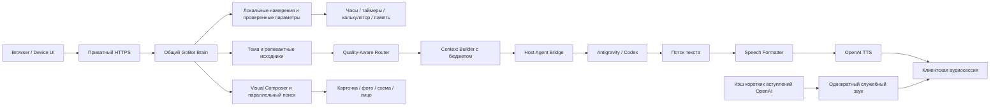

# GoBot Home — единый паспорт фактического состояния

Обновлён 10 ноября 2026 года. Рабочая ветка — `master`.
Этот файл описывает **реализованный код, проверки и ограничения**. Требования
остаются в [единой целевой спецификации](GOBOT_HOME_TARGET_SYSTEM.md).
Описание задуманной функции не означает её готовности.

## 1. Где находится проект и как им пользоваться

* Репозиторий: [anpavel84-afk/gobot-home](https://github.com/anpavel84-afk/gobot-home).
* Локально: `C:\Users\PLAN\gobot\GoBotHome`.
* Панель: приватный Tailscale HTTPS, порт 18786; экран устройства — `/device`.
* Профиль дисплея: круг 240×240, конфигурируемый. Это браузерный прототип.
* Сохранённый legacy baseline — `a71b71e987efdfe01884e34de10712782c0e36ac`.
  Native/A-B код с two-stage visuals, круглым cover и silence-close исправлением опубликован и запущен на `2c276a614ce806715d9402b9ab2fd612bb55c067`.
  Вне B default пока legacy до приёмки; ручные пробы B владельцем без одноразовой квоты (§19).
  Исторические проверки стабилизации — раздел 10.

## 2. Карта legacy-пути запроса (native candidate — раздел 15)

Интерфейсы используют один Brain, память, Router и серверные инструменты.
Служебное вступление отделено от полезного ответа и его TTFA. Оно использует
тот же AudioContext, но отдельный набор источников с приоритетом основного звука.

## 3. Что реализовано

| Компонент | Фактическое поведение | Основной код | Граница проверки |
| --- | --- | --- | --- |
| AUTO / FAST | Antigravity Flash Low; автоматического дорогого fallback нет | [routing.py](../services/brain/gobot/routing.py), [antigravity.py](../services/brain/gobot/antigravity.py) | Реальные ограниченные CLI-пробы выполнены |
| REASONING / ручной выбор | Flash Medium; Argon и Codex доступны явно | [routing.py](../services/brain/gobot/routing.py), [live_agents.py](../services/brain/gobot/live_agents.py) | Пригодность к любым сложным задачам не доказана |
| Оценка качества | Раздельные сложность, фактическая неопределённость, последствия и проверка | [quality.py](../services/brain/gobot/quality.py) | Детерминированные правила; не точные вероятности |
| Быстрые команды | Каталог 30 сценариев; 13 отмечены реализованными, остальные требуют интеграций/прав | [quick-intents.json](../services/brain/quick-intents.json), [quick_intents.py](../services/brain/gobot/quick_intents.py), [local_tools.py](../services/brain/gobot/local_tools.py) | 228 синтетических формулировок; не исследование живой речи |
| Завершение беседы | «Нет, спасибо» локально завершает активный сеанс без CLI/TTS; новое прослушивание не включается | [conversation_control.py](../services/brain/gobot/conversation_control.py), [device.js](../services/phone/dist/device.js) | Автоматические тесты; новый iPhone-прогон отсутствует |
| STT | OpenAI основной; Whisper только вручную | [stt.py](../services/brain/gobot/stt.py), [audio.py](../services/brain/gobot/audio.py), [capture.js](../services/phone/dist/capture.js) | Русские короткие фразы/домашний шум требуют дальнейшей проверки |
| TTS | OpenAI, выбранный голос; PCM streaming; необязательный лимит символов после форматтера | [audio.py](../services/brain/gobot/audio.py), [pipeline.py](../services/brain/gobot/pipeline.py) | Реальные пробы и клиентские события; не акустическая лаборатория |
| Speech Formatter | Отдельный speech_text; Markdown, дубли имён, числа, даты, падежи, словарь | [speech_formatter.py](../services/brain/gobot/speech_formatter.py) | Правила не дают полной гарантии русской морфологии |
| Вступления | 100 готовых OpenAI marin клипов, 2886 символов; случайный подходящий вариант по категории | [speech_openings.py](../services/brain/gobot/speech_openings.py), [speech-openings.json](../services/brain/speech-openings.json), [turn-trace.js](../services/phone/dist/turn-trace.js) | Реальное создание 100/100; сочетаемость каждого вступления с живым ответом не проверена |
| Старый звук ожидания | Denis «Секунду…» исключён; старый URL возвращает 410 | [browser.py](../services/brain/gobot/browser.py), [browser.js](../services/phone/dist/browser.js) | Резервный ручной голос Denis для ответа отдельно сохранён |
| Контекст | SQLite-архив в GoBot, бюджетный пакет, последние обмены, темы/эпизоды, FTS5 | [memory.py](../services/brain/gobot/memory.py), [archive.py](../services/brain/gobot/archive.py), [context_manager.py](../services/brain/gobot/context_manager.py) | Семантический retrieval и качественные summaries не доказаны |
| Визуальная тема | Составные именные группы, active_visual_subject, нормализация ё/е и падежей | [semantic_visual.py](../services/brain/gobot/semantic_visual.py), [visual_memory.py](../services/brain/gobot/visual_memory.py), [image_query.py](../services/brain/gobot/image_query.py) | Эвристика, не универсальное семантическое понимание |
| Визуальный поиск | Prefetch параллельно ответу; Wikimedia и Openverse; source/license checks, TTL/LRU кэш | [visual.py](../services/brain/gobot/visual.py), [visual_images.py](../services/brain/gobot/visual_images.py), [visual_prefetch.py](../services/brain/gobot/visual_prefetch.py) | Проверка metadata не равна полной проверке содержимого фото |
| Визуальные сцены | Фото/галереи, локальные схемы, карточки/таймер, лицо; поздние старые события отсекаются | [response_composer.py](../services/brain/gobot/response_composer.py), [device-renderer.js](../services/phone/dist/device-renderer.js), [visual.js](../services/phone/dist/visual.js) | Реальные изображения проверены в Browser и Device Renderer |
| Генерация картинок | API-адаптер и согласие/лимиты подготовлены; Codex capability обнаружена | [image_generation.py](../services/brain/gobot/image_generation.py) | Codex image-only изоляция не проверена; генерация не включается молча |
| Семья / Speaker Identity | Профили, PIN, локальные биометрические компоненты и guest downgrade | [family.py](../services/brain/gobot/family.py), [speaker.py](../services/brain/gobot/speaker.py), [family_api.py](../services/brain/gobot/family_api.py) | Биометрия не является авторизацией и не объявлена надёжной |
| Device Mode | PTT, автоматическая отправка, скины Classic/Soft/Minimal, серверное сохранение настроек | [device.js](../services/phone/dist/device.js), [device_contract.py](../services/brain/gobot/device_contract.py), [device_store.py](../services/brain/gobot/device_store.py) | Телефонный круг не доказывает совместимость платы ESP32 |
| Continuous Conversation | Локальное окно после фактического playback, экспериментальный VAD, timeout и отмена | [capture.js](../services/phone/dist/capture.js), [device.js](../services/phone/dist/device.js) | TV/шум/реальный iPhone не приняты |
| Wake word | Контракт/статус есть | [activation.py](../services/brain/gobot/activation.py) | Русское «ГоБот» рабочей моделью не подтверждено |
| Наблюдаемость | Раздельные часы Brain/Bridge/клиента, usage либо unavailable, actual playback counter | [telemetry.py](../services/brain/gobot/telemetry.py), [turn-trace.js](../services/phone/dist/turn-trace.js) | Клиентский counter не является акустическим измерением |

Пути Python в таблице относительны к `services/brain/gobot`, JSON — к
`services/brain`, клиентские JS — к `services/phone/dist`.

## 4. Быстрые серверные сценарии

Намерение, варианты речи, параметры, исполнитель, ограничения и readiness
хранятся отдельно. «Засеки три минуты» и «таймер на три минуты» ведут к одному
инструменту. Время/дата читаются из часов домашнего сервера с его UTC-offset;
это не угадывание местоположения человека. Таймеры читаются из серверного
состояния владельца. Точные совпадения шаблонов не запускают отдельную LLM.

Имеются время/дата/день недели, запуск/отмена/остаток таймера, справка,
калькулятор, закрытие диалога и уже существующий scoped memory path.
«Засеки время» требует уточнения: секундомер не выдаётся за таймер.
Неподдержанные числительные не должны превращаться в другую длительность.
Погода, музыка, устройства дома и дверь не считаются подключёнными по одному
совпадению фразы. Неоднозначная или отрицательная команда не исполняется
приблизительным сопоставлением. «Да» не становится универсальным разрешением.

Изучены первичные источники [Home Assistant intents](https://github.com/OHF-Voice/intents),
[Alexa built-in intents](https://developer.amazon.com/en-US/docs/alexa/custom-skills/standard-built-in-intents.html)
и [Siri Shortcuts](https://support.apple.com/en-gb/HT209055).
Свой каталог и примеры написаны для GoBot; чужой корпус массово не импортирован.
Дальнейшее расширение: реальные обезличенные промахи → предлагаемые шаблоны →
проверка параметров и прав → позитивные/негативные тесты → включение executor.
Синтетические варианты не следует считать статистикой реальных пользователей.

## 5. Контекст, данные и доступ

* SQLite сохраняет исходные сообщения/статусы и происхождение, темы/эпизоды,
  источники summaries/фактов, provider_sessions и context_runs.
* Обычный пакет имеет target 3600 / maximum 6000 estimated tokens; особый
  подробный режим — до 12000. Provider usage учитывается отдельно.
* Обычные CLI-обращения не продолжают накопительный provider thread.
* Семейное, личное и гостевое различаются. Личный архив требует подтверждения.
* Mock/fixture данные исключены из production retrieval. remember=false — RAM.
* Перед миграциями используются SQLite online backup с WAL и integrity_check.
* Архив, ключи, биометрия, WAV и сертификаты не публикуются в GitHub.
* Публичные generic opening clips тоже остаются локальным runtime-кэшем;
  в GitHub доступны их тексты, builder и обезличенный отчёт создания.

Подробности: [Context policy](CONTEXT_POLICY.md), [Memory architecture](MEMORY_ARCHITECTURE.md),
[Context evaluation](CONTEXT_EVALUATION.md), [Security](SECURITY.md).

## 6. Измерения и что они означают

| Проверка | Результат | Ограничение |
| --- | --- | --- |
| Две реальные Flash + TTS пробы | Начало playback через 7,783 / 6,971 с от текста; 549 TTS символов | STT исключён; desktop IAB, не iPhone |
| Первая картинка | Показ через 7,058 с, до начала голоса | Второй реальный случай обнаружил ё/е-баг |
| Исправление ё/е | Оба сохранённых ответа проходят бесплатный streaming replay с настоящим кэшем | Нового платного повторения после фикса нет |
| ACP без prompt | Первая новая сессия 1723 мс; вторая в том же runtime 16 мс | Не измерение inference/ответа, изоляция ещё не допущена |
| 100 вступлений | 100 completed, 2886 символов, 0 повторов | Денежная стоимость API не сообщена адаптером |
| Визуальный synthetic eval | 40/40 предметов на собственном наборе | Не независимое доказательство качества любых фото |
| Регрессия | 930 passed за 19,60 с на коде `6f936b4` | Mocks отдельно от реальных устройств |
| Локальный HTTPS без моделей | «Нет, спасибо» — 469,58 мс; часы/дата/справка — 211–214 мс | Полное HTTP-обращение, не время слышимого ответа; 4 пробы |

Доказательства: [real latency probes](real-latency-probes-20261110.json),
[Antigravity audit](antigravity-latency-audit.json), [opening build](speech-openings-build.json), [quick intents research](quick-intents-research.json),
[visual source checks](semantic-visual-source-checks.json), [context evaluation](CONTEXT_EVALUATION.md),
[проверка локальных команд и кэша через HTTPS](quick-openings-https-check.json).
Исторические замеры не переименовываются в текущие результаты.

## 7. Что остаётся открытым

1. M1: уменьшить реальное время до содержательного голоса. Новый ACP runtime
   требует эквивалентной изоляции, отмены, fresh sessions и разрешённого замера.
2. Проверить PTT, followup, preemption вступления, отмену и воспроизведение
   на настоящем iPhone. Клип не считается содержательным ответом.
3. Проверить retrieval/summaries и переходы тем на независимом русском наборе.
4. Подтвердить русский wake word и частоты ложных срабатываний на домашнем шуме.
5. Подключить разрешённые погодные/музыкальные/домашние источники и их ACL.
6. Проверить безопасный Codex ImageGen; API-генерацию использовать только
   в отдельном согласованном лимите.
7. Проверить реальную ревизию ESP32, память, экран, микрофон, Opus/transport.
   Физического устройства и подтверждения firmware-совместимости пока нет.

## 8. История внедрений

| Коммит / этап | Что изменилось | Свидетельство |
| --- | --- | --- |
| Ранний MVP | Общий Brain, Bridge, Browser, инструменты, SQLite и voice path | Git history; старый [снимок статуса](https://github.com/anpavel84-afk/gobot-home/blob/9c087ce/docs/CURRENT_STATUS.md) |
| Context / quality / speech | Бюджеты, независимые риски, семья, форматирование речи | Профильные документы и regression tests |
| `2c4c5bd` | Prefetch по финальному вводу, CLI только текст | MULTIMODAL_RESPONSES.md |
| `654152e` | Безопасные растровые Commons thumbnails | test_wikimedia_entities.py |
| `0931bd5` | Иллюстрации названных персонажей; карты ответа скрыты | test_character_images.py |
| `6d7811a` | Настройки визуала, gated generation и followup | CONTINUOUS_CONVERSATION.md |
| `c079771`, `574de9a` | Общие именные группы, visual subject, placeholder и отмена | semantic-visual-evaluation.json |
| `a0e46f8`, `9c087ce` | Лимит TTS, две реальные пробы, ё/е и падежи | real-latency-probes-20261110.json |
| `4919da3` | Стабилизация вступлений, проверенных slots, pending/followup и позднего визуала | dialogue-stabilization-checks.json; HTTPS deployment |
| `6f936b4` | Локальный конец беседы, 100 OpenAI-вступлений, quick intents и этот паспорт | 930 tests; создание клипов; HTTPS-проверка и deployment ниже |

Полная история действий хранится в Git. Эта таблица сохраняет смысл этапов;
старые неактуальные выводы доступны по commit, а не перемешаны с текущим статусом.

## 9. Правила дальнейших обновлений

Каждое значимое внедрение сопровождается обновлением этого файла: поведение,
файлы, проверки, ограничения, расходы/разрешения и изменения runtime.
В записи указываются дата, commit реализации, ссылки на изменённые компоненты
и доказательства проверки. До коммита допустима пометка «в работе»; после
проверки она заменяется фактическим результатом. Опубликованный код и запущенная
версия учитываются отдельно. Полные технические отчёты остаются по ссылкам,
а сводное состояние — здесь. Ссылка на паспорт находится в README, обязательность
его обновления закреплена в AGENTS.md.
Незавершённая функция отмечается явно. Статусы «код», «mock», «реальный
провайдер», «браузер», «iPhone», «ESP32» не подменяют друг друга.
Целевая спецификация определяет требования; этот паспорт — их фактическую реализацию.

## 10. Проверка и развёртывание базового пакета 6f936b4

10 ноября 2026 года развёрнут код `6f936b4b60a1945d4aca476a2630d460e0f9ee46`.
Полный прогон: **930 passed за 19,60 с**, включая параметры таймера,
локальные завершения, идемпотентность и Node-проверки клиентской очереди.
Проверка индекса и всей Git-истории Gitleaks 8.30.1 перед коммитом: 0 находок.

После перезапуска проверены приватный HTTPS и `/device` (HTTP 200), health
Brain/Bridge/голосового стенда/изображений. Активных turns и голосовых потоков — 0.
Метаданные native isolation для Antigravity/Codex подтверждены; без согласия
на квоту они остаются недоступными. Gemini CLI отмечен retired и недоступен.

Через настоящий HTTPS выполнены четыре временных обращения с remember=false,
speak=false и без разрешения CLI-квот. Все ответили локально: завершение
«Нет, спасибо!», часы, дата и справка. Завершение содержит conversation_ended;
ни один запрос не создал аудиочанков, CLI-вызова или синтеза TTS.

Кэш marin сообщает 100/100 готовых клипов. Один клип получен через HTTPS и
декодирован как WAV 24 кГц длительностью 2,0 с. Старый URL Denis возвращает 410.
Это проверка доставки и декодирования, **не подтверждение слышимого
воспроизведения нового вступления на iPhone**. Платные вызовы в этой проверке — 0.
Реальное создание всех клипов ранее израсходовало одобренный лимит:
100 запросов / 2886 символов / 0 повторов. Денежная стоимость недоступна.

Документационные изменения после этого развёртывания служб не перезапускают.
Ключи, приватный контекст и содержимое семейных разговоров сюда не добавляются.

## 11. Стабилизация быстрого диалога — 10 ноября 2026

База перед исправлениями — `2f0eefc`, рабочее дерево было чистым.
Замечания независимого аудита воспроизведены: 15 падающих backend-регрессий
и падающий тест настоящего клиентского соединения вступления.

* Исправлена передача третьего аргумента в playFeedback. Настоящие функции
  offerOpening → fetch/decode → FeedbackController → playFeedback вызывают
  AudioBufferSource.start с готовым буфером и ролью filler.
* В браузере IAB готовый marin-клип действительно запущен и завершён через
  Web Audio. Это проверка аудиографа desktop, не акустическое испытание iPhone.
* Распознаватель возвращает validated / needs_parameters / rejected /
  unavailable; отсутствие намерения возвращается отдельно. Широкий legacy
  timer route удалён; slots передаются исполнителю без повторного разбора фразы.
* Полчаса, альтернативы, отрицания и хвост команды проверяются целиком.
  Отмена разрешает один ID/номер; несколько таймеров без ясной цели — уточнение.
  Массовая отмена допускается только по явной команде «все».
* decline_pending, stop_output и conversation_ended имеют разные события.
  Pending хранится в RAM с owner/conversation/profile epoch при remember=false;
  в постоянном режиме используется существующая таблица с TTL 120 секунд.
  «Да» не даёт новых полномочий и не выполняет неподключённое действие.
* Старт followup требует окончания серверного аудио, actual playback ACK,
  пустой очереди ответа/вступления, echo guard и актуальной сессии. no_audio,
  ошибка TTS, отмена, Stop и уход в фон не открывают микрофон автоматически.
* Завершённый текст фиксируется до необязательного позднего визуала.
  Отмена картинки не стирает его из контекста; подтверждённо проигранные
  фрагменты по-прежнему учитываются отдельно от сгенерированного текста.
* Необязательный кэш переживает отсутствие/повреждение каталога и клипа.
  Клиент держит максимум 8 декодированных клипов; fetch ограничен 5 секундами.
  Подбор читает только metadata с пределом 80 мс. Порог 2250 мс сохранён.
  Семантически ограниченные клипы помечены requires; выбранное вступление
  не повторяется подряд в сеансе. Все 100 исходных WAV сохранены без пересинтеза.

Проверки и таблица изоляции ошибок: [dialogue-stabilization-checks.json](dialogue-stabilization-checks.json).
Новые регрессии: [test_dialogue_stabilization.py](../tests/test_dialogue_stabilization.py),
[opening_connection.cjs](../tests/opening_connection.cjs),
[device_ui.cjs](../tests/device_ui.cjs). Новых платных запросов — **0**.
До этого прохода 930 тестов; расширенная регрессия — 956 passed за 20,36 с.
P0 опубликован и развёрнут как `4919da3c7def2df94fc7a70fd22a1b0ca9dd5045`.
Перед перезапуском active_turns=0 / active_voice_streams=0; выполнен SQLite
online backup с WAL, integrity_check=ok, без новой миграции схемы.
[Проверка после deployment](dialogue-stabilization-deployment.json): семь реальных
HTTPS-обращений (remember=false, speak=false, quota=false), все local,
191–354 мс полного HTTP, без CLI/STT/TTS. Это не TTFA голосового запроса.
Проверены выдаваемый browser.js, /device HTTP 200, health и 100/100 клипов.
Codex потребовал штатной повторной офлайн-проверки: 1 mock HTTP запрос,
0 реальных модельных запросов, tools=[]. Границы допуска не ослаблялись.
Реальное ускорение CLI и полный сценарий iPhone не измерены.

Дополнительное усиление цели таймера подготовлено после этого deployment:
номер относится только к показанному списку ID (120 секунд, owner/conversation/
profile epoch), а не к заново пересортированным живым таймерам. Без списка
нужен вопрос-уточнение. Истечение таймера не сдвигает смысл старого номера.
Усиление привязки номера развёрнуто вместе с пакетом a71b71e; без актуального списка цель уточняется.

## 12. Контролируемый ACP-кандидат

Реализован отдельный экспериментальный путь в существующем Host Bridge:
[antigravity_acp.py](../services/brain/gobot/antigravity_acp.py),
[штатная metadata-проба](../scripts/audit_agy_acp.py),
[проверки транспорта](../tests/test_acp_candidate.py).
Настройка [router-policy.json](../services/brain/router-policy.json):
`antigravity_transport=stream_json` — рабочий прежний путь;
`acp_experimental` — кандидат с отдельным обязательным допуском. По умолчанию
он выключен. Недоказанный ACP не переключается скрыто на второй транспорт.

Кандидат переиспользует bounded JSON-RPC GoBot и Windows kill-on-close job.
Параллельность 1, ожидание очереди 100 мс, init/session RPC до 10 с,
первый вывод до 35 с, вся операция до 90 с, idle runtime до 60 с,
до 16 свежих sessions на runtime. session/load/resume не используется.
Каждая сессия имеет отдельный ID, MCP servers=[], client FS/terminal=false;
permission requests отклоняются, tool activity завершает операцию.
При отмене отправляется session/cancel, затем runtime уничтожается;
после нормального завершения используется объявленный session/close.
Отсутствующий usage остаётся unavailable. Авторизационные файлы не читаются.

Нативно подтверждены только initialize и две session/new/close через
установленный Antigravity 1.5.3, с поддерживаемыми sandbox/process-per-session
флагами. Числа и SHA: [antigravity-acp-candidate.json](antigravity-acp-candidate.json).
Эти времена относятся к metadata, а не ответу модели. session/prompt не отправлялся.

**Блокер допуска:** session/new не предоставляет проверяемого отчёта об
эффективных deny-правилах worker. Отказ клиентской стороны не доказывает запрет
внутренних файловых/командных/web/MCP tools агента. Нативная adversarial-проверка
этой гарантии не проведена. Поэтому native_session_deny_verified=false,
а кандидат блокируется до любого prompt даже при включённом переключателе.
Сравнение скорости без устранения этого блокера не имеет смысла; безопасности
ради ускорения не уступаем. Прежний stream-json путь сохранён.

Основание: [официальный agy ACP](https://antigravity.google/docs/cli/acp),
[ACP sessions](https://agentclientprotocol.com/protocol/v1/session-setup),
[ACP prompt lifecycle](https://agentclientprotocol.com/protocol/v1/prompt-turn).

Полная регрессия текущего пакета: **965 passed за 21,03 с**. Из них 8 ACP
fixtures проверяют реальный stdio RPC с локальным агентом: свежие сессии,
повторное использование процесса, отказ permissions/FS/tools, EOF/битый JSON,
очередь и отмену. Это не проверка инструментария нативного агента на реальной LLM.
Новых платных API/модельных запросов — 0. Старые разрешения не использовались.
Следующий внешний приёмочный сценарий: реальный iPhone PTT → ожидание с готовым
вступлением → ответ → followup → «нет, спасибо» → микрофон остаётся закрыт.
Он пока **не выполнен**. Useful TTFA нового кода не измерен.

Откат транспорта: сохранить/вернуть stream_json в конфигурации, проверив
отсутствие активной беседы перед перезапуском. Откат кода — отдельный проверенный
revert-коммит с регрессией, без reset/force push; миграций этого этапа нет.
Копия SQLite находится локально под ignored data/backups и не публикуется.

## 13. Итоговое развёртывание стабилизации

Запущенный код: **a71b71e987efdfe01884e34de10712782c0e36ac**, ветка master.
Коммиты этапа: 4919da3 (P0), abb4c8f (связь номера таймера с показанным списком),
a71b71e (отдельный выключенный ACP-кандидат). После них меняется только документация;
перезапуск ради Markdown не требуется.

Проверка [фактического runtime](dialogue-stabilization-runtime.json): все четыре
сервиса healthy, /device=200, исправленный browser.js отдаётся, native isolation
metadata Codex/Antigravity подтверждены, 100 marin клипов доступны. Реальный
HTTPS «Нет, спасибо» — 379,23 мс полного HTTP (n=1, без STT/TTS),
conversation_ended; повтор request_id возвращает replay. Это не сравнение скорости
модельного ответа и не слышимая задержка iPhone. Оба перезапуска выполнены без
активных turns/voice streams. Клиентскую страницу необходимо обновить для нового JS.

Продуктовый транспорт остался **stream_json**. ACP не допущен: включение одного
флага не обходит native proof gate. Новых оплачиваемых API-вызовов, prompt или
пересинтезов вступлений в этом проходе не было. Все разрешённые ранее бюджеты
остаются израсходованными. Проверка секретов индекса и истории — 0 находок.

Полная приёмка на iPhone и новое сопоставимое измерение полезного ответа
остаются открытыми. Комфорт ожидания и исправление воспроизведения не подменяют M1.

## 14. Приёмка a71b71e и решение по ACP — текущий этап

Начальный HEAD — `6bf40d47eb00199dbfdffac36ab64b4985a62b8f`.
Пакет стабилизации не переписывается. Начатые после него голосовые настройки
погоды/устройства сохранены как **17 незакоммиченных WIP-файлов** и копия с
SHA-manifest под ignored run/preserved-work; они в этот проход не публикуются.
Голосовой конфигуратор не объявляется готовым или развёрнутым.

### Приёмка телефона

[phone_acceptance.py](../scripts/phone_acceptance.py) экспортирует проверенный
код a71b71e из Git в ignored run/phone-acceptance. Приватный HTTPS использует
committed gateway factory и статические ресурсы этого пакета; хеши browser.js,
device.js, device-renderer.js, capture.js и turn-trace.js сверены с Git.
Это тестовая обвязка существующего gateway, **не новый Brain/голосовой pipeline**.
Brain и Bridge не перезапускались и остаются на a71b71e. Изменения WIP-клиента
не отдаются телефону. HTTPS перезапущен только после active_turns=0 и
active_voice_streams=0; Tailscale, TLS и сеть не перенастраивались.

Владелец отдельно разрешил **3 STT-запроса / 45 секунд, 2 Flash-запроса,
800 TTS-символов**. Старые бюджеты не использованы. Одноразовый локальный
ledger резервирует попытку перед отправкой; ошибка/отмена не возвращает лимит.
По 400 символов TTS на каждый из двух содержательных turns, не более 15 секунд
одной записи. Режим OpenAI file STT; live STT временно закрыт, чтобы его вызовы
не обходили лимит. AUTO не меняется глобально: только тестовые запросы
ограничиваются Flash Low без дорогого fallback. Генерация картинок для этого
теста подавляется без изменения сохранённых настроек. Готовые вступления
используют существующий кэш; никакого нового синтеза вступлений.

Перед STT длина принятого файла проверяется локальным декодером в RAM.
Это дополнительная проверка лимита приёмки; её время нельзя выдавать за
ускорение обычного STT. Ни файл, ни PCM, ни содержимое вопроса ledger не сохраняет.
Тестовые turns принудительно remember=false. Обычные согласия интерфейса всё
равно требуются. Пока обвязка активна, не следует использовать другие клиенты
для платных обращений. После окончания запускается phone_acceptance.py --finish:
ledger закрывается, счётчики не обнуляются, pinned-клиент остаётся обычным.

**Последовательность на настоящем iPhone (не более трёх реплик):**

1. В панели выбрать OpenAI STT/TTS, marin, согласия STT/TTS/CLI; отключить
   «Запоминать этот разговор». Открыть /device, обновить и включить GoBot.
2. PTT: «Что такое чёрная дыра? Ответь двумя короткими предложениями».
3. После ответа, в followup: «А почему из неё не выходит свет? Коротко».
4. После второго ответа: «Нет, спасибо». Молчать 15 секунд, проверить, что
   микрофон остаётся закрыт. При ошибке не повторять автоматически.

От владельца нужны наблюдения: одно вступление или повтор; сохранено ли начало
основного ответа; работал ли followup; остался ли микрофон закрыт; примерная
слышимая пауза после вступления. Дополнительная аудиозапись не требуется.

[phone_acceptance_report.py](../scripts/phone_acceptance_report.py) выбирает
**только** trace IDs из одноразового ledger и существующей content-free телеметрии.
Не читает messages/архив разговоров. Отдельно считает earcon, начало/конец
вступления, useful playback и оставшуюся тишину по одной клиентской шкале;
Bridge durations остаются в своей шкале. Playback — оценка AudioContext,
а не акустическое доказательство первого слова. p95 для этого n не строится.
Текущий результат: [phone-acceptance-results.json](phone-acceptance-results.json).
**Физическая приёмка ожидает действий/подтверждения владельца**; desktop и Node
её не заменяют.

Бесплатно повторены 350 целевых тестов **из снимка a71b71e**, включая ранний
ответ до клипа, preemption, Stop, скрытие страницы, VAD silence, pending/end,
контекст при позднем визуале и реальные функции общей клиентской очереди.
Ещё 4 теста проверяют ограничитель, сохранение счётчиков после перезапуска,
передачу capped remember=false запроса и отбор только тестовой телеметрии.
Это программные проверки, не новая акустическая приёмка телефона.

### ACP: вывод D, отдельное разрешение ещё требуется

[Наблюдение native worker](acp-worker-acceptance.json) получено скриптом
[audit_acp_worker.py](../scripts/audit_acp_worker.py), без session/prompt.
Установленная версия и защищённые флаги сохранены. Canary workspace содержит
только синтетический файл и собственную Git-границу, чтобы discovery не
переходил в родительский проект. CLI credentials не читались и не копировались.

Текущий argv: pinned agy --settings tracked-policy --log-file NUL acp
--sandbox --process-per-session --disable-telemetry. Наблюдались один parent
и два разных worker PID. Переиспользуется parent/broker; worker создаётся
заново. Для исторических 1722,79 / 15,63 мс argv и worker PID не сохранены,
поэтому точный набор прежних флагов неизвестен. Их нельзя объявлять
эквивалентным прогоном или переносить 16 мс на текущую конфигурацию.
Ранее записанные 1823,82 / 1582,61 мс сохраняются в исходном отчёте.

В последней metadata-пробе, n=2: session/new roundtrip 1878,92 / 1202,95 мс.
Наблюдение worker началось через 27,93 / 16,01 мс после запроса; остаток до
ответа — 1850,99 / 1186,94 мс.
Подготовка argv/проверка бинарника — 331,71 мс; environment — 0,57 мс;
spawn + Windows job — 17,68 мс; initialize RPC — 162,27 мс. Полный open с
вложенными этапами — 512,51 мс. Два session/new wire RPC — 1878,39 / 1202,61 мс. Это наблюдаемые интервалы metadata-старта,
не inference. Частота psutil — 10 мс; auth/network/runtime внутри worker
по отдельности недоступны. Точные wire durations и вложенные этапы приведены
в JSON; их нельзя складывать как независимые этапы.

Проверены поддерживаемые configOptions и available commands установленной
версии. /permissions не объявлен через ACP; read-only root CLI аудит правил
не доказывает их применение worker. Root задаёт plan, session возвращает default;
в argv worker путь tracked policy не виден. Ни отличие mode, ни отсутствие
аргумента/отчёта сами по себе **не доказывают обход permissions**: настройки
могут передаваться другим каналом. Они требуют проверки поведения, а не ручного
выставления native_session_deny_verified.

Документация описывает native deny rules для ACP, но не описывает локальную
подмену подписочного provider для offline модельного теста. customModelsConfig
относится к Gemini API-key mode, который в GoBot исключён. Неподдерживаемые
флаги, API-ключи и обход подтверждений не добавлялись.

Владелец получил отдельный конкретный запрос на **до 4 Flash-проб без STT/TTS**:
файлы, команда-маркер, loopback HTTP и синтетический MCP в canary workspace.
Разрешение на телефон их не покрывает. Допуск требует наблюдаемой попытки
инструмента и native запрета **до эффекта**, с проверенными canary-детекторами.
Один отказ модели, отсутствие попытки, позднее tool_call notification или
клиентский Deny недостаточны. Такие результаты останутся «не доказано».
Сейчас эти модельные пробы **не запускались**, native proof=false, ACP выключен.

После допуска предлагается отдельное текстовое сравнение: один фиксированный
вопрос/ContextPacket, Flash Low, одинаковые настройки, два транспорта × cold/warm
(4 независимых вызова, без автоматических повторов и без TTS). При отсутствии
преимущества сохраняется stream-json. Речь проверяется отдельным следующим
лимитом. Сейчас оснований для переключения транспорта нет.

## 15. Realtime Mini, Family Identity и русская речь: кандидат миграции

База прохода — master@b09f2f369eb183f22b47fa72b4018324b1aa8c0d. Сохранены и интегрированы
17 прежних WIP-файлов голосовых настроек. Ни reset, ни stash, ни откат базы не выполнялись.
Новая архитектура и заменённые правила внесены в единую спецификацию, §36–39.
На момент подготовки этого раздела runtime ещё a71b71e; развёртывание и итог проверок
фиксируются ниже после выполнения. Описанный кандидат не является принятой миграцией default.

### 15.1. Что реализовано

- `realtime_contract.py`, `realtime_provider.py`, `realtime.py`, `realtime_api.py`:
  audio-only WebRTC SDP через прежний HTTPS/FastAPI, серверный sideband `/v1/realtime`,
  ровно одна active audio media section, запрет provider data channel/video, подтверждение
  effective session.updated, один native разговор на несколько реплик, владение клиентом,
  запрет позднего setup после Cancel, cleanup/hangup и content-free persistent ledger для
  незакрытых calls. Известный результат не повторяется автоматически.
- `realtime.js`: отдельный native adapter общего GoBotClient, а не новый Brain. PTT,
  автоматический commit после отпускания, отказ короткой/тихой записи, server VAD только
  для followup, Stop/pagehide/offline/track-ended cleanup. Звук идёт напрямую по WebRTC;
  обычный turn не вызывает старые STT, CLI, Speech Formatter или отдельный TTS.
  Текст админки передаётся как input_text; text-only output поддерживается конфигурацией.
- Воспроизведение: generation done отделено от output buffer drained и клиентского
  фактического ненулевого audio signal. Только совместные подтверждения допускают followup
  и сохранение полного услышанного ответа. После прерывания полный непрослушанный хвост
  не записывается как услышанный. Точная граница услышанного в Safari пока не принята.
- `realtime_budget.py`: отдельные local owner policies для Realtime и expert jobs,
  ограничение attempts/sessions/responses/time/output tokens/наблюдаемого usage,
  дедупликация usage по response ID. Ошибки не возвращают лимит автоматически.
  Это не гарантированный абсолютный dollar cap: usage приходит после обработки.
- Visual Composer подключён к финальному input transcript и ранним output transcript
  fragments через существующий SpeculativePhoto/ImageCache; локальные схемы и widgets
  остаются прежними. Иллюстрация не блокирует голос, старый turn не меняет новую сцену.
  Отвергнутый answer_map не используется как обязательная заглушка.
- Подключены существующие typed clocks/timers/settings/weather/memory-denial tools.
  Таймеры имеют устойчивый device scope и не зависят от provider session; гостевой scope
  не открывает личную историю. Семантическая достоверность нативной речи до проверки
  обязательного текущего источника ещё не доказана серверным gate: default не допускается.
- `expert_jobs.py`: proposal/expiry/context revision, реальное пользовательское согласие,
  один активный эксперт, отдельный бюджет, pending function call с единственным output
  для настоящего call_id. Старый результат не перебивает новый turn; отказ не запускает
  CLI. Native эксперт требует PIN-подтверждённого взрослого и отдельного лимита.
  Реальные экспертные пробы этой миграции не проводились.

### 15.2. Модель, параметры, расходы

`gpt-realtime-2.1-mini` подтверждена официальной модельной страницей и отдельным бесплатным
GET metadata с текущим серверным ключом: HTTP 200, точный model ID совпал.
Это не успешное создание Realtime call и не проверка акустики.
SDK openai в окружении отсутствует; используются имеющиеся httpx 0.28.1/websockets 16.0.
Транспорт — Realtime API, не GPT-Live. См. `realtime-api-compatibility.json`.
Долговременный ключ остаётся в DPAPI; клиент получает только app session ID и SDP answer.

Целевой голос marin; сохранённый выбор пользователя и явно выбранный семейный голос
применяются при создании сессии. После первого audio output voice не меняется через
session.update. Записанные сто вступлений в native-turn не проигрываются.

Проверка штатным Codex model/list (0 модельных запросов) подтвердила:
ASTRA_HIGH = gpt-6-astra + high, SOL_XHIGH = gpt-6.1-sol + xhigh.
ARGON_DEEP использует уже разрешённый gemini-4-argon-medium, effort medium в model ID.
Каталог/валидаторы и Bridge передают фактический профиль без молчаливой подмены effort.
Повторный Codex offline audit: tools=[], 1 mock HTTP request, real_model_requests=0,
проверка изоляции пройдена. Это не проверка качества экспертных выводов.
ACP остаётся OFF, и больше не блокирует бытовой native путь.

Для расчётной оценки Mini используются официальные token rates на 10.11.2026:
text input/output $0.60/$2.40 за миллион, cached text $0.06;
audio input/output $10/$20, cached audio $0.30. Это не реальный счёт;
асинхронная input transcription учитывается отдельно. Новые paid Realtime/CLI/ImageGen
пробы не выполнялись. Владелец отдельно разрешил одну новую iPhone-пробу:
1 сессия Mini до 90 s, до 4 response attempts по 384 output tokens, асинхронная
входная gpt-transcribe; без CLI/ImageGen/автоповторов. Подготовка допуска — §16.2.
Ранее разрешённый телефонный ledger завершён: 3 STT attempts / 11.3945625 s,
2 Flash reservations, 800 TTS characters reserved. Reservation не означает фактическое
озвучивание 800 символов; физическая приёмка по этому счётчику не заявляется.

### 15.3. Family Identity и SpeakerIdentity через WebRTC

Существующие Family/PIN/epoch, SQLite Memory/ContextManager, SpeechBrain ECAPA в
.venv-speaker переиспользованы. Новых пользователей или альтернативной family DB нет.
`family_access.py` отделяет principal, client device, предполагаемого speaker,
подтверждённый профиль, conversation и native/provider sessions.

`realtime-speaker.js` + `realtime_speaker.py` копируют активное микрофонное аудио в
локальный PCM16 16 kHz mirror. До 6 секунд / 192000 bytes на segment и до 1 секунды
кольцевого RAM-буфера. PTT и server-VAD followup имеют server-generated segment nonce,
однократную отправку и проверку актуальной сессии. Это не второй STT. Embeddings
не отправляются OpenAI. Нет фоновых API-вызовов из SpeakerIdentity; raw PCM не пишется
на диск и освобождается после обработки. Тёплый worker освобождает предыдущие audio
references и входной tensor, сохраняя веса модели.

До согласий/образцов/калибровки показан unknown, а не «Узнал вас». На фактическом ПК
при аудите: модель установлена, family profiles=0, enrolled profiles=0, calibration=false.
Поэтому обработчик подключён, но семейная идентификация пока не готова к узнаванию.
Для регистрации используются прежние добровольные образцы и held-out calibration.

Локальная реальная проверка worker на уже разрешённом синтетическом marin-клипе
3.1 s дала embedding 192 components. Первое отдельное наблюдение холодного загрузчика —
12169 ms. Повторный свежий процесс с уже прогретым файловым кэшем — 2845.02 ms;
следующая обработка в том же worker — 69.73 ms. По одному наблюдению на условие,
не p95, не benchmark реальной семьи и не скорость Realtime ответа.
`realtime-speaker-local-check.json` содержит только обезличенные размеры/времена.

Native candidate преднамеренно не загружает личный архив даже при PIN cookie.
Сейчас native память — guest RAM-only; настройка remember=false не ослабляется,
а remember=true пока не включает долговременную native историю. Это видно в UI.
Смена распознанного говорящего либо несоответствие manual UX профилю закрывает старую
provider session. Старый результат распознавания не меняет новый turn. Автоматическое
распознавание/смена голоса без паузы ещё не приняты на реальных людях.

### 15.4. Характеры и голоса семьи

`family_assistant_preferences` — связанная таблица по существующему family_profiles.id,
миграция 7, ON DELETE CASCADE, schema version и atomic revision/CAS. При существующих
профилях перед новой миграцией выполняется SQLite backup. Prompt/preferences хранятся
в игнорируемой приватной БД, не в публичных JSON или GitHub.

В прежней семейной карточке добавлены ты/вы, имя/обращение, частота имени, язык,
семь character presets, длина, глубина, сложность языка, поле до 1500 символов,
выбор встроенного голоса, reset, проверка выбранного UX и готовый cached preview.
Свой prompt можно читать/менять только с собственным действующим PIN/epoch.
Чужой профиль не изменяется, stale revision отклоняется.
Удаление биометрии сохраняет характер; удаление человека удаляет оба вида данных.
Custom voice creation/клонирование не реализованы. Нет автоматического платного preview;
marin может использовать уже готовый клип, отсутствие cedar-клипа честно показывается.

Native manual PIN UX применяет голос и structured style при старте, проверяет effective
instructions. Произвольный prompt/имя/обращение передаются как отдельные низкоприоритетные
user data, не вставляются в системный слой. Это не открывает private-memory ACL.
Обновление prefs закрывает старую native сессию; новая конфигурация — на следующем Start.
Безопасное полноценное сохранение личной темы через rotation ещё не реализовано.
Изменение детских prefs закрыто до настройки настоящего серверного parental edit grant;
флажок биометрического согласия не выдаётся за такое разрешение.

### 15.5. Русский Speech Formatter и проверки

Legacy SpeechFormatter и audio.py канонически совпадают с a71b71e; код чтения цифр
не заменён. В native system instructions есть компактный Russian Pronunciation &
Number Grammar. `realtime_russian.py` использует прежний детерминированный нормализатор
только для точных tool data: display_text, spoken_text/spoken_date, explicit identifier
semantics и часы/минуты. Native audio не проходит postprocessing и повторный TTS.

`tests/data/realtime-russian-evaluation.json`: 100 независимо составленных примеров,
10 категорий; 90 normalizer/data cases и 10 акустических stress cases. Текстовые
проверки не доказывают ударения или произношение в реальном звуке. Нового синтеза нет.

Бесплатные проверки: native protocol/SDP/ownership/cancel/cleanup/usage, guest/PIN ACL,
семейные prefs/CAS/delete/reset, expert proposal/refusal/one-call/stale result,
существующий worker boundary и production browser client с fake media/network.
Полный набор и развёртывание — после финальной проверки ниже. Live native/iPhone/ESP32
этими fixtures не заменяются.

### 15.6. Ограничения допуска

Новый ограниченный live Realtime test budget разрешён владельцем; результат пробы
ещё не получен. Нет измеренного нативного cold setup/TTFA, подтверждённых acoustic
чисел/ударений или фактического iPhone. Не завершён строгий
mandatory-current-fact audio gate. Не включён private native retrieval, не принят
speaker-driven voice rotation/handoff, parental editing и physical speaker accuracy.
Основной engine остаётся legacy до отдельной приёмки; скрытого fallback нет.

Голосовые typed настройки из прежнего WIP теперь интегрированы: валидированные
voice/device preferences, readback, подтверждение найденного weather location и
Open-Meteo current card с TTL/rate caps. Точная исходная геопозиция владельца в
этом проходе автоматически не менялась; сервис не обещает автономное подключение
датчиков. Бесплатные weather tests используют MockTransport.

## 16. До деплоя сохранена рабочая версия; Демо 2 A/B

До перезапуска сохранён локальный ignored backup `data/backups/legacy-before-realtime-20261110T220200Z`:
архив source a71b71e, bundle опубликованной истории master@b09f2f3, онлайн backups
обеих SQLite (integrity_check=ok), проектные настройки и DPAPI-конфигурация,
100 готовых marin-клипов и их metadata (200 файлов, 11485006 bytes).
CLI credentials/home не копировались. Приватный архив не отправляется GitHub.
Указатель находится в `run/legacy-preservation-pointer.json`; source/backup hashes
и отсутствие провайдерских вызовов — `legacy-preservation-check.json`.

Нормализованные LF исходники `speech_formatter.py` и `audio.py` совпадают с a71b71e;
CRLF рабочей копии audio.py не считается изменением алгоритма. Старое произношение
и клипы доступны для сравнения. Записи последних домашних разговоров ради диагностики
не создавались; отдельного сохранённого файла каждого прошлого TTS-ответа нет.

`/demo2` — общий вход. `/demo2/a` и `/demo2/a/device` используют 25 hash-verified
legacy static assets a71b71e и старый голосовой путь. `/demo2/b` и
`/demo2/b/device` выбирают native-кандидат без автоматического запуска оплаченной
сессии. Это два клиента **одного обновляемого Brain**, не два независимых frozen
сервера. Полный старый source/config/data snapshot хранится отдельно для настоящего
отката, а не выдаётся за два одновременно неизменяемых backend deployment.

Быстрый откат — выбрать legacy/A, без изменения Git и удаления данных. Полное
восстановление старых баз из backup не выполняется автоматически: сначала сохранить
новые изменения и отдельно согласовать восстановление, чтобы не потерять свежую историю.

### 16.1. Бесплатная проверка перед развёртыванием

Полный regression suite: **1111 passed, 26.21 s**. Все 7 изменённых production JS
файлов прошли node --check. Demo A/B проверяет immutable asset hashes и запрет
подменённого baseline; native client tests выполняют настоящий production JS с
fake WebRTC/media/network, без API/микрофона. Это не проверка Safari или реального
WebRTC media с OpenAI. После последней настройки сохранённого голоса отдельно
повторяются native/browser fixtures до публикации.

### 16.2. Допуск новой iPhone-пробы B

Владелец дал новое отдельное согласие: 1 сессия `gpt-realtime-2.1-mini` до 90 секунд,
не более 4 серверных response attempts, максимум 384 output tokens на ответ,
асинхронная входная `gpt-transcribe`. CLI, ImageGen, отдельные legacy STT/TTS и
автоматические повторы исключены. Ориентир до $1 с запасом не объявляется абсолютным
денежным пределом. Старые бюджеты не переиспользуются, отказ setup не возвращает attempt.

`allowed_client_id` привязывает допуск к сохранённому клиенту iPhone. Проверка происходит
до создания provider call. Для сессии принудительно отключаются генерация изображений
и экспертные инструменты, даже если прежние настройки устройства разрешали их.
Настройки самого устройства при этом не перезаписываются. Приватная policy хранится
только в ignored `run/realtime/policy.json`; открытие страницы само не расходует попытку.

Исправлен найденный в реальном desktop browser дефект: на круглом экране отсутствует
footer, и native controls не добавлялись в DOM. Теперь они находятся внутри существующей
панели диагностики. Production JS DOM test воспроизводит именно эту разметку без footer.
B выбирает Realtime, а без API consent микрофон остаётся закрытым. Проверены desktop
viewport 390×844, A/B navigation и фактический raster 240×240. Это не физический iPhone.
Предварительное развёртывание af35bfe: `realtime-deployment-check.json` (бюджет тогда OFF).

Добавлены обезличенные persistent отчёты: стадии setup и каждого turn, response attempts,
доступный provider usage и оценка без входной транскрипции. Время измеряется на сервере
от начала сессии; input_ended — получение PTT release либо provider speech_stopped,
client_playback — получение сообщения о ненулевом сигнале браузерного audio analyser.
Их разность — диагностический proxy, а не доказательство времени первого полезного
слова или акустической корректности на iPhone. Запросы/ответы/PCM/биометрия в отчёт
не попадают; специальный тест проверяет allowlist. Полный regression: 1116 passed,
29.50 s; после дополнительной проверки привязки клиента native subset — 28 passed.

Текстовый native timer tool теперь допускает эквивалентные «5 минут»/«пять минут»,
сверяя валидированную длительность, и использует устойчивый scope устройства.
«Нет, спасибо» отклоняет pending expert proposal без запуска/нового ответа; без
предложения закрывает разговор. Full expert result доступен в раскрываемой карточке,
actual model/effort сохранены. Реальных экспертных вызовов в этом проходе не было.

Физический прогон выполняет владелец: открыть B/device, включить GoBot, дождаться
готовности и задать короткий вопрос
с датами; затем один содержательный followup и «Нет, спасибо». Готовые legacy клипы
не синтезируются заново. До получения звука/телеметрии native приемка не объявляется.

### 16.3. Фактически загруженный B и разрешённая проба

Код `384c5522d34440e067d6b689fd34e2cc69208dc1` опубликован в origin/master и
загружен службами. Перед перезапуском active_turns=0, active_voice_streams=0,
active_native_sessions=0 и pending_hangups=0. HTTPS, Brain/Bridge и A/B маршруты
проверены после запуска, HTTP200. Приватный HTTPS и существующая сеть сохранены.

В 22:31 UTC 10.11.2026 создана новая одноразовая owner policy. Начать единственную
сессию можно до 00:31 UTC 11.11 (21:31 10.11 по America/Sao_Paulo); сессия всё равно
ограничена 90 s и остатком срока policy. Consent Realtime и локальный SpeakerIdentity
включены в существующем профиле телефона по явным указаниям владельца. Другие профили
не менялись. Native сессия сама не запускалась, developer provider calls=0;
при выдаче допуска sessions_reserved=0. Подтверждение: `realtime-phone-trial-admission.json`.

Настроенный default voice marin; ранее явно выбранный голос может примениться при
создании. Фактический голос подтверждается session.updated/ready. SpeakerIdentity
подключён и модель установлена, но enrolled profiles=0/calibration=false: пока он
не может узнавать членов семьи. Образцы и калибровка требуют добровольного участия,
синтетическое тестовое аудио за реальный семейный отпечаток не выдаётся.

Приёмка на физическом iPhone, фактические audio latency/произношение и native visual
показ остаются ожидаемыми. Допуск не означает включение Realtime по умолчанию или
постоянный бюджет использования. Ошибка setup не запускает автоматическую вторую
сессию. Для сравнения остаются A и полный локальный backup до обновления.

## 17. Первый реальный iPhone-прогон B: обрыв речи и завершение

Источник — сообщение/скриншот владельца и content-free ledger, а не desktop-подмена.
`realtime-phone-first-trial.json`: одна разрешённая сессия, 3 response attempts,
setup acknowledged 2214.12 ms; input end → client audio signal 1259.08 ms для первого
и 1518.91 ms для третьего ответа. Второй ответ не имеет client playback acknowledgement.
Это не время первого полезного слова и не акустическая проверка произношения.
Владелец сообщил об обрывах речи, затем отключении после паузы.

Первые два output_tokens — **384/384**, равны тестовому потолку; во втором из 384
output tokens 345 обозначены provider reasoning_tokens (подмножество text tokens),
audio_tokens=27. Ограничение было слишком низким для этой проверки и объясняет риск
обрыва. Исходный response.done status_details не сохранялся, поэтому достижение
потолка не выдаётся за сохранённый статус max_output_tokens. Повышение лимита требует
нового согласия; прежняя policy не расширена и reservations не сброшены.

От старта до сохранения cleanup report 58642.87 ms, не 90 секунд. Hangup подтверждён,
active sessions=0. Точная причина закрытия не сохранена старым runtime; нельзя честно
объявить её timeout, Safari error или provider error. Расчёт response usage $0.01188468
не включает отдельно оплачиваемую входную транскрипцию и не является итоговым счётом.

Исправлены воспроизводимые дефекты обработки:
- Native close синхронно закрывает mic/меняет DeviceApp state; повторный close возвращает
  тот же promise. Старый draw-loop/legacy error handler не затирают причину и не рисуют
  error при нормальном end/timeout. Нажатие на выключенное лицо сохраняет последнее объяснение.
- Safe enum причины закрытия, длительность lifecycle, allowlisted provider error codes
  и completion counters сохраняются без transcript/PCM/raw error messages. Повторный cleanup
  не меняет первую причину. Совпавший код ошибки без ссылки на наш cancel event не игнорируется.
- Только correlated response_cancel_not_active после нашего response.cancel — warning,
  а неизвестная ошибка остаётся fail-closed. API semantics: официальный Realtime client-events
  reference допускает cancel без активного response, возвращая error без уничтожения сессии.
- max_output_tokens incomplete больше не становится тупиком followup: после реального
  окончания имеющегося аудио продолжение разрешено, а память помечается incomplete.
  Reasoning-only результат без аудио не считается услышанным и не запускает retry/followup.
- Исчерпанная одноразовая проба отклоняется клиентом до запроса микрофона/нового call.
  Нет автоматического второго оплачиваемого запуска, старый лимит остаётся исчерпанным.

Бесплатные проверки: full regression 1119 passed / 30.53 s, затем добавлены два
incomplete cases, целевой набор 83 passed / 6.72 s. Desktop browser: ручной Stop
без активной оплаченной сессии оставляет нормальную muted-сцену, mic closed; это не
повторение iPhone audio bug. Исправленный живой iPhone-прогон ещё не выполнен.
Новый визуальный OWNER DIRECT Wikimedia-first принят в текущую работу; scope не заменён.

## 18. Wikimedia-first и controlled Image API fallback

Новое owner правило реализовано внутри прежних `VisualService.images/_images`,
`attachment`, `VisualResponseComposer`, ImageCache и SceneManager; отдельного pipeline
нет. `ScreenPreferences.visual_source_policy` сохраняется в прежнем профиле устройства:
`wikimedia_generate` по умолчанию, `wikimedia_only` и `wikimedia_first` с опциональной
Openverse. Cached qualified asset проверяется до нового поиска. PageImages/Commons
проверяются до secondary/generation; сначала RU исходная смысловая группа, потом
целые нормализованные aliases. Изображения не задерживают native голос.

Критерии: явная article/entity связь либо caption match; допустимая лицензия;
отказ placeholder/logo, если не запрошены; безопасный HTTP/MIME/PIL decode;
long side >=240 и short side >=96. Это metadata-based gate, не VLM-проверка пикселей.
Уровень exact/overview и source/license сохраняются. Dictionary failure не исключает
поиск неизвестной составной темы. Ранее проверенные локальные diagrams/widgets остаются
доступны и не называются нейросетевой генерацией.

Генерация: прежний официальный `OpenAIImageGenerationAdapter`, gpt-image-2.6-flare,
1024×1024, JPEG, low quality/complexity; модель/параметры сверены с официальным Image API
reference. Это не реальная оплаченная проверка доступа/качества. Существующий Codex
image-only isolation blocker сохранён; согласие на Codex не переносится на API.
Default provider новых prefs — openai, но generation OFF/consent=false/limit=0.
Сохранённый старый provider не переписывается. Для фактических предметов предпочтение
illustrations больше не обходит retrieval. Творческий дракон/планета могут использовать
прямую разрешённую генерацию. Медицинский anatomy synthesis без валидации запрещён,
включая followup с медицинским subject и нейтральным текущим вопросом.

`generation_attempts` атомарно резервирует дневной лимит до вызова; `generation_lineage`
в том же приватном cache SQLite хранит модель, public visual subject prompt, style,
consent snapshot, outcome, usage, asset ID. Failed/cancelled attempt не возвращается;
неизвестный outcome того же cache key не запускается повторно автоматически в этот день.
Успешный asset повторно используется без синтеза; browser rendition сохраняет 1024,
device rendition 240×240. Доступный API usage сохраняется, итоговая денежная стоимость
пока null. При ошибке API ответ продолжается. Чувствительные запросы в этот путь закрыты.

В существующих «Устройство → Экран и внешний вид → Генерация изображений» появился
source policy select; прежние Auto visual, лимит и consent сохранены. Browser rich card
и круглый renderer помечают AI-generated. В нативной тестовой policy ImageGen по-прежнему
запрещён, новый бюджет на изображения не выдавался. Выбор источника сам ничего не генерирует.

Новые fixture cases (`test_visual_source_policy.py`): Wikimedia success/cache для
Moon/Oxheart/Falcon 9; empty/irrelevant/logo/tiny/corrupt → разрешённый mock generator;
policy/budget denial; optional secondary after Wiki; illustration preference без bypass;
cancellation/unknown outcome без повторной оплаты; medical followup gate. Прежние tests
подтверждают concurrent voice/visual, stale turn rejection и единый 240×240 contract.
Full suite до последней локальной доработки ledger: **1136 passed / 34.03 s**;
после consent snapshot/provider failure handling целевые ImageGen/policy: 18 passed.

Бесплатные реальные проверки `visual-wikimedia-first-check.json`:
- Чёрная дыра: Wikimedia Commons / M87, CC BY 4.0, 1179.19 ms, готовый decoded JPEG 240×240.
- Эндокринная система: Commons Endocrine English.svg через raster thumbnail,
  CC BY-SA 4.0, 929.89 ms, decoded device JPEG. Это не акустическая/медицинская экспертиза.
- Повтор чёрной дыры: cache_hit=true, 22.51 ms, source request counter не изменился.
Платных генераций/LLM для этих проверок 0. Фактический показ этих новых сцен во время
голоса на физическом iPhone и hardware ESP32 не подтверждён.

Дополнительно проверены provider outage без падения голоса/автоповтора и творческий
дракон. Дневной счётчик привязан к устойчивому server-injected client_id, а не
realtime-guest RAM scope: новая native сессия не обнуляет лимит и переиспользует
тот же разрешённый cached asset. API отображения usage использует такой же scope.
Это отдельный бюджет изображений, не разрешение на личную память.
После failure/creative cases full suite: 1138 passed / 32.61 s; затем stable-budget
регрессия и browser checks: 67 passed / 2.70 s. Перед развёртыванием выполняется
финальный полный набор.

Финальный полный набор после всех изменений: **1139 passed / 31.88 s**. Production JS syntax checks пройдены. Реальных оплаченных Image API/новых Realtime вызовов в этом исправлении не выполнялось.

### 18.1. Развёртывание исправлений

Код 9b78a1c (включая native исправления 3e9dc0b) опубликован и загружен после проверки
отсутствия активных legacy/native операций. A/B, profile/status API: HTTP200.
`realtime-visual-fix-deployment.json` фиксирует runtime, 1139 tests, исходную одну
израсходованную сессию и отсутствие её автоматического расширения. Владелец уточнил:
сначала речь прерывалась, после паузы беседа не возобновлялась. Новый ретест с потолком
1024 вместо 384 предложен, но до нового согласия не включается.

В настоящем desktop browser проверены выбранная policy Wikimedia → Generate-if-missing,
режим generation OFF/consent=false/daily limit 0, остальные варианты политики и загрузка
элементов настроек. Дополнительно поправлен старый текст UI: в native followup аудио
идёт OpenAI для server VAD, в legacy VAD локальный; молчание в native окне не объявляется
гарантированно бесплатным. Эта проверка не заменяет iPhone audio/network acceptance.
Legacy A, Speech Formatter, private backup и 100 marin-клипов сохранены.

## 19. Владелец разрешил постоянное ручное тестирование B

Новый OWNER DIRECT отменяет прежнюю одноразовую пробу для собственного iPhone.
Реализована явная owner_interactive policy: max_sessions/max_responses_per_session,
max_session_seconds, observed_token_limit и expires_at могут быть null. Это настоящий
uncapped режим, не подстановка большого скрытого числа. Null допускается только для
owner_interactive с конкретным allowed_client_id; developer_trial сохраняет scoped
ограничения. Старые usage/cancellation/call ledgers и отчёты не очищаются.

На ответ выбран поддерживаемый предел 4096 вместо слишком малого тестового 384.
API/провайдерские ресурсные ограничения остаются; это не обещание бесконечной длины
одного ответа или непрерывного фонового микрофона. Native expiry watcher учитывает
отзыв policy; Stop/idle/followup timeout/pagehide/offline по-прежнему закрывают звук
и микрофон. Следующий ручной запуск не требует нового разового разрешения.

Счётчики usage сохраняются без application spending cap; согласие не переносится на
CLI/ImageGen или автоматические платные developer прогоны. Default engine вне B пока
legacy; A и backup остаются для сравнения.

Browser preflight правильно понимает sessions_remaining/max_sessions=null вместо
ошибочного JS сравнения с нулём. В диагностике виден статус ручного тестирования.
Закрытые сессии вытесняются из RAM, а durable cancellation не позволяет переиспользовать
их IDs. Command deduplication вынесена в прежний SQLite ledger: лимит 512 команд больше
не закрывает долгую ручную беседу; повтор старой команды после вытеснения RAM-кэша
по-прежнему не выполняется.

Бесплатные проверки: более 100 session reservations и более 50 responses без old caps;
old timestamps без искусственного 90 s cutoff; другой client/нет consent запрещены;
повтор session ID/command ID запрещён; revocation закрывает активную fixture session;
свыше 256 command IDs сохраняют dedup; очищенный RAM cache не открывает replay/чужой
close. Native/browser/expert subset: 45 passed / 8.73 s. Full suite перед deployment
выполняется отдельно. Реальные вызовы разработчиком для этого переключения не запускались.

Итог полного набора: **1143 passed / 35.01 s**. GET native status теперь no-store, чтобы телефон не сохранял старое состояние «проба использована». Нового оплаченного developer вызова не было.

### 19.1. Допуск включён и проверен на сервере

Runtime 4f23908 опубликован и загружен; перед restart все legacy/native операции
отсутствовали. Новая owner_interactive authorization действует до отзыва: counts,
application session duration и expiry=null, output cap=4096. Привязка к прежнему
клиенту iPhone сохранена, realtime_consent=true. Старый policy snapshot сохранён
в ignored run/realtime/policy-history; usage SQLite не сбрасывалась. CLI/ImageGen OFF.

Реальный GET status подтверждает unlimited_manual_testing=true, sessions_remaining=null,
no-store; A/B/device routes HTTP200, active sessions=0 и pending hangups=0 на момент
включения. Новый developer оплаченный вызов не создавался. Подтверждение:
`realtime-owner-manual-admission.json`. Фактический iPhone audio retest выполняет
владелец в удобном ему количестве; старое отрицательное состояние страницы надо
обновить, чтобы загрузить исправленный browser preflight.

## 20. Случайное касание и «паук»/«плод» в native B

Аудит кода подтвердил два параллельных пути: native audio → Realtime ответ и committed
input audio → gpt-transcribe → текст для UI/визуала/context. Второй не подменяет аудио
основной модели текстом. Это не два последовательных STT и не legacy CLI/TTS.
[Официальный reference](https://developers.openai.com/api/reference/resources/realtime/server-events)
указывает на асинхронность и возможное отличие transcript от понимания native model.
Скриншот «Пауки» — request-side scene label, не доказательство правильного голосового
понимания и не готовая фотография. Исходное аудио и закрытые transcripts не сохранялись,
поэтому точный acoustic/ASR механизм прежней подмены не восстанавливается.

Последний доступный перед изменением content-free report: completed=1,
provider_errors={}, close_reason=page_hidden, input end→client audio signal 2065.23 ms,
setup ack 1754.95 ms. Это последний ledger, не доказанная идентификация конкретного
содержания вопроса со скриншота. Не объявляется новой акустической оценкой произношения.

### 20.1. Управление касанием

`DeviceApp.press/beginPress/cancelTapGuard`: при playing/feedback короткое касание
не вызывает NativeVoice.pttStart, Stop, endRecording или microphone capture.
Удержание 500 ms разрешает прежний путь намеренного прерывания. Pointer release/cancel
и native close отменяют таймер. Idle PTT начинается как раньше, без задержки.
В toggle mode нужен явный Stop, чтобы случайным касанием не оборвать речь.
Это предотвращение случайной отмены, не кэш/replay уже отменённого provider-аудио.
Фикстуры исполняют production device.js: short tap, cancelled pointer, stale timer,
deliberate hold, toggle. Реальное ощущение порога на iPhone ещё не принято.

### 20.2. Согласованность и подтверждённое уточнение

В NativeSession retrieval loading scene теперь avatar, а не query-only «Пауки».
SpeculativePhoto/ImageCache/Wikimedia-first сохранены; готовое фото по-прежнему требует
подтверждения сущности текстом ответа. Голос не ждёт картинку.

`response_alignment.py`: локальное сравнение повторённой превосходной конструкции и
существительного. «Самый ядовитый паук»/«самым ядовитым плодом» даёт suspected_mismatch;
синонимы/свободные перефразировки/неподходящая грамматика остаются unknown. Это не
универсальный semantic checker; возможны пропуски и ложные предупреждения (например,
близкие head nouns). Он не переписывает голос, не закрывает сессию и не вызывает LLM.
Нестабильное последнее слово delta отбрасывается; порядок input/output events независим.
При warning снимается неподтверждённая картинка, выбранное лицо продолжает речь.
В ledger остаются только alignment_counts без raw question/answer/entity.

Вне круга видна «Авторасшифровка» и кнопка «Ответить по этой расшифровке». Только её
нажатие явно отправляет текущий подтверждённый текст через имеющийся NativeVoice.sendText
в ту же сессию и голос; нет нового STT/CLI/отдельного TTS. Для распознанных quick tools
кнопка скрыта, чтобы не предлагать повторное действие. Кнопка защищена от двойного
нажатия, review привязан к turn_id, очищается при close/profile/новой реплике.
Это RAM/UI текущего вопроса, а не новые содержательные диагностические логи.

Native instructions дополнены просьбой уточнять неясный главный объект, а не заменять
его созвучным. Prompt не выдаётся за гарантированную точность распознавания.
Нативный быстрый audio path остаётся; автоматического ожидания внешнего STT до каждой
первой фразы не добавлено. Бюджет owner manual остаётся uncapped; CLI/ImageGen отдельны.

### 20.3. Проверки

12 grammar fixtures; native ASR-before-output и ASR-after-output conflict fixtures;
partial unfinished noun не даёт warning; initial retrieval сцены остаются avatar;
нет автоматического дополнительного response.create, warning счётчик без raw content;
production DOM correction требует click, игнорирует старый turn и не дублирует отправку.
**Полный набор: 1158 passed / 36.81 s**; production JS syntax checks пройдены.
Новых оплаченных developer вызовов нет; физический iPhone retest после deployment
остаётся отдельной проверкой владельца, а не подтверждённым результатом fixtures.

### 20.4. Развёртывание

Runtime 528c866 опубликован и загружен после проверки active turns/voice/native=0.
A/B и status HTTP200; pending hangups=0. Owner manual policy остаётся uncapped,
CLI/ImageGen OFF; существующие consent, память, кэш и legacy A сохранены.
Подтверждение: `realtime-touch-alignment-deployment.json`. После последней защиты
от возврата старой gallery отдельно прошли 42 device/composer tests. Чтобы телефон
загрузил новую защиту жеста и review controls, обновить страницу B. Это не новая
запись звука и не выполненный акустический ретест iPhone.

## 21. Круглый cover и двухэтапный визуал — OWNER DIRECT

Фактическая база этого прохода: master 84762ac (runtime 528c866). До изменений
рабочее дерево чистое; reset/stash/rebase не применялись. Прежняя A и локальный
backup сохранены. Развёртывание новой версии фиксируется ниже после idle guard.

### 21.1. Что изменилось

`device-renderer.js`: фото получает preview JPEG из того же кэша, сохраняет пропорции
и заполняет круг 240×240 через center cover. Исчезли двойные поля padded device.jpg
и внутреннего квадрата 200×200. Есть совместимость с прежними padded-only frames.
Схемы/SVG источники получают image_fit=contain; текст остаётся в safe area.
Compact gobot.ui несёт fit/stage/revision; это подсказка будущему renderer, а не
подтверждение реализации cover в LVGL или нового cropped аппаратного JPEG.

`visual_prefetch.py:TwoStageVisual` — turn-local coordinator вокруг существующего
VisualService.attachment, не новая поисковая система. Legacy SpeculativePhoto сохранён.
`VisualStages` хранит question_topic/provisional_visual/answer_topic/refined_visual/
topic_alignment_status. NativeSession планирует оба этапа фоновыми задачами; обычный
аудиоответ не ждёт картинки и не получает дополнительного CLI/STT/TTS/LLM-вызова.

Stage 1: final input transcription (или текстовый вопрос) → тема/короткая локальная
сцена → найденное изображение. Предварительный topic label снова разрешён решением
владельца §45; прежний always-avatar §43 этим заменён. Асинхронная транскрипция всё
ещё не доказывает понимание native audio. Если input transcript приходит позже
начала речи, Stage 1 раньше него обещать нельзя.

Stage 2: завершённое предложение либо >=8 устойчивых слов, без оборванного слова;
именная группа/явная связанная научная номенклатура/названный объект/процесс.
Примеры в проверках: Пауки→Phoneutria, кратер Луны→кратер Тихо,
сердце человека→Кровообращение человека (contain для схемы). Не всякая сущность
может быть надёжно извлечена такими правилами: unresolved/unknown сохраняет первый
визуал вместо неподтверждённой подмены. Это не ChatGPT-equivalent semantic model.

Не больше двух уточнений, дедупликация темы/ассета, старый Stage 1 не перекрывает
Stage 2. Рендереры держат прежнюю декодированную сцену того же turn до готовности
новой; fade 180 ms / reduced motion. Browser заменяет карточку в одном scene slot,
а не накапливает стадии каруселью. Для clock/timer quick intents optional image
lookup не запускается: фактический widget принадлежит серверному инструменту.

Mismatch: существующий conservative grammatical frame + обязательная связь новой
сущности с affirmative question-topic clause. «Паук/плод» предупреждает; unrelated
слова и предложения будущих тем не становятся final visual. Unknown не равен match.
При warning UI переходит к нейтральному лицу; автоматического платного исправления
нет. Гарантий распознавания любой смысловой ошибки это не даёт.

### 21.2. Источники, расходы, память

В native two-stage: кэш → Wikimedia article/PageImages/Commons → разрешённый
Generate-if-missing. Старый saved wikimedia_first нормализуется к этой политике;
Openverse legacy code/cache не удалён. Админка предлагает Wikimedia only либо
Wikimedia+generation и три visual strategy; default question_then_refine.
Настройки сохраняются существующим DeviceStore; никакой новой Family DB.

Stage 1 никогда не тратит деньги на неподтверждённую гипотезу. Возможность платного
fallback откладывается до устойчивого alignment, не более одного допуска за turn,
при отсутствии подходящего фото/существенной конкретизации. VisualService сохраняет
атомарный дневной счётчик, lineage/unknown-outcome guard, medical restriction и
actual-provider consent. Native owner policy всё ещё ImageGen OFF. Codex ImageGen
не объявлен изолированно доступным; новых разрешений на него этот проход не даёт.
Confirmed visual subject остаётся в существующей scoped памяти, provisional не
выдаётся за подтверждённый предмет. Новых raw household diagnostic записей нет.

### 21.3. Проверки и границы

Полный бесплатный набор: **1176 passed / 36.31 s**. Новые проверки: production Canvas
cover/contain и 240×240; source identity/stale load; browser scene replacement после
decode; 16 shared two-stage cases и native protocol flow до response.done;
wrong-turn presented signal игнорируется. Сохранены существующие >30 разнообразных
визуальных сценариев, memory/ACL/profile и legacy regression tests.

Реальные бесплатные Wikimedia/cache пробы: `two-stage-wikimedia-check.json`.
Пауки: provisional из кэша за 28.09 ms, Phoneutria — 1814.87 ms от старта
контролируемой пробы, CC BY-SA 4.0, preview декодирован. Кратер Тихо —
2051.33 ms, LRO Public domain, preview декодирован; медленный прежний кандидат
не перезаписал уточнение. Это не время native голоса и не тест iPhone: ответ
подставлен фикстурой, сети/кэш условия различаются. LLM/ImageGen/STT/TTS вызовов 0.

В in-app браузере production renderers с этими сохранёнными изображениями:
Stage 1→Stage 2, одна текущая карточка, late Stage 1 отвергнут обоими renderer;
круг заполнен без искажения пропорций. Отдельно показан фактический растр 240×240
на прежнем снимке муравьёв. Снимки локально: run/device-cover-preview.jpg и
run/two-stage-visual-preview.jpg (не публикуются как household telemetry).
Это сценарный стенд рендереров, не реальный Realtime voice run.

Content-free native ledger теперь разрешает visual_*_sent/candidate_ready/presented
тайминги. Presented приходит после декодирования/рисования видимой страницы,
проверяется current turn + фактически отправленный frame ID. Это клиентский сигнал,
не доказательство акустического/физического отображения на iPhone.
Новые реальные голосовые задержки не измерены; отсутствие ухудшения latency на
физическом iPhone ещё не принято. Платная генерация, iPhone и ESP32 не тестировались.

## 22. Silence close и выбранный владельцем характер

### 22.1. Расследование и исправление

В восьми последних content-free reports найдены command_failed без provider_errors;
самый последний report закрыт page_hidden. Содержание бесед и effective VAD payload
не записывались, поэтому конкретный пользовательский случай нельзя достоверно
приписать единственной причине по этим данным.

Найден воспроизводимый дефект: update_input ждал точного равенства словарей VAD.
Официальный Realtime session.updated возвращает полную effective конфигурацию,
включая дополнительные default поля. Добавление такого поля в production protocol
fixture воспроизводит прежний timeout подтверждения followup. Теперь
input_settings_applied сравнивает requested controls и допускает extra defaults;
опасные create_response/interrupt_response/idle_timeout изменения не принимаются.
В followup явно idle_timeout_ms=null: provider не должен создавать idle prompt.
Документация: [Realtime client events](https://developers.openai.com/api/reference/resources/realtime/client-events),
[VAD](https://developers.openai.com/api/docs/guides/realtime-vad).

Дополнительно устранена классификационная гонка: remote WebRTC close/EOF может
дойти раньше штатного terminal SSE. NativeVoice.transportEnded немедленно глушит
микрофон и звук, затем однократно читает owner-scoped /sessions/{id}/status.
Подтверждённый followup/idle timeout становится нормальным muted, а реальная/неизвестная
потеря связи остаётся error. Нет автоматического Start/reconnect/платного retry.
Сам status — только closed/reason, с прежним device/client/epoch контролем и no-store.

Followup requested/acknowledged добавлены в allowlisted timing ledger. Для будущего
command_failed сохраняются только action + ограниченный тип исключения, без raw
message/аргументов/содержания речи. Старые reports не переписаны.

Проверки: effective extra-default ack; отказ при auto-response/interrupt/idle prompt
и отсутствии turn_detection; тишина→followup_timeout без нового response.create;
terminal status чужому scope 404; production JS WebRTC-before-SSE normal close и
реальная потеря связи; mic выключен немедленно и нет нового session start.
Это mocks/Node, а не новый физический iPhone-прогон. Реальный повтор владельцем
после deployment остаётся необходимым.

### 22.2. Характер

На момент настройки Family profiles=0. Новый семейный профиль/PIN не создаётся и
личность не подтверждается автоматически. Явное пожелание владельца применяется
только к его уже разрешённому client-bound owner_interactive B: индивидуальные
предпочтения лежат в private run/realtime/policy.json. Их полный текст не публикуется.
Переиспользованы AssistantPreferences и preference_instructions/preference_user_data;
система Family/биометрии не дублируется. Если будет выбран подтверждённый Family
профиль, его preferences имеют приоритет над phone-owner style.

Structured манера проходит в разрешённый стиль, произвольные пожелания — отдельным
user item низшего приоритета, с acknowledgement. Это один setup item на сессию,
без дополнительного ответа/модели. Голос, guest/RAM memory, child/ACL/tool restrictions,
экспертные согласия и ImageGen OFF сохраняются. Стиль не означает узнавание говорящего;
другой человек на том же телефоне может услышать выбранную манеру, но не получает
личные данные. Индивидуальный семейный выбор требует существующего profile flow.

Тест с synthetic private preference подтверждает отсутствие его в system instructions
и public budget/status, role=user для пожелания, неизменный голос, отсутствие права
private memory/expert и отсутствие платного ответа при setup. Прослушивание характера
на реальном Realtime/iPhone ещё не оценивалось.

Итоговый бесплатный regression прогон объединённого пакета: **1180 passed / 37.45 s**.
Новых paid developer calls и синтезов вступлений нет.

### 22.3. Опубликовано и запущено

Runtime **2c276a614ce806715d9402b9ab2fd612bb55c067** отправлен в origin/master и
перезагружен после idle guard: turns/voice/native/pending hangups=0. A/B/panel/status
и обновлённые JS HTTP200; отдаваемый device renderer совпадает с опубликованным файлом.
Private owner style применён атомарно, прежний policy сохранён в private history.
Неограниченный ручной owner budget сохранён; voice=marin, expert/ImageGen OFF.
Family profiles не создавались, PIN/ACL/биометрия не изменялись. Публичный status
не содержит персональный промпт. Evidence: `two-stage-silence-deployment.json`.

Перед push весь prospective Git index и вся история проверены gitleaks: 0 findings.
Полный набор 1180 passed / 37.45 s; после дополнительного исключения Family-профилей
из phone-owner style отдельно 50 native/family-preferences tests passed / 14.16 s.
Обновить B в Safari, затем новый Start. Рекомендуемая ручная приёмка: короткий вопрос
→ ответ → молчание в followup → нейтральное завершение без Error и микрофон OFF;
потом новый ручной Start и оценка выбранного характера. Это инструкция владельцу,
не утверждение, что данный физический прогон уже выполнен.

## 23. Срочное исправление запуска с owner style

После включения характера реальные owner попытки закрывались setup_failed / user_stop
с provider_errors.other=1 до settings_acknowledged; службы и HTTPS оставались healthy.
Сырые provider ошибки ранее не сохранялись, поэтому их точный payload не восстановлен.
Найден дефект bootstrap preferences: client item ID pref_ + uuid.hex имел 37 символов;
заменён на 32-символьный uuid.hex. Provider input item IDs ограничены 32 символами
([официальная схема](https://developers.openai.com/api/reference/resources/realtime/client-events)).
Production socket fixture теперь проверяет это ограничение, чего прежний mock не делал.
50 native/family-preferences checks passed; новой платной developer пробы нет.
Характер не удаляется, voice и budgets не меняются. Подтверждение нового запуска
настоящим владельцем ожидается после загрузки исправления. Настройка погоды продолжается.

## 24. Незавершённая настройка погоды — сохранённый рабочий checkpoint

После startup hotfix 1d71913 начато исправление голосового подключения погоды:
SettingsTools получает шаги connect/location/confirm/verify, проверку перед записью,
отмену и current-turn guard; NativeSession — отдельную owner-bound capability
и чтение pending из правильного device context. Это пока локальный checkpoint,
не объявленная приёмка и не загруженная версия. Private device_settings_allowed
ещё не включён. Целевая проверка интеграции/визуала настройки остаётся незавершённой.

Следующее явное указание владельца: вариант B принят для обычного разговора;
сейчас приоритет — завершить Realtime→Expert CLI Handoff. Эту незакоммиченную работу
сохраняем, не откатываем и не подменяем отдельной системой. Активных subagents нет.
