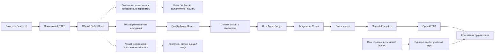

# GoBot Home — единый паспорт фактического состояния

Обновлён 10 ноября 2026 года. Рабочая ветка — `master`.
Этот файл описывает **реализованный код, проверки и ограничения**. Требования
остаются в [единой целевой спецификации](GOBOT_HOME_TARGET_SYSTEM.md).
Описание задуманной функции не означает её готовности.

## 1. Где находится проект и как им пользоваться

* Репозиторий: [anpavel84-afk/gobot-home](https://github.com/anpavel84-afk/gobot-home).
* Локально: `C:\Users\PLAN\gobot\GoBotHome`.
* Панель: приватный Tailscale HTTPS, порт 18786; экран устройства — `/device`.
* Профиль дисплея: круг 240×240, конфигурируемый. Это браузерный прототип.
* Последнее подтверждённое развёртывание до текущего пакета — `9c087ce`.
  Текущий пакет проходит проверку; факт развёртывания фиксируется в разделе 10.

## 2. Карта пути запроса

Интерфейсы используют один Brain, память, Router и серверные инструменты.
Служебное вступление отделено от полезного ответа и его TTFA. Оно использует
тот же AudioContext, но отдельный набор источников с приоритетом основного звука.

## 3. Что реализовано

| Компонент | Фактическое поведение | Основной код | Граница проверки |
| --- | --- | --- | --- |
| AUTO / FAST | Antigravity Flash Low; автоматического дорогого fallback нет | `routing.py`, `antigravity.py` | Реальные ограниченные CLI-пробы выполнены |
| REASONING / ручной выбор | Flash Medium; Argon и Codex доступны явно | `routing.py`, `live_agents.py` | Пригодность к любым сложным задачам не доказана |
| Оценка качества | Раздельные сложность, фактическая неопределённость, последствия и проверка | `quality.py` | Детерминированные правила; не точные вероятности |
| Быстрые команды | Каталог 30 сценариев; 13 отмечены реализованными, остальные требуют интеграций/прав | `quick-intents.json`, `quick_intents.py`, `local_tools.py` | 228 синтетических формулировок; не исследование живой речи |
| Завершение беседы | «Нет, спасибо» локально завершает активный сеанс без CLI/TTS; новое прослушивание не включается | `conversation_control.py`, `device.js` | Автоматические тесты; новый iPhone-прогон отсутствует |
| STT | OpenAI основной; Whisper только вручную | `stt.py`, `audio.py`, `capture.js` | Русские короткие фразы/домашний шум требуют дальнейшей проверки |
| TTS | OpenAI, выбранный голос; PCM streaming; необязательный лимит символов после форматтера | `audio.py`, `pipeline.py` | Реальные пробы и клиентские события; не акустическая лаборатория |
| Speech Formatter | Отдельный speech_text; Markdown, дубли имён, числа, даты, падежи, словарь | `speech_formatter.py` | Правила не дают полной гарантии русской морфологии |
| Вступления | 100 готовых OpenAI marin клипов, 2886 символов; случайный подходящий вариант по категории | `speech_openings.py`, `speech-openings.json`, `turn-trace.js` | Реальное создание 100/100; сочетаемость каждого вступления с живым ответом не проверена |
| Старый звук ожидания | Denis «Секунду…» исключён; старый URL возвращает 410 | `browser.py`, `browser.js` | Резервный ручной голос Denis для ответа отдельно сохранён |
| Контекст | SQLite-архив в GoBot, бюджетный пакет, последние обмены, темы/эпизоды, FTS5 | `memory.py`, `archive.py`, `context_manager.py` | Семантический retrieval и качественные summaries не доказаны |
| Визуальная тема | Составные именные группы, active_visual_subject, нормализация ё/е и падежей | `semantic_visual.py`, `visual_memory.py`, `image_query.py` | Эвристика, не универсальное семантическое понимание |
| Визуальный поиск | Prefetch параллельно ответу; Wikimedia и Openverse; source/license checks, TTL/LRU кэш | `visual.py`, `visual_images.py`, `visual_prefetch.py` | Проверка metadata не равна полной проверке содержимого фото |
| Визуальные сцены | Фото/галереи, локальные схемы, карточки/таймер, лицо; поздние старые события отсекаются | `response_composer.py`, `device-renderer.js`, `visual.js` | Реальные изображения проверены в Browser и Device Renderer |
| Генерация картинок | API-адаптер и согласие/лимиты подготовлены; Codex capability обнаружена | `image_generation.py` | Codex image-only изоляция не проверена; генерация не включается молча |
| Семья / Speaker Identity | Профили, PIN, локальные биометрические компоненты и guest downgrade | `family.py`, `speaker.py`, `family_api.py` | Биометрия не является авторизацией и не объявлена надёжной |
| Device Mode | PTT, автоматическая отправка, скины Classic/Soft/Minimal, серверное сохранение настроек | `device.js`, `device_contract.py`, `device_store.py` | Телефонный круг не доказывает совместимость платы ESP32 |
| Continuous Conversation | Локальное окно после фактического playback, экспериментальный VAD, timeout и отмена | `capture.js`, `device.js` | TV/шум/реальный iPhone не приняты |
| Wake word | Контракт/статус есть | `activation.py` | Русское «ГоБот» рабочей моделью не подтверждено |
| Наблюдаемость | Раздельные часы Brain/Bridge/клиента, usage либо unavailable, actual playback counter | `telemetry.py`, `turn-trace.js` | Клиентский counter не является акустическим измерением |

Пути Python в таблице относительны к `services/brain/gobot`, JSON — к
`services/brain`, клиентские JS — к `services/phone/dist`.

## 4. Быстрые серверные сценарии

Намерение, варианты речи, параметры, исполнитель, ограничения и readiness
хранятся отдельно. «Засеки три минуты» и «таймер на три минуты» ведут к одному
инструменту. Время/дата читаются из часов домашнего сервера с его UTC-offset;
это не угадывание местоположения человека. Таймеры читаются из серверного
состояния владельца. Точные совпадения шаблонов не запускают отдельную LLM.

Имеются время/дата/день недели, запуск/отмена/остаток таймера, справка,
калькулятор, закрытие диалога и уже существующий scoped memory path.
«Засеки время» требует уточнения: секундомер не выдаётся за таймер.
Неподдержанные числительные не должны превращаться в другую длительность.
Погода, музыка, устройства дома и дверь не считаются подключёнными по одному
совпадению фразы. Неоднозначная или отрицательная команда не исполняется
приблизительным сопоставлением. «Да» не становится универсальным разрешением.

Изучены первичные источники [Home Assistant intents](https://github.com/OHF-Voice/intents),
[Alexa built-in intents](https://developer.amazon.com/en-US/docs/alexa/custom-skills/standard-built-in-intents.html)
и [Siri Shortcuts](https://support.apple.com/en-gb/HT209055).
Свой каталог и примеры написаны для GoBot; чужой корпус массово не импортирован.
Дальнейшее расширение: реальные обезличенные промахи → предлагаемые шаблоны →
проверка параметров и прав → позитивные/негативные тесты → включение executor.
Синтетические варианты не следует считать статистикой реальных пользователей.

## 5. Контекст, данные и доступ

* SQLite сохраняет исходные сообщения/статусы и происхождение, темы/эпизоды,
  источники summaries/фактов, provider_sessions и context_runs.
* Обычный пакет имеет target 3600 / maximum 6000 estimated tokens; особый
  подробный режим — до 12000. Provider usage учитывается отдельно.
* Обычные CLI-обращения не продолжают накопительный provider thread.
* Семейное, личное и гостевое различаются. Личный архив требует подтверждения.
* Mock/fixture данные исключены из production retrieval. remember=false — RAM.
* Перед миграциями используются SQLite online backup с WAL и integrity_check.
* Архив, ключи, биометрия, WAV и сертификаты не публикуются в GitHub.
* Публичные generic opening clips тоже остаются локальным runtime-кэшем;
  в GitHub доступны их тексты, builder и обезличенный отчёт создания.

Подробности: [Context policy](CONTEXT_POLICY.md), [Memory architecture](MEMORY_ARCHITECTURE.md),
[Context evaluation](CONTEXT_EVALUATION.md), [Security](SECURITY.md).

## 6. Измерения и что они означают

| Проверка | Результат | Ограничение |
| --- | --- | --- |
| Две реальные Flash + TTS пробы | Начало playback через 7,783 / 6,971 с от текста; 549 TTS символов | STT исключён; desktop IAB, не iPhone |
| Первая картинка | Показ через 7,058 с, до начала голоса | Второй реальный случай обнаружил ё/е-баг |
| Исправление ё/е | Оба сохранённых ответа проходят бесплатный streaming replay с настоящим кэшем | Нового платного повторения после фикса нет |
| ACP без prompt | Первая новая сессия 1723 мс; вторая в том же runtime 16 мс | Не измерение inference/ответа, изоляция ещё не допущена |
| 100 вступлений | 100 completed, 2886 символов, 0 повторов | Денежная стоимость API не сообщена адаптером |
| Визуальный synthetic eval | 40/40 предметов на собственном наборе | Не независимое доказательство качества любых фото |
| Регрессия | Финальное число после сборки фиксируется в разделе 10 | Mocks отдельно от реальных устройств |

Доказательства: [real latency probes](real-latency-probes-20261110.json),
[Antigravity audit](antigravity-latency-audit.json), [opening build](speech-openings-build.json), [quick intents research](quick-intents-research.json),
[visual source checks](semantic-visual-source-checks.json), [context evaluation](CONTEXT_EVALUATION.md).
Исторические замеры не переименовываются в текущие результаты.

## 7. Что остаётся открытым

1. M1: уменьшить реальное время до содержательного голоса. Новый ACP runtime
   требует эквивалентной изоляции, отмены, fresh sessions и разрешённого замера.
2. Проверить PTT, followup, preemption вступления, отмену и воспроизведение
   на настоящем iPhone. Клип не считается содержательным ответом.
3. Проверить retrieval/summaries и переходы тем на независимом русском наборе.
4. Подтвердить русский wake word и частоты ложных срабатываний на домашнем шуме.
5. Подключить разрешённые погодные/музыкальные/домашние источники и их ACL.
6. Проверить безопасный Codex ImageGen; API-генерацию использовать только
   в отдельном согласованном лимите.
7. Проверить реальную ревизию ESP32, память, экран, микрофон, Opus/transport.
   Физического устройства и подтверждения firmware-совместимости пока нет.

## 8. История внедрений

| Коммит / этап | Что изменилось | Свидетельство |
| --- | --- | --- |
| Ранний MVP | Общий Brain, Bridge, Browser, инструменты, SQLite и voice path | Git history; старый [снимок статуса](https://github.com/anpavel84-afk/gobot-home/blob/9c087ce/docs/CURRENT_STATUS.md) |
| Context / quality / speech | Бюджеты, независимые риски, семья, форматирование речи | Профильные документы и regression tests |
| `2c4c5bd` | Prefetch по финальному вводу, CLI только текст | MULTIMODAL_RESPONSES.md |
| `654152e` | Безопасные растровые Commons thumbnails | test_wikimedia_entities.py |
| `0931bd5` | Иллюстрации названных персонажей; карты ответа скрыты | test_character_images.py |
| `6d7811a` | Настройки визуала, gated generation и followup | CONTINUOUS_CONVERSATION.md |
| `c079771`, `574de9a` | Общие именные группы, visual subject, placeholder и отмена | semantic-visual-evaluation.json |
| `a0e46f8`, `9c087ce` | Лимит TTS, две реальные пробы, ё/е и падежи | real-latency-probes-20261110.json |
| Текущий пакет | Локальный конец беседы, 100 OpenAI-вступлений, quick intents и этот паспорт | Код и новые бесплатные tests; deployment ниже |

Полная история действий хранится в Git. Эта таблица сохраняет смысл этапов;
старые неактуальные выводы доступны по commit, а не перемешаны с текущим статусом.

## 9. Правила дальнейших обновлений

Каждое значимое внедрение сопровождается обновлением этого файла: поведение,
файлы, проверки, ограничения, расходы/разрешения и изменения runtime.
Незавершённая функция отмечается явно. Статусы «код», «mock», «реальный
провайдер», «браузер», «iPhone», «ESP32» не подменяют друг друга.
Целевая спецификация определяет требования; этот паспорт — их фактическую реализацию.

## 10. Последняя проверка и развёртывание

Текущий пакет ещё не развёрнут. До него runtime `9c087ce`; завершены
создание 100 клипов, полный прогон 930 тестов, включая проверки параметров таймера и Node-клиента. После полного прогона,
публикации и deployment сюда заносится фактический commit и результат health.
Ключи, приватный контекст и содержимое семейных разговоров сюда не добавляются.
