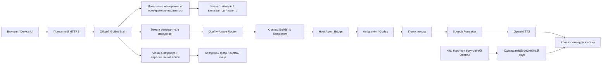

# GoBot Home — единый паспорт фактического состояния

Обновлён 10 ноября 2026 года. Рабочая ветка — `master`.
Этот файл описывает **реализованный код, проверки и ограничения**. Требования
остаются в [единой целевой спецификации](GOBOT_HOME_TARGET_SYSTEM.md).
Описание задуманной функции не означает её готовности.

## 1. Где находится проект и как им пользоваться

* Репозиторий: [anpavel84-afk/gobot-home](https://github.com/anpavel84-afk/gobot-home).
* Локально: `C:\Users\PLAN\gobot\GoBotHome`.
* Панель: приватный Tailscale HTTPS, порт 18786; экран устройства — `/device`.
* Профиль дисплея: круг 240×240, конфигурируемый. Это браузерный прототип.
* Проверенный runtime — `a71b71e987efdfe01884e34de10712782c0e36ac`.
  Последующие документационные коммиты не требуют перезапуска служб.
  Результаты проверки развёртывания приведены в разделе 10.

## 2. Карта пути запроса

Интерфейсы используют один Brain, память, Router и серверные инструменты.
Служебное вступление отделено от полезного ответа и его TTFA. Оно использует
тот же AudioContext, но отдельный набор источников с приоритетом основного звука.

## 3. Что реализовано

| Компонент | Фактическое поведение | Основной код | Граница проверки |
| --- | --- | --- | --- |
| AUTO / FAST | Antigravity Flash Low; автоматического дорогого fallback нет | [routing.py](../services/brain/gobot/routing.py), [antigravity.py](../services/brain/gobot/antigravity.py) | Реальные ограниченные CLI-пробы выполнены |
| REASONING / ручной выбор | Flash Medium; Argon и Codex доступны явно | [routing.py](../services/brain/gobot/routing.py), [live_agents.py](../services/brain/gobot/live_agents.py) | Пригодность к любым сложным задачам не доказана |
| Оценка качества | Раздельные сложность, фактическая неопределённость, последствия и проверка | [quality.py](../services/brain/gobot/quality.py) | Детерминированные правила; не точные вероятности |
| Быстрые команды | Каталог 30 сценариев; 13 отмечены реализованными, остальные требуют интеграций/прав | [quick-intents.json](../services/brain/quick-intents.json), [quick_intents.py](../services/brain/gobot/quick_intents.py), [local_tools.py](../services/brain/gobot/local_tools.py) | 228 синтетических формулировок; не исследование живой речи |
| Завершение беседы | «Нет, спасибо» локально завершает активный сеанс без CLI/TTS; новое прослушивание не включается | [conversation_control.py](../services/brain/gobot/conversation_control.py), [device.js](../services/phone/dist/device.js) | Автоматические тесты; новый iPhone-прогон отсутствует |
| STT | OpenAI основной; Whisper только вручную | [stt.py](../services/brain/gobot/stt.py), [audio.py](../services/brain/gobot/audio.py), [capture.js](../services/phone/dist/capture.js) | Русские короткие фразы/домашний шум требуют дальнейшей проверки |
| TTS | OpenAI, выбранный голос; PCM streaming; необязательный лимит символов после форматтера | [audio.py](../services/brain/gobot/audio.py), [pipeline.py](../services/brain/gobot/pipeline.py) | Реальные пробы и клиентские события; не акустическая лаборатория |
| Speech Formatter | Отдельный speech_text; Markdown, дубли имён, числа, даты, падежи, словарь | [speech_formatter.py](../services/brain/gobot/speech_formatter.py) | Правила не дают полной гарантии русской морфологии |
| Вступления | 100 готовых OpenAI marin клипов, 2886 символов; случайный подходящий вариант по категории | [speech_openings.py](../services/brain/gobot/speech_openings.py), [speech-openings.json](../services/brain/speech-openings.json), [turn-trace.js](../services/phone/dist/turn-trace.js) | Реальное создание 100/100; сочетаемость каждого вступления с живым ответом не проверена |
| Старый звук ожидания | Denis «Секунду…» исключён; старый URL возвращает 410 | [browser.py](../services/brain/gobot/browser.py), [browser.js](../services/phone/dist/browser.js) | Резервный ручной голос Denis для ответа отдельно сохранён |
| Контекст | SQLite-архив в GoBot, бюджетный пакет, последние обмены, темы/эпизоды, FTS5 | [memory.py](../services/brain/gobot/memory.py), [archive.py](../services/brain/gobot/archive.py), [context_manager.py](../services/brain/gobot/context_manager.py) | Семантический retrieval и качественные summaries не доказаны |
| Визуальная тема | Составные именные группы, active_visual_subject, нормализация ё/е и падежей | [semantic_visual.py](../services/brain/gobot/semantic_visual.py), [visual_memory.py](../services/brain/gobot/visual_memory.py), [image_query.py](../services/brain/gobot/image_query.py) | Эвристика, не универсальное семантическое понимание |
| Визуальный поиск | Prefetch параллельно ответу; Wikimedia и Openverse; source/license checks, TTL/LRU кэш | [visual.py](../services/brain/gobot/visual.py), [visual_images.py](../services/brain/gobot/visual_images.py), [visual_prefetch.py](../services/brain/gobot/visual_prefetch.py) | Проверка metadata не равна полной проверке содержимого фото |
| Визуальные сцены | Фото/галереи, локальные схемы, карточки/таймер, лицо; поздние старые события отсекаются | [response_composer.py](../services/brain/gobot/response_composer.py), [device-renderer.js](../services/phone/dist/device-renderer.js), [visual.js](../services/phone/dist/visual.js) | Реальные изображения проверены в Browser и Device Renderer |
| Генерация картинок | API-адаптер и согласие/лимиты подготовлены; Codex capability обнаружена | [image_generation.py](../services/brain/gobot/image_generation.py) | Codex image-only изоляция не проверена; генерация не включается молча |
| Семья / Speaker Identity | Профили, PIN, локальные биометрические компоненты и guest downgrade | [family.py](../services/brain/gobot/family.py), [speaker.py](../services/brain/gobot/speaker.py), [family_api.py](../services/brain/gobot/family_api.py) | Биометрия не является авторизацией и не объявлена надёжной |
| Device Mode | PTT, автоматическая отправка, скины Classic/Soft/Minimal, серверное сохранение настроек | [device.js](../services/phone/dist/device.js), [device_contract.py](../services/brain/gobot/device_contract.py), [device_store.py](../services/brain/gobot/device_store.py) | Телефонный круг не доказывает совместимость платы ESP32 |
| Continuous Conversation | Локальное окно после фактического playback, экспериментальный VAD, timeout и отмена | [capture.js](../services/phone/dist/capture.js), [device.js](../services/phone/dist/device.js) | TV/шум/реальный iPhone не приняты |
| Wake word | Контракт/статус есть | [activation.py](../services/brain/gobot/activation.py) | Русское «ГоБот» рабочей моделью не подтверждено |
| Наблюдаемость | Раздельные часы Brain/Bridge/клиента, usage либо unavailable, actual playback counter | [telemetry.py](../services/brain/gobot/telemetry.py), [turn-trace.js](../services/phone/dist/turn-trace.js) | Клиентский counter не является акустическим измерением |

Пути Python в таблице относительны к `services/brain/gobot`, JSON — к
`services/brain`, клиентские JS — к `services/phone/dist`.

## 4. Быстрые серверные сценарии

Намерение, варианты речи, параметры, исполнитель, ограничения и readiness
хранятся отдельно. «Засеки три минуты» и «таймер на три минуты» ведут к одному
инструменту. Время/дата читаются из часов домашнего сервера с его UTC-offset;
это не угадывание местоположения человека. Таймеры читаются из серверного
состояния владельца. Точные совпадения шаблонов не запускают отдельную LLM.

Имеются время/дата/день недели, запуск/отмена/остаток таймера, справка,
калькулятор, закрытие диалога и уже существующий scoped memory path.
«Засеки время» требует уточнения: секундомер не выдаётся за таймер.
Неподдержанные числительные не должны превращаться в другую длительность.
Погода, музыка, устройства дома и дверь не считаются подключёнными по одному
совпадению фразы. Неоднозначная или отрицательная команда не исполняется
приблизительным сопоставлением. «Да» не становится универсальным разрешением.

Изучены первичные источники [Home Assistant intents](https://github.com/OHF-Voice/intents),
[Alexa built-in intents](https://developer.amazon.com/en-US/docs/alexa/custom-skills/standard-built-in-intents.html)
и [Siri Shortcuts](https://support.apple.com/en-gb/HT209055).
Свой каталог и примеры написаны для GoBot; чужой корпус массово не импортирован.
Дальнейшее расширение: реальные обезличенные промахи → предлагаемые шаблоны →
проверка параметров и прав → позитивные/негативные тесты → включение executor.
Синтетические варианты не следует считать статистикой реальных пользователей.

## 5. Контекст, данные и доступ

* SQLite сохраняет исходные сообщения/статусы и происхождение, темы/эпизоды,
  источники summaries/фактов, provider_sessions и context_runs.
* Обычный пакет имеет target 3600 / maximum 6000 estimated tokens; особый
  подробный режим — до 12000. Provider usage учитывается отдельно.
* Обычные CLI-обращения не продолжают накопительный provider thread.
* Семейное, личное и гостевое различаются. Личный архив требует подтверждения.
* Mock/fixture данные исключены из production retrieval. remember=false — RAM.
* Перед миграциями используются SQLite online backup с WAL и integrity_check.
* Архив, ключи, биометрия, WAV и сертификаты не публикуются в GitHub.
* Публичные generic opening clips тоже остаются локальным runtime-кэшем;
  в GitHub доступны их тексты, builder и обезличенный отчёт создания.

Подробности: [Context policy](CONTEXT_POLICY.md), [Memory architecture](MEMORY_ARCHITECTURE.md),
[Context evaluation](CONTEXT_EVALUATION.md), [Security](SECURITY.md).

## 6. Измерения и что они означают

| Проверка | Результат | Ограничение |
| --- | --- | --- |
| Две реальные Flash + TTS пробы | Начало playback через 7,783 / 6,971 с от текста; 549 TTS символов | STT исключён; desktop IAB, не iPhone |
| Первая картинка | Показ через 7,058 с, до начала голоса | Второй реальный случай обнаружил ё/е-баг |
| Исправление ё/е | Оба сохранённых ответа проходят бесплатный streaming replay с настоящим кэшем | Нового платного повторения после фикса нет |
| ACP без prompt | Первая новая сессия 1723 мс; вторая в том же runtime 16 мс | Не измерение inference/ответа, изоляция ещё не допущена |
| 100 вступлений | 100 completed, 2886 символов, 0 повторов | Денежная стоимость API не сообщена адаптером |
| Визуальный synthetic eval | 40/40 предметов на собственном наборе | Не независимое доказательство качества любых фото |
| Регрессия | 930 passed за 19,60 с на коде `6f936b4` | Mocks отдельно от реальных устройств |
| Локальный HTTPS без моделей | «Нет, спасибо» — 469,58 мс; часы/дата/справка — 211–214 мс | Полное HTTP-обращение, не время слышимого ответа; 4 пробы |

Доказательства: [real latency probes](real-latency-probes-20261110.json),
[Antigravity audit](antigravity-latency-audit.json), [opening build](speech-openings-build.json), [quick intents research](quick-intents-research.json),
[visual source checks](semantic-visual-source-checks.json), [context evaluation](CONTEXT_EVALUATION.md),
[проверка локальных команд и кэша через HTTPS](quick-openings-https-check.json).
Исторические замеры не переименовываются в текущие результаты.

## 7. Что остаётся открытым

1. M1: уменьшить реальное время до содержательного голоса. Новый ACP runtime
   требует эквивалентной изоляции, отмены, fresh sessions и разрешённого замера.
2. Проверить PTT, followup, preemption вступления, отмену и воспроизведение
   на настоящем iPhone. Клип не считается содержательным ответом.
3. Проверить retrieval/summaries и переходы тем на независимом русском наборе.
4. Подтвердить русский wake word и частоты ложных срабатываний на домашнем шуме.
5. Подключить разрешённые погодные/музыкальные/домашние источники и их ACL.
6. Проверить безопасный Codex ImageGen; API-генерацию использовать только
   в отдельном согласованном лимите.
7. Проверить реальную ревизию ESP32, память, экран, микрофон, Opus/transport.
   Физического устройства и подтверждения firmware-совместимости пока нет.

## 8. История внедрений

| Коммит / этап | Что изменилось | Свидетельство |
| --- | --- | --- |
| Ранний MVP | Общий Brain, Bridge, Browser, инструменты, SQLite и voice path | Git history; старый [снимок статуса](https://github.com/anpavel84-afk/gobot-home/blob/9c087ce/docs/CURRENT_STATUS.md) |
| Context / quality / speech | Бюджеты, независимые риски, семья, форматирование речи | Профильные документы и regression tests |
| `2c4c5bd` | Prefetch по финальному вводу, CLI только текст | MULTIMODAL_RESPONSES.md |
| `654152e` | Безопасные растровые Commons thumbnails | test_wikimedia_entities.py |
| `0931bd5` | Иллюстрации названных персонажей; карты ответа скрыты | test_character_images.py |
| `6d7811a` | Настройки визуала, gated generation и followup | CONTINUOUS_CONVERSATION.md |
| `c079771`, `574de9a` | Общие именные группы, visual subject, placeholder и отмена | semantic-visual-evaluation.json |
| `a0e46f8`, `9c087ce` | Лимит TTS, две реальные пробы, ё/е и падежи | real-latency-probes-20261110.json |
| `4919da3` | Стабилизация вступлений, проверенных slots, pending/followup и позднего визуала | dialogue-stabilization-checks.json; HTTPS deployment |
| `6f936b4` | Локальный конец беседы, 100 OpenAI-вступлений, quick intents и этот паспорт | 930 tests; создание клипов; HTTPS-проверка и deployment ниже |

Полная история действий хранится в Git. Эта таблица сохраняет смысл этапов;
старые неактуальные выводы доступны по commit, а не перемешаны с текущим статусом.

## 9. Правила дальнейших обновлений

Каждое значимое внедрение сопровождается обновлением этого файла: поведение,
файлы, проверки, ограничения, расходы/разрешения и изменения runtime.
В записи указываются дата, commit реализации, ссылки на изменённые компоненты
и доказательства проверки. До коммита допустима пометка «в работе»; после
проверки она заменяется фактическим результатом. Опубликованный код и запущенная
версия учитываются отдельно. Полные технические отчёты остаются по ссылкам,
а сводное состояние — здесь. Ссылка на паспорт находится в README, обязательность
его обновления закреплена в AGENTS.md.
Незавершённая функция отмечается явно. Статусы «код», «mock», «реальный
провайдер», «браузер», «iPhone», «ESP32» не подменяют друг друга.
Целевая спецификация определяет требования; этот паспорт — их фактическую реализацию.

## 10. Проверка и развёртывание базового пакета 6f936b4

10 ноября 2026 года развёрнут код `6f936b4b60a1945d4aca476a2630d460e0f9ee46`.
Полный прогон: **930 passed за 19,60 с**, включая параметры таймера,
локальные завершения, идемпотентность и Node-проверки клиентской очереди.
Проверка индекса и всей Git-истории Gitleaks 8.30.1 перед коммитом: 0 находок.

После перезапуска проверены приватный HTTPS и `/device` (HTTP 200), health
Brain/Bridge/голосового стенда/изображений. Активных turns и голосовых потоков — 0.
Метаданные native isolation для Antigravity/Codex подтверждены; без согласия
на квоту они остаются недоступными. Gemini CLI отмечен retired и недоступен.

Через настоящий HTTPS выполнены четыре временных обращения с remember=false,
speak=false и без разрешения CLI-квот. Все ответили локально: завершение
«Нет, спасибо!», часы, дата и справка. Завершение содержит conversation_ended;
ни один запрос не создал аудиочанков, CLI-вызова или синтеза TTS.

Кэш marin сообщает 100/100 готовых клипов. Один клип получен через HTTPS и
декодирован как WAV 24 кГц длительностью 2,0 с. Старый URL Denis возвращает 410.
Это проверка доставки и декодирования, **не подтверждение слышимого
воспроизведения нового вступления на iPhone**. Платные вызовы в этой проверке — 0.
Реальное создание всех клипов ранее израсходовало одобренный лимит:
100 запросов / 2886 символов / 0 повторов. Денежная стоимость недоступна.

Документационные изменения после этого развёртывания служб не перезапускают.
Ключи, приватный контекст и содержимое семейных разговоров сюда не добавляются.

## 11. Стабилизация быстрого диалога — 10 ноября 2026

База перед исправлениями — `2f0eefc`, рабочее дерево было чистым.
Замечания независимого аудита воспроизведены: 15 падающих backend-регрессий
и падающий тест настоящего клиентского соединения вступления.

* Исправлена передача третьего аргумента в playFeedback. Настоящие функции
  offerOpening → fetch/decode → FeedbackController → playFeedback вызывают
  AudioBufferSource.start с готовым буфером и ролью filler.
* В браузере IAB готовый marin-клип действительно запущен и завершён через
  Web Audio. Это проверка аудиографа desktop, не акустическое испытание iPhone.
* Распознаватель возвращает validated / needs_parameters / rejected /
  unavailable; отсутствие намерения возвращается отдельно. Широкий legacy
  timer route удалён; slots передаются исполнителю без повторного разбора фразы.
* Полчаса, альтернативы, отрицания и хвост команды проверяются целиком.
  Отмена разрешает один ID/номер; несколько таймеров без ясной цели — уточнение.
  Массовая отмена допускается только по явной команде «все».
* decline_pending, stop_output и conversation_ended имеют разные события.
  Pending хранится в RAM с owner/conversation/profile epoch при remember=false;
  в постоянном режиме используется существующая таблица с TTL 120 секунд.
  «Да» не даёт новых полномочий и не выполняет неподключённое действие.
* Старт followup требует окончания серверного аудио, actual playback ACK,
  пустой очереди ответа/вступления, echo guard и актуальной сессии. no_audio,
  ошибка TTS, отмена, Stop и уход в фон не открывают микрофон автоматически.
* Завершённый текст фиксируется до необязательного позднего визуала.
  Отмена картинки не стирает его из контекста; подтверждённо проигранные
  фрагменты по-прежнему учитываются отдельно от сгенерированного текста.
* Необязательный кэш переживает отсутствие/повреждение каталога и клипа.
  Клиент держит максимум 8 декодированных клипов; fetch ограничен 5 секундами.
  Подбор читает только metadata с пределом 80 мс. Порог 2250 мс сохранён.
  Семантически ограниченные клипы помечены requires; выбранное вступление
  не повторяется подряд в сеансе. Все 100 исходных WAV сохранены без пересинтеза.

Проверки и таблица изоляции ошибок: [dialogue-stabilization-checks.json](dialogue-stabilization-checks.json).
Новые регрессии: [test_dialogue_stabilization.py](../tests/test_dialogue_stabilization.py),
[opening_connection.cjs](../tests/opening_connection.cjs),
[device_ui.cjs](../tests/device_ui.cjs). Новых платных запросов — **0**.
До этого прохода 930 тестов; расширенная регрессия — 956 passed за 20,36 с.
P0 опубликован и развёрнут как `4919da3c7def2df94fc7a70fd22a1b0ca9dd5045`.
Перед перезапуском active_turns=0 / active_voice_streams=0; выполнен SQLite
online backup с WAL, integrity_check=ok, без новой миграции схемы.
[Проверка после deployment](dialogue-stabilization-deployment.json): семь реальных
HTTPS-обращений (remember=false, speak=false, quota=false), все local,
191–354 мс полного HTTP, без CLI/STT/TTS. Это не TTFA голосового запроса.
Проверены выдаваемый browser.js, /device HTTP 200, health и 100/100 клипов.
Codex потребовал штатной повторной офлайн-проверки: 1 mock HTTP запрос,
0 реальных модельных запросов, tools=[]. Границы допуска не ослаблялись.
Реальное ускорение CLI и полный сценарий iPhone не измерены.

Дополнительное усиление цели таймера подготовлено после этого deployment:
номер относится только к показанному списку ID (120 секунд, owner/conversation/
profile epoch), а не к заново пересортированным живым таймерам. Без списка
нужен вопрос-уточнение. Истечение таймера не сдвигает смысл старого номера.
Усиление привязки номера развёрнуто вместе с пакетом a71b71e; без актуального списка цель уточняется.

## 12. Контролируемый ACP-кандидат

Реализован отдельный экспериментальный путь в существующем Host Bridge:
[antigravity_acp.py](../services/brain/gobot/antigravity_acp.py),
[штатная metadata-проба](../scripts/audit_agy_acp.py),
[проверки транспорта](../tests/test_acp_candidate.py).
Настройка [router-policy.json](../services/brain/router-policy.json):
`antigravity_transport=stream_json` — рабочий прежний путь;
`acp_experimental` — кандидат с отдельным обязательным допуском. По умолчанию
он выключен. Недоказанный ACP не переключается скрыто на второй транспорт.

Кандидат переиспользует bounded JSON-RPC GoBot и Windows kill-on-close job.
Параллельность 1, ожидание очереди 100 мс, init/session RPC до 10 с,
первый вывод до 35 с, вся операция до 90 с, idle runtime до 60 с,
до 16 свежих sessions на runtime. session/load/resume не используется.
Каждая сессия имеет отдельный ID, MCP servers=[], client FS/terminal=false;
permission requests отклоняются, tool activity завершает операцию.
При отмене отправляется session/cancel, затем runtime уничтожается;
после нормального завершения используется объявленный session/close.
Отсутствующий usage остаётся unavailable. Авторизационные файлы не читаются.

Нативно подтверждены только initialize и две session/new/close через
установленный Antigravity 1.5.3, с поддерживаемыми sandbox/process-per-session
флагами. Числа и SHA: [antigravity-acp-candidate.json](antigravity-acp-candidate.json).
Эти времена относятся к metadata, а не ответу модели. session/prompt не отправлялся.

**Блокер допуска:** session/new не предоставляет проверяемого отчёта об
эффективных deny-правилах worker. Отказ клиентской стороны не доказывает запрет
внутренних файловых/командных/web/MCP tools агента. Нативная adversarial-проверка
этой гарантии не проведена. Поэтому native_session_deny_verified=false,
а кандидат блокируется до любого prompt даже при включённом переключателе.
Сравнение скорости без устранения этого блокера не имеет смысла; безопасности
ради ускорения не уступаем. Прежний stream-json путь сохранён.

Основание: [официальный agy ACP](https://antigravity.google/docs/cli/acp),
[ACP sessions](https://agentclientprotocol.com/protocol/v1/session-setup),
[ACP prompt lifecycle](https://agentclientprotocol.com/protocol/v1/prompt-turn).

Полная регрессия текущего пакета: **965 passed за 21,03 с**. Из них 8 ACP
fixtures проверяют реальный stdio RPC с локальным агентом: свежие сессии,
повторное использование процесса, отказ permissions/FS/tools, EOF/битый JSON,
очередь и отмену. Это не проверка инструментария нативного агента на реальной LLM.
Новых платных API/модельных запросов — 0. Старые разрешения не использовались.
Следующий внешний приёмочный сценарий: реальный iPhone PTT → ожидание с готовым
вступлением → ответ → followup → «нет, спасибо» → микрофон остаётся закрыт.
Он пока **не выполнен**. Useful TTFA нового кода не измерен.

Откат транспорта: сохранить/вернуть stream_json в конфигурации, проверив
отсутствие активной беседы перед перезапуском. Откат кода — отдельный проверенный
revert-коммит с регрессией, без reset/force push; миграций этого этапа нет.
Копия SQLite находится локально под ignored data/backups и не публикуется.

## 13. Итоговое развёртывание стабилизации

Запущенный код: **a71b71e987efdfe01884e34de10712782c0e36ac**, ветка master.
Коммиты этапа: 4919da3 (P0), abb4c8f (связь номера таймера с показанным списком),
a71b71e (отдельный выключенный ACP-кандидат). После них меняется только документация;
перезапуск ради Markdown не требуется.

Проверка [фактического runtime](dialogue-stabilization-runtime.json): все четыре
сервиса healthy, /device=200, исправленный browser.js отдаётся, native isolation
metadata Codex/Antigravity подтверждены, 100 marin клипов доступны. Реальный
HTTPS «Нет, спасибо» — 379,23 мс полного HTTP (n=1, без STT/TTS),
conversation_ended; повтор request_id возвращает replay. Это не сравнение скорости
модельного ответа и не слышимая задержка iPhone. Оба перезапуска выполнены без
активных turns/voice streams. Клиентскую страницу необходимо обновить для нового JS.

Продуктовый транспорт остался **stream_json**. ACP не допущен: включение одного
флага не обходит native proof gate. Новых оплачиваемых API-вызовов, prompt или
пересинтезов вступлений в этом проходе не было. Все разрешённые ранее бюджеты
остаются израсходованными. Проверка секретов индекса и истории — 0 находок.

Полная приёмка на iPhone и новое сопоставимое измерение полезного ответа
остаются открытыми. Комфорт ожидания и исправление воспроизведения не подменяют M1.
